# pixelworld

Real places, drawn as isometric pixel art in the browser. pixelworld builds worlds from open data (elevation, land cover, OpenStreetMap and Overture roads and buildings, and cities' own building records) and bakes them into pixel-art tiles as you move: fly over a city, drive its streets or walk its blocks, in four rotations, by day or by night.

[](https://www.npmjs.com/package/pixelworld)
[](https://pypi.org/project/pixelworld-pipeline/)
[](#license)

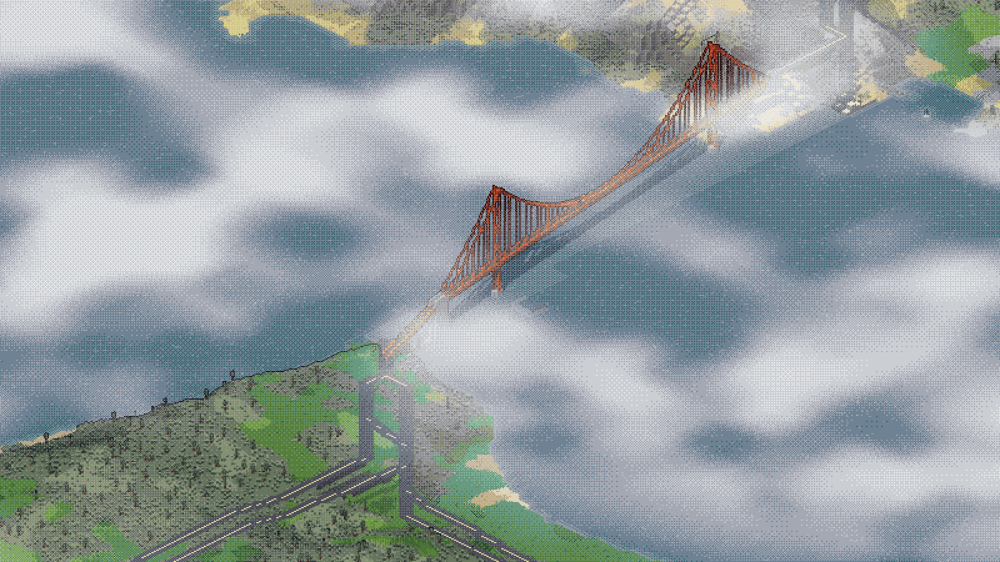

- **[pixelworld.site](https://pixelworld.site):** every world and the example game in your browser, nothing to install.
- **[The viewer](#run-it):** every world in this repository, in your browser: San Francisco, New York, Kyoto, Paris, Tokyo, Hong Kong and the US Southwest.
- **[`pixelworld` on npm](#use-it-in-your-project):** the engine as a library: a world in a canvas, with your own controls, entities and rules. Games and demos in this repository are built on it.
- **[`pixelworld-pipeline` on PyPI](#build-a-world-of-your-own-place):** a world of your own place, from a region spec in YAML.

## Gallery

Every image here is a screenshot of the viewer, taken by [`tools/readme-shots.mjs`](tools/readme-shots.mjs). Click one for full size.

### San Francisco

<table>
<tr>
<td width="50%"><a href="docs/images/readme/sf-chinatown.png">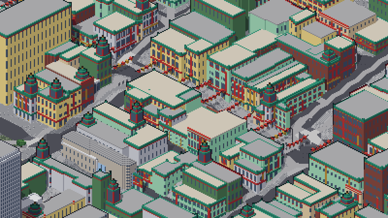</a><br><sub><b>Chinatown</b>, walking: pagoda-roofed corners, and lanterns strung across Grant Avenue.</sub></td>
<td width="50%"><a href="docs/images/readme/sf-painted-ladies.png">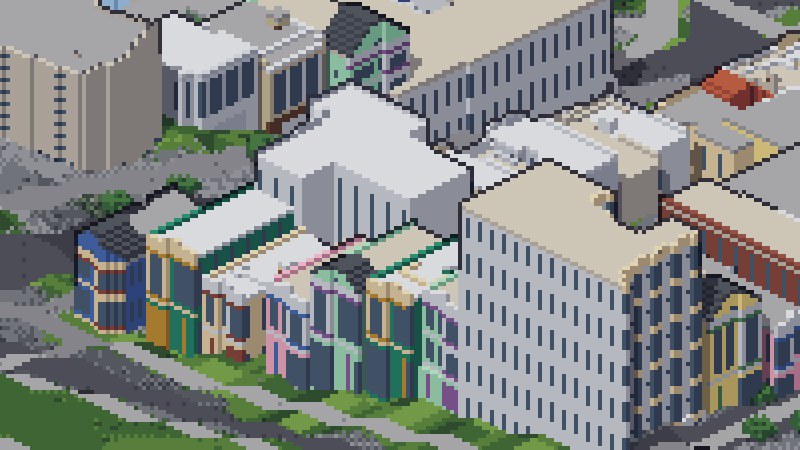</a><br><sub><b>The Painted Ladies</b> on Steiner Street, their painted fronts and bays, walking.</sub></td>
</tr>
<tr>
<td width="50%"><a href="docs/images/readme/sf-lombard.png">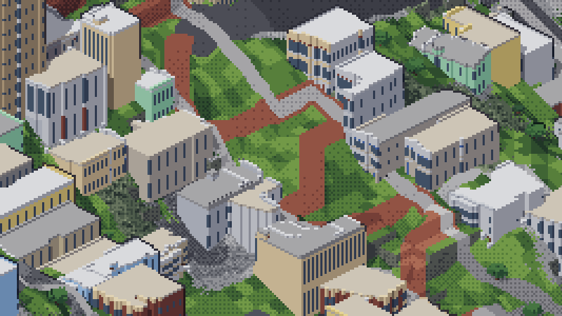</a><br><sub><b>Lombard Street</b>'s brick hairpins between their gardens, walking.</sub></td>
<td width="50%"><a href="docs/images/readme/sf-hills.png">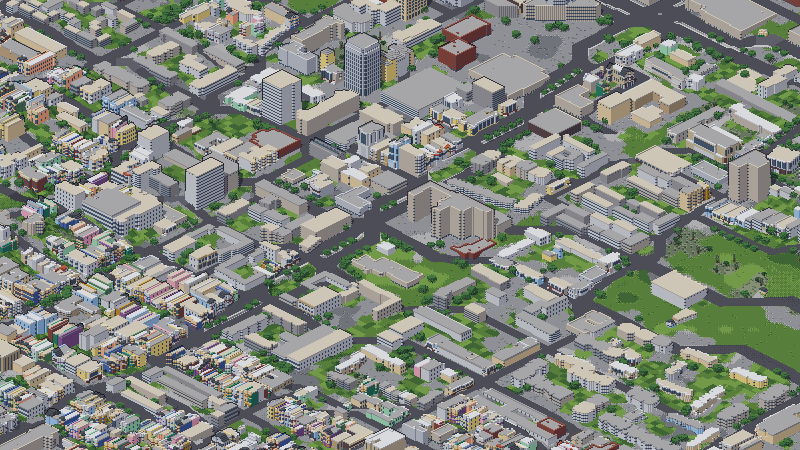</a><br><sub><b>The Western Addition</b>, driving: rowhouses and flats, block by block from the city's records.</sub></td>
</tr>
<tr>
<td width="50%"><a href="docs/images/readme/sf-golden-gate.png">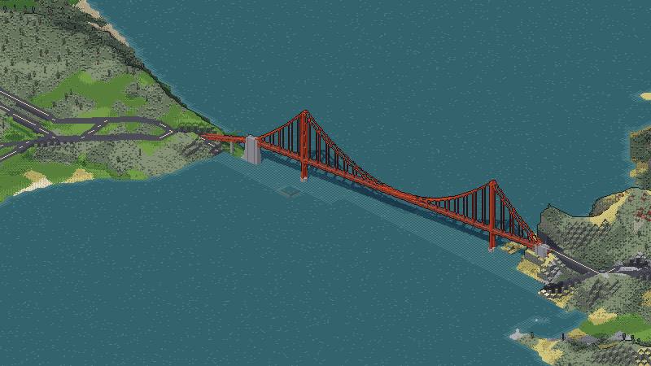</a><br><sub><b>The Golden Gate</b>, flying: the deck comes ashore on its approach viaducts.</sub></td>
<td width="50%"><a href="docs/images/readme/sf-downtown-night.png">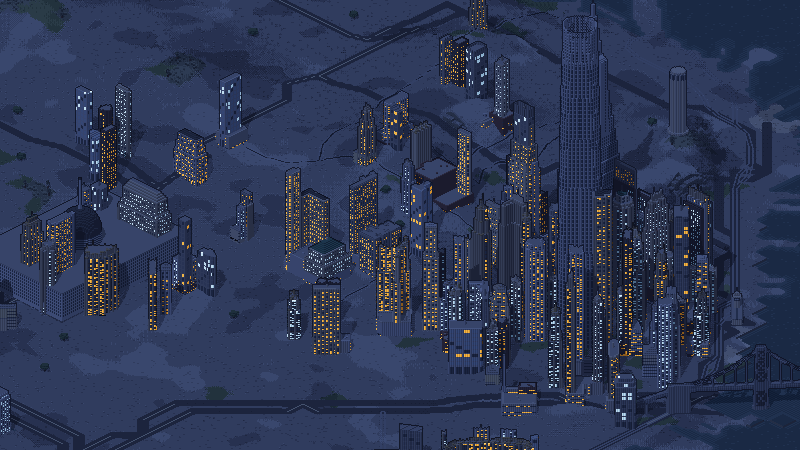</a><br><sub><b>Downtown at night:</b> the Salesforce Tower, lit windows, and the Bay Bridge.</sub></td>
</tr>
</table>

### New York

<table>
<tr>
<td width="50%"><a href="docs/images/readme/nyc-central-park.png">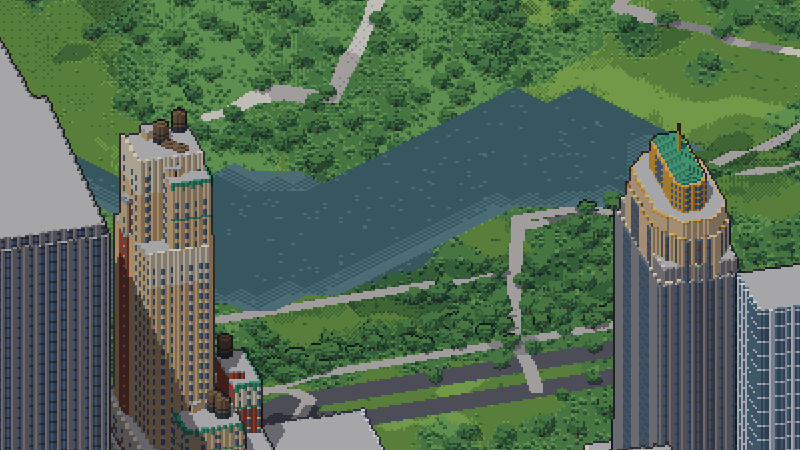</a><br><sub><b>Central Park</b>'s Pond under the towers of Central Park South, walking.</sub></td>
<td width="50%"><a href="docs/images/readme/nyc-battery.png">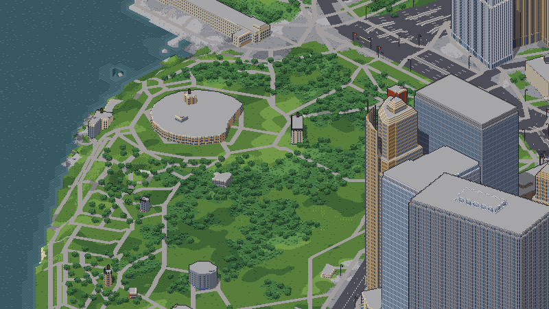</a><br><sub><b>Battery Park</b> and Castle Clinton on the harbour, walking.</sub></td>
</tr>
<tr>
<td width="50%"><a href="docs/images/readme/nyc-village.png">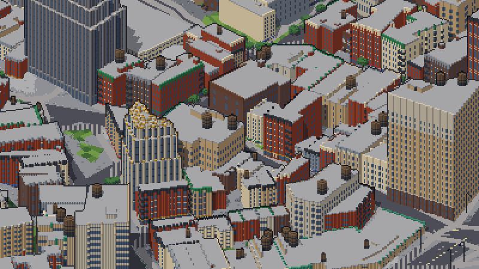</a><br><sub><b>Greenwich Village</b>, walking: brick walk-ups, brownstones and water towers, from the city's lot records (PLUTO).</sub></td>
<td width="50%"><a href="docs/images/readme/nyc-brownstones.png">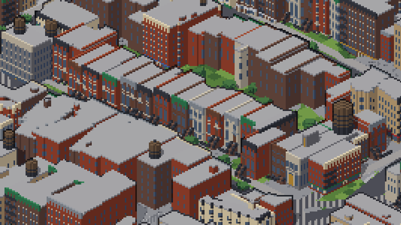</a><br><sub><b>The West Village</b> up close: stoops, cornices and water tanks.</sub></td>
</tr>
<tr>
<td width="50%"><a href="docs/images/readme/nyc-bridges.png">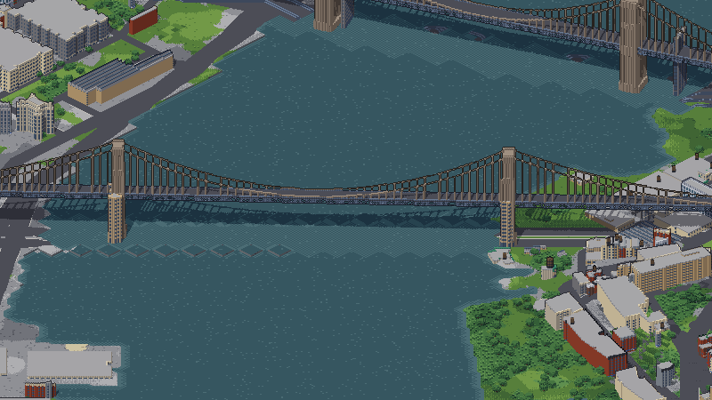</a><br><sub><b>The Brooklyn and Manhattan bridges</b> over the East River, driving.</sub></td>
<td width="50%"><a href="docs/images/readme/nyc-midtown-night.png">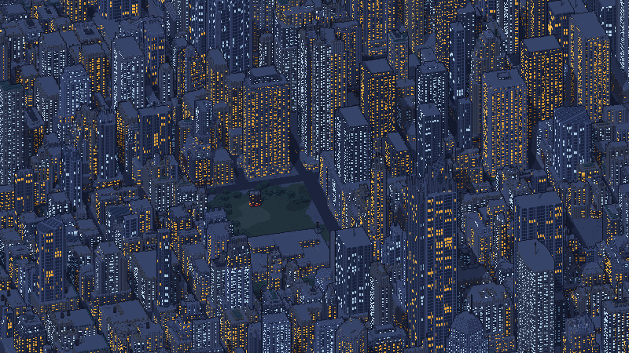</a><br><sub><b>Midtown at night,</b> round Bryant Park.</sub></td>
</tr>
</table>

### Kyoto

<table>
<tr>
<td width="50%"><a href="docs/images/readme/kyoto-yasaka.png">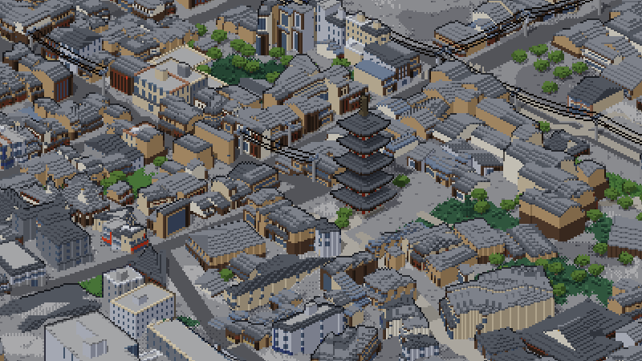</a><br><sub><b>Yasaka Pagoda</b> over Higashiyama's machiya, wires strung pole to pole.</sub></td>
<td width="50%"><a href="docs/images/readme/kyoto-yasaka-shrine.png">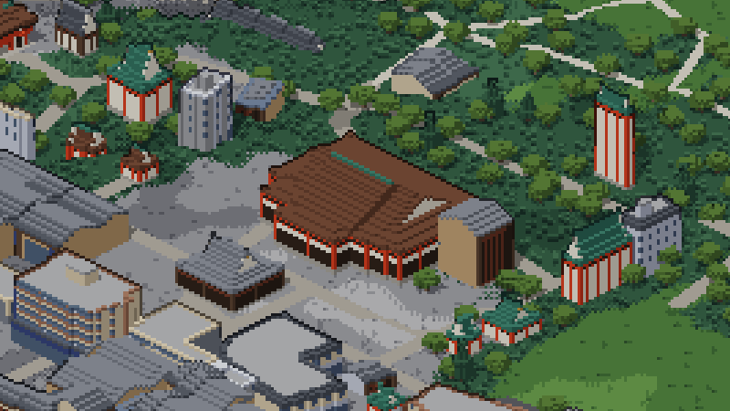</a><br><sub><b>Yasaka Shrine</b>'s vermilion halls under the trees, walking.</sub></td>
</tr>
<tr>
<td width="50%"><a href="docs/images/readme/kyoto-shoseien.png">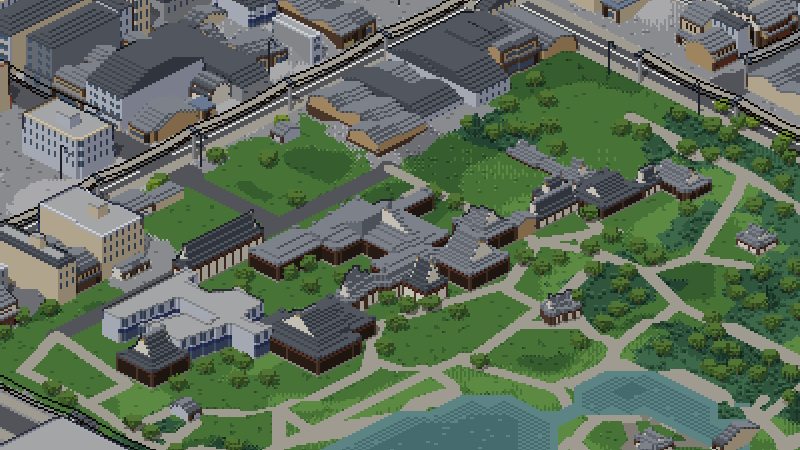</a><br><sub><b>Shōsei-en</b>, Higashi Hongan-ji's garden, its pond and halls.</sub></td>
<td width="50%"><a href="docs/images/readme/kyoto-kamo.png">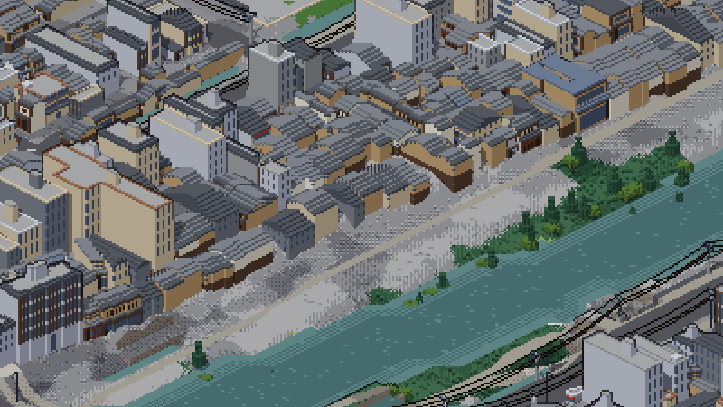</a><br><sub><b>The Kamo River</b> and its wooded banks by Gion.</sub></td>
</tr>
<tr>
<td width="50%"><a href="docs/images/readme/kyoto-nanzenji.png">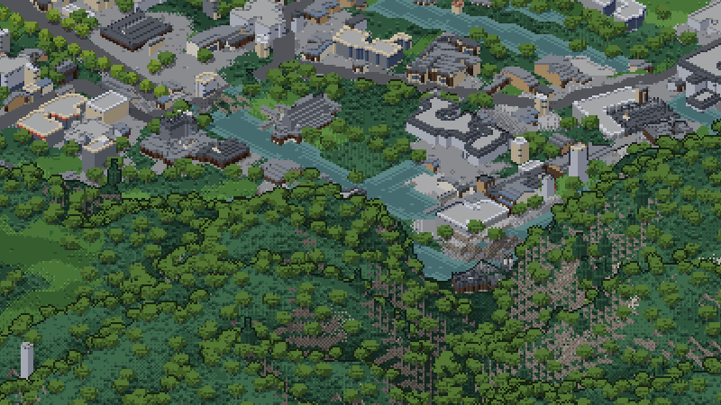</a><br><sub><b>Nanzen-ji</b> under the wooded Higashiyama hills, driving.</sub></td>
<td width="50%"><a href="docs/images/readme/kyoto-gion-night.png">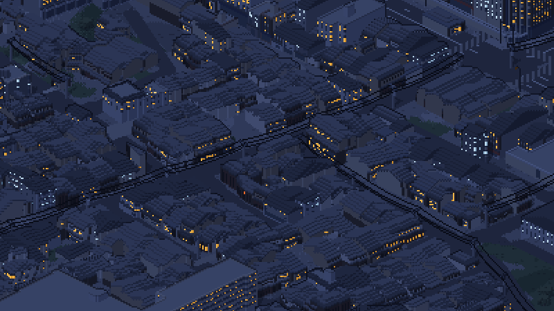</a><br><sub><b>Gion</b>'s tiled roofs at night.</sub></td>
</tr>
</table>

### Hong Kong

<table>
<tr>
<td width="50%"><a href="docs/images/readme/hk-waterfront.png">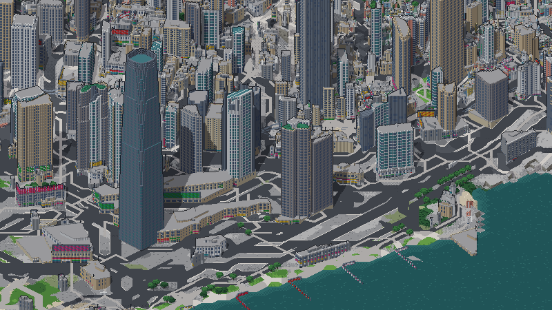</a><br><sub><b>Central</b>'s waterfront on Victoria Harbour, Two IFC over it, driving.</sub></td>
<td width="50%"><a href="docs/images/readme/hk-wanchai.png">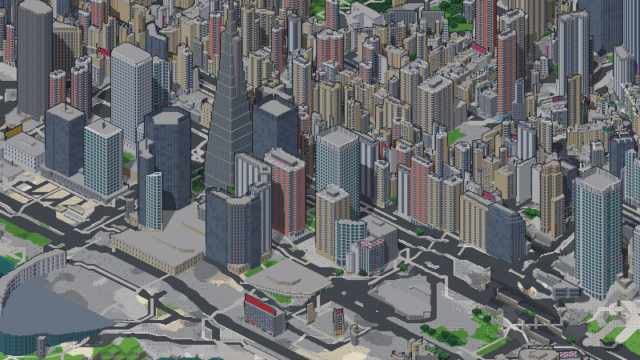</a><br><sub><b>Wan Chai</b> round Central Plaza, driving.</sub></td>
</tr>
<tr>
<td width="50%"><a href="docs/images/readme/hk-peak.png">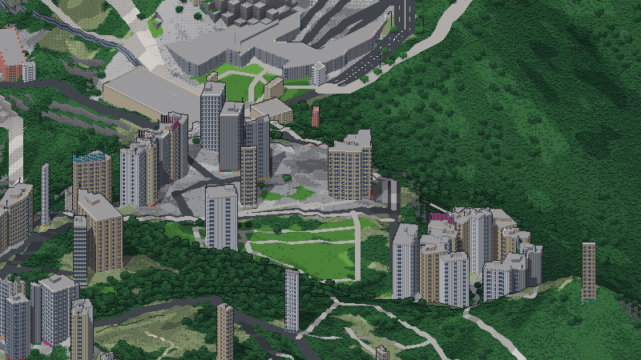</a><br><sub><b>The Mid-Levels</b> climbing to the Peak's woods, walking.</sub></td>
<td width="50%"><a href="docs/images/readme/hk-central-night.png">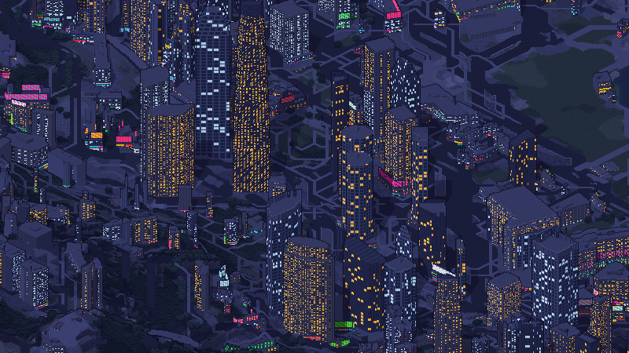</a><br><sub><b>Central at night.</b></sub></td>
</tr>
<tr>
<td width="50%"><a href="docs/images/readme/hk-aberdeen.png">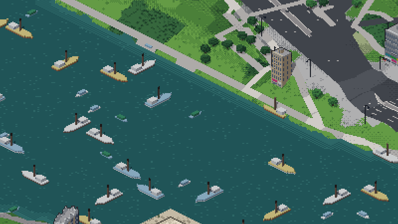</a><br><sub><b>Aberdeen</b>'s typhoon shelter and its boats, walking.</sub></td>
<td width="50%"><a href="docs/images/readme/hk-man-mo.png">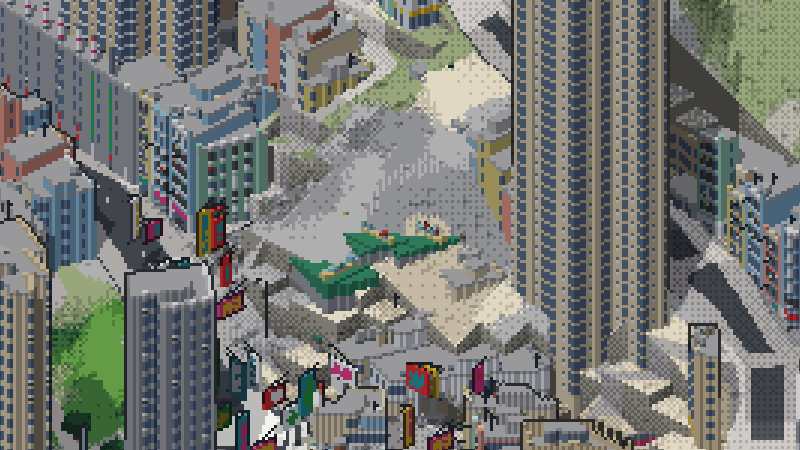</a><br><sub><b>Man Mo Temple</b> among the signs of Sheung Wan, walking.</sub></td>
</tr>
</table>

### Paris, Tokyo and the Southwest

<table>
<tr>
<td width="50%"><a href="docs/images/readme/paris-eiffel.png">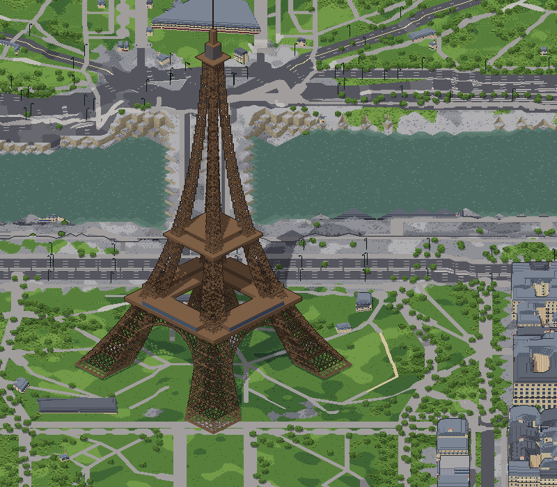</a><br><sub><b>Paris:</b> the Eiffel Tower over the Champ de Mars and the Seine's quays.</sub></td>
<td width="50%"><a href="docs/images/readme/paris-cite.png">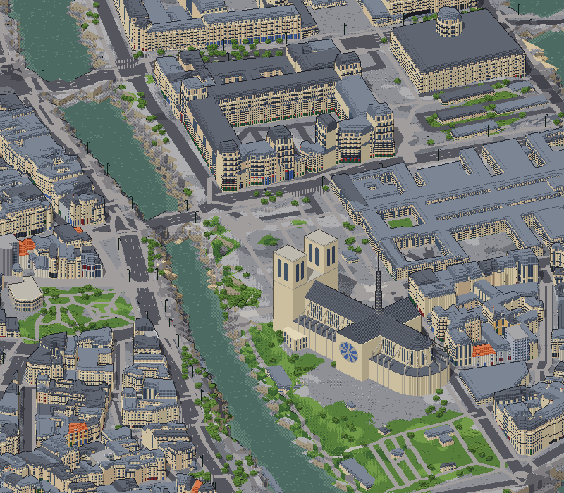</a><br><sub><b>Paris:</b> Notre-Dame on the Île de la Cité.</sub></td>
</tr>
<tr>
<td width="50%"><a href="docs/images/readme/paris-opera.png">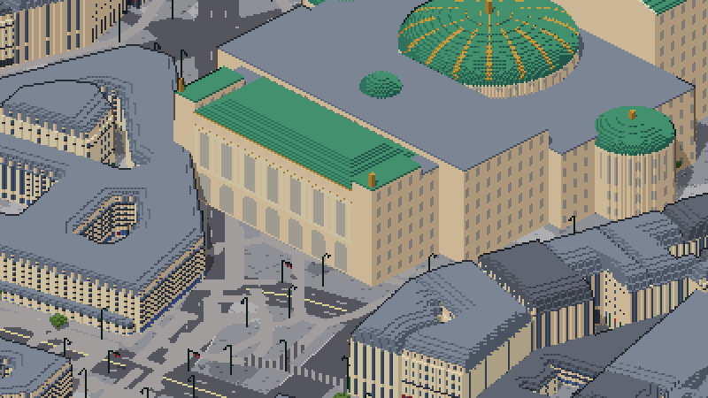</a><br><sub><b>Paris:</b> the Opéra Garnier's domes, walking.</sub></td>
<td width="50%"><a href="docs/images/readme/tokyo-shinjuku.png">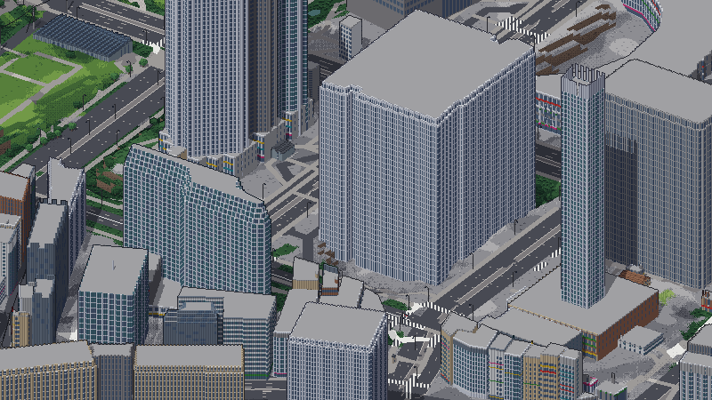</a><br><sub><b>Tokyo:</b> Shinjuku's towers.</sub></td>
</tr>
<tr>
<td width="50%"><a href="docs/images/readme/sw-grand-canyon.png">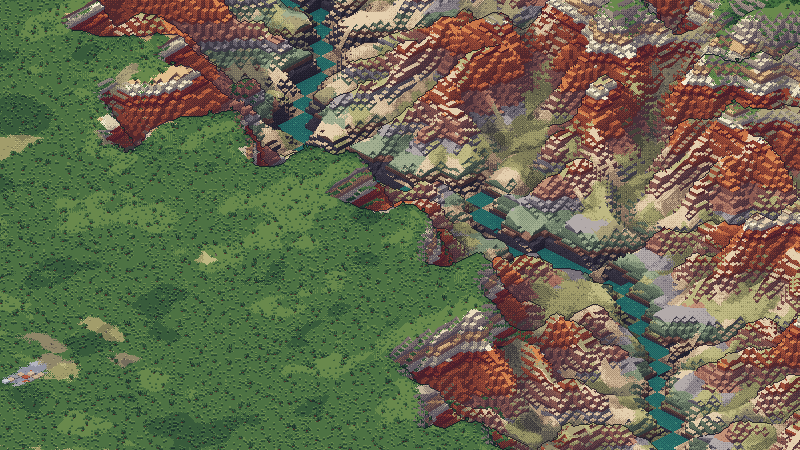</a><br><sub><b>The Grand Canyon</b>, flying.</sub></td>
<td width="50%"><a href="docs/images/readme/sw-hoover-dam.png">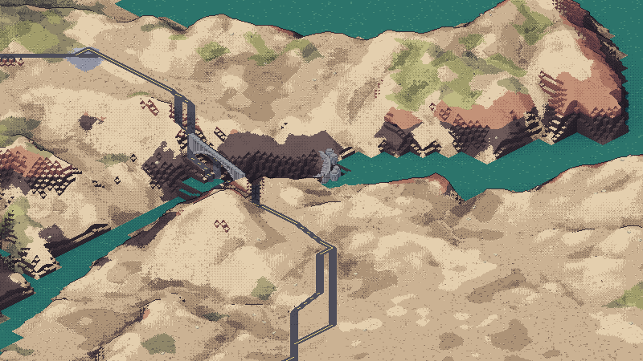</a><br><sub><b>Hoover Dam</b> between Lake Mead and the Colorado, driving.</sub></td>
</tr>
</table>

## How it draws

**From open data.** The pipeline reads elevation, land cover, the map's roads, water and buildings, and where a city publishes them, its building records (heights, ages, uses, materials). It lays them on a grid, compresses the geography between landmarks so a region stays small enough to cross, and writes a world package of static files. The browser bakes that package into pixel-art tiles as you move, in a WebGL2 worker. A style pack sets the palette, the materials and which generator draws each kind of building, tree and landmark; [the style guide](docs/style-guide.md) is the rules every pixel follows.

**Three scale levels** of the same place, each a world of its own, and `L` switches between them where you stand: flying, driving and walking.

<table>
<tr>
<td width="33%"><a href="docs/images/readme/level-fly.png">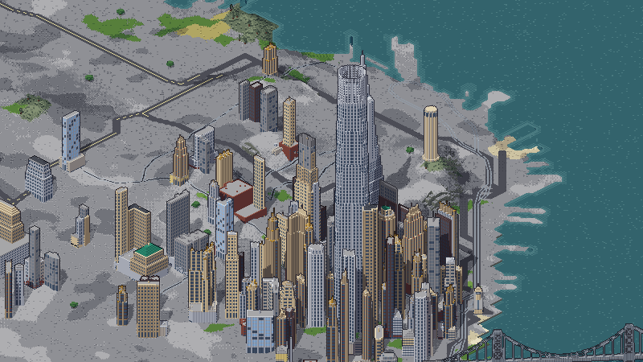</a><br><sub>Flying</sub></td>
<td width="33%"><a href="docs/images/readme/level-drive.png">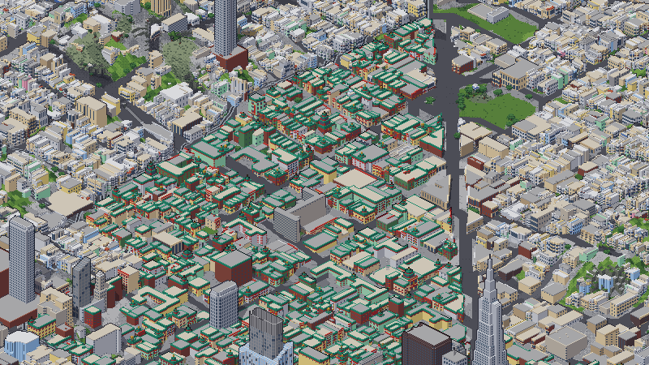</a><br><sub>Driving</sub></td>
<td width="33%"><a href="docs/images/readme/level-walk.png">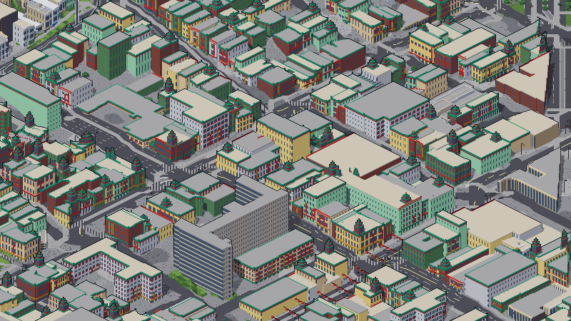</a><br><sub>Walking</sub></td>
</tr>
</table>

**Four rotations,** each baked, not a turned image: `Q` and `E` turn the view.

<table>
<tr>
<td width="50%"></td>
<td width="50%">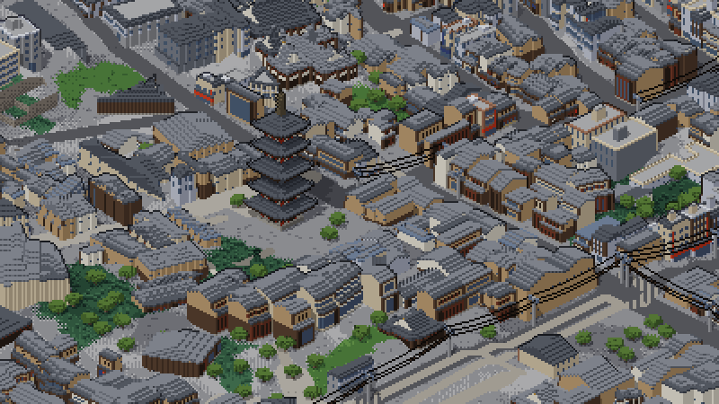</td>
</tr>
<tr>
<td>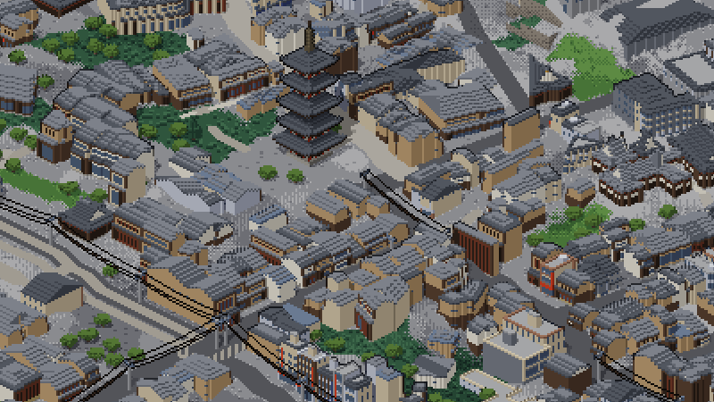</td>
<td>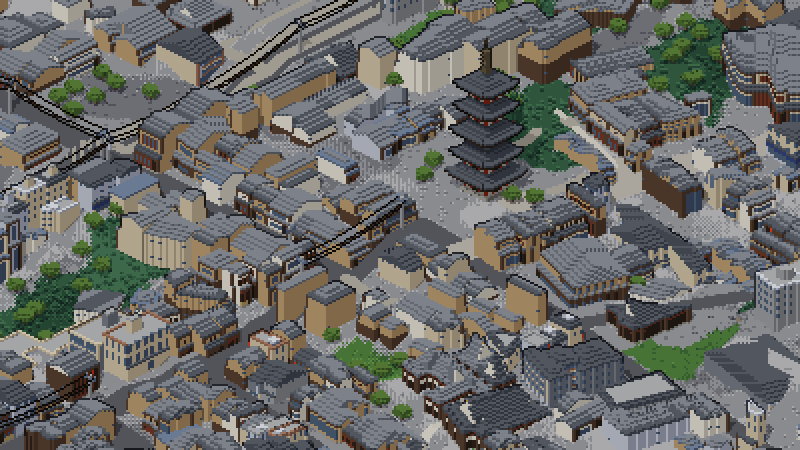</td>
</tr>
</table>

**And** day and night palettes (`T`), fog (`G`), traffic on the roads (`V`), and every landmark, building and source inspectable (`I`, Alt+click).

## Run it

Requires Node 22.12+ and pnpm 10, plus a browser with WebGL2 (the pipeline: Python 3.12+ and uv). To work on pixelworld, see [CONTRIBUTING.md](CONTRIBUTING.md): setup, a map of the repo, the checks CI runs, golden images and the debugging tools.

```sh
pnpm install
pnpm dev            # http://localhost:5173: the US Southwest
```

`?world=` picks another world: `/sf-walk/`, `/sf/`, `/sf-fly/`, `/nyc-walk/`, `/nyc/`, `/kyoto-walk/`, `/kyoto/`, `/kyoto-fly/`, `/paris-walk/`, `/tokyo-walk/`, `/hongkong-island/`, `/hongkong/`, `/hongkong-walk/`, `/southwest-walk/`, `/southwest-fly/` (for example http://localhost:5173/?world=/kyoto-walk/).

| Input | Action |
|---|---|
| WASD / drag | pan |
| arrow keys | drive the rover (it can't climb cliffs or steep slopes, or enter water) |
| Q / E | rotate the view 90° |
| 1–6 | zoom |
| F | toggle camera follow |
| N | toggle no-clip |
| T | day / night |
| L | next scale level (flying, driving, walking) at the same place |
| V / G | traffic / fog on or off |
| I | data sources and licences |
| H | hide or show the HUD |
| Alt+click | log what is under the pointer (ramp, surface, object, generator) to the console |

URL parameters make views repeatable: `world` (package URL, default `/southwest/`), `rot`, `zoom`, `fx`/`fy` (focus cell), `rover=x,y` or `at=lon,lat`, `w`/`h` (fixed canvas size), `hud=0`, `cache=0` (skip the IndexedDB tile cache), `traffic=0`, `fog=0`, `palette=night`, `style=<pack>` (draw the world with another pack from `worlds/_styles/`, such as a variant you are trying; the city packs it names come from `apps/web/src/plugins.ts`, [plugins.md §9.7](docs/plugins.md#97-the-viewers-city-packs)) and more. Every key, URL parameter and debug function is in the [viewer reference](docs/viewer.md). `pnpm models` previews one asset group's models alone, in four rotations, by day and night ([model preview](docs/viewer.md#4-the-model-preview-pnpm-models)).

**Built on the engine:**
- `pnpm example:minimal` runs the smallest client of it (http://localhost:5180): San Francisco, the rover and traffic, in about 45 lines.
- `pnpm --filter @pixelworlds/game dev` runs the example game (http://localhost:5252): drive Las Vegas → Hoover Dam → the Grand Canyon, take off from a straight road and fly the canyon (H for keys; `?world=/sf/` starts on the Embarcadero, `?run=1` drives and flies the run by itself and reports its frame times).
- [`@pixelworlds/multiplayer`](packages/multiplayer/README.md)'s demos, each run by a server: a dogfight over the Grand Canyon (`pnpm --filter @pixelworlds/multiplayer demo:dogfight`), a race round the Las Vegas Strip (`demo:race`), and Fogfront, a small real-time strategy game with the fog of war on San Francisco's Presidio (`demo:rts`).

## Use it in your project

The engine, the world format, the generators and traffic are one npm package, `pixelworld`, ESM with types:

```sh
npm install pixelworld
```

```ts
import { createWorldView, roverController } from "pixelworld/engine";

const canvas = document.querySelector<HTMLCanvasElement>("#world")!;
const view = await createWorldView({
  canvas,
  worldUrl: "/worlds/grand-canyon-m0/",                                   // a world package, e.g. a copy of fixtures/grand-canyon-m0
  style: (id) => fetch(`/styles/${id}/style.json`).then((r) => r.json()), // its style pack, from worlds/_styles/
  controller: roverController({ listen: { keys: window, pointer: canvas } }),
});
```

Worlds and style packs are data you host; the bake worker works in Vite, webpack 5 and plain ESM without configuration. The cities' buildings come from their city packs, also on npm: [`@pixelworlds/city-sf`](packages/city-sf/README.md), [`-nyc`](packages/city-nyc/README.md), [`-paris`](packages/city-paris/README.md), [`-kyoto`](packages/city-kyoto/README.md), [`-tokyo`](packages/city-tokyo/README.md) and [`-hongkong`](packages/city-hongkong/README.md). See [Using pixelworld from npm](docs/npm.md), [the engine API](docs/library.md#7-as-built-the-engine-m4-step-1) and the [example consumers](examples/consumers/).

## Build a world of your own place

The pipeline is a Python package, `pixelworld-pipeline`:

```sh
pip install pixelworld-pipeline        # or: uv tool install pixelworld-pipeline
pixelworld build region.yaml --out my-world
pixelworld view my-world               # serve it, and print the viewer URL
```

A region spec says where, at what scale and from which data. [Make your own world](docs/worlds.md) walks through one (Jerome, Arizona) and is the reference of every key; [writing pipeline plugins](docs/plugins.md) covers data sources of your own. To rebuild a world in this repository, from `pipeline/` in a checkout (downloads are cached in `pipeline/.cache/`; the Southwest takes about 3 minutes once cached):

```sh
cd pipeline && uv run pixelworld build ../worlds/southwest/region.yaml
```

## Checks

The same checks as CI (`.github/workflows/ci.yml`); [CONTRIBUTING.md](CONTRIBUTING.md#3-the-checks-as-ci-runs-them) has them job by job, and how to run one test.

```sh
pnpm check                               # eslint + tsc + vitest
pnpm exec playwright install chromium    # once, for the e2e tests (--with-deps on a fresh Linux machine)
pnpm test:e2e                            # Playwright golden images + behaviour tests (headless Chromium, SwiftShader); pnpm test:e2e:smoke for a quick subset
pnpm package:check                       # the npm package: pack it, check the tarball and its size budgets (also package:size, package:consumers, docs:api)
cd pipeline && uv sync && uv run ruff check . && uv run ruff format --check . && uv run pytest
```

To measure tile bakes, frames and memory on your own GPU, run `pnpm bench` (it opens the benchmark page in your browser); see [Benchmarks](docs/architecture.md#benchmarks).

## Docs

Start with the [docs index](docs/README.md):

- [Contributing](CONTRIBUTING.md)
- [The viewer: keys, URL parameters, debug API](docs/viewer.md)
- [Using pixelworld from npm](docs/npm.md) and [the library](docs/library.md)
- [Make your own world](docs/worlds.md) and [pipeline plugins](docs/plugins.md)
- [Architecture](docs/architecture.md)
- [Places built and proposed](docs/cities.md)
- [Roadmap](docs/roadmap.md)
- [Style guide](docs/style-guide.md)
- [World format](docs/world-format.md)
- [Data sources and licensing](docs/data-sources.md)
- [Decision log](docs/decisions.md)

## Data attribution

The worlds, and so the screenshots above, are made from:
- **Maps and buildings:** © OpenStreetMap contributors, and the Overture Maps Foundation (with Esri Community Maps contributors, Microsoft and Google Open Buildings), ODbL 1.0.
- **Elevation and land cover:**
  - USGS 3D Elevation Program, public domain.
  - Copernicus WorldDEM-30, © DLR e.V. 2010–2014 and © Airbus Defence and Space GmbH 2014–2018, provided under COPERNICUS by the European Union and ESA.
  - ESA WorldCover 2021 (contains modified Copernicus Sentinel data), CC BY 4.0.
  - WRI and Meta's high-resolution canopy height maps, CC BY 4.0.
- **City records:**
  - DataSF, ODC PDDL 1.0.
  - NYC Open Data: PLUTO, building footprints, landmarks.
  - Apur, ODbL 1.0, and IGN (BD TOPO®, RGE ALTI®), Licence Ouverte 2.0.
  - Japan's MLIT (PLATEAU) and GSI.

Each world package lists every source and its licence in its manifest, which the viewer shows (press `I`). See [fixtures/LICENSE.md](fixtures/LICENSE.md) and [data sources and licensing](docs/data-sources.md).

## License

pixelworld is open source:

- **Code** (TypeScript packages, apps, tools and the Python pipeline): licensed under either of the [MIT License](LICENSE-MIT) or the [Apache License 2.0](LICENSE-APACHE), at your option.
- **Style packs** (`worlds/_styles/`): [CC BY 4.0](worlds/_styles/LICENSE.md).
- **World packages** (`fixtures/`): [ODbL 1.0](fixtures/LICENSE.md), as databases derived from OpenStreetMap and Overture Maps. Each package's manifest lists its sources and their licences; see [data sources and licensing](docs/data-sources.md).

Unless you explicitly state otherwise, any contribution intentionally submitted for inclusion in this project by you, as defined in the Apache-2.0 licence, shall be dual-licensed as above, without any additional terms or conditions.
