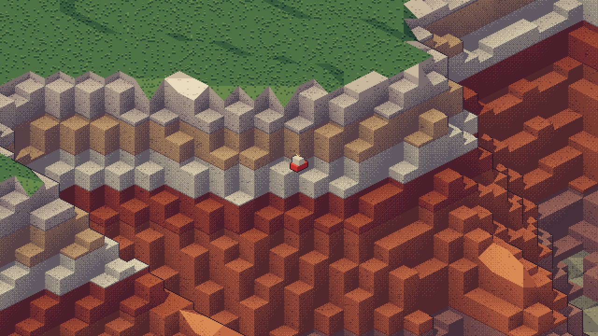

# pixelworld

An interactive world built from real places and drawn as isometric pixel art in the browser. Geography is compressed and rearranged around recognizable landmarks, so you can drive from the Las Vegas Strip past Hoover Dam to the Grand Canyon in minutes, then fly through it.

**Status:** M0 (grid and bake slice) is done. A 20 km slice of the Grand Canyon, made from real USGS elevation data and the OpenStreetMap river, is baked into pixel art in the browser and can be explored in 4 rotations with a placeholder rover.



## Run it

Requires Node 22+ and pnpm 10, plus a browser with WebGL2.

```sh
pnpm install
pnpm dev            # http://localhost:5173
```

| Input | Action |
|---|---|
| WASD / drag | pan |
| arrow keys | drive the rover (it can't climb cliffs or steep slopes, or enter water) |
| Q / E | rotate the view 90° |
| 1–6 | zoom |
| F | toggle camera follow |
| N | toggle no-clip |
| H | hide or show the HUD |

URL parameters, useful for repeatable views: `rot`, `zoom`, `fx`/`fy` (focus cell), `rover=x,y`, `w`/`h` (fixed canvas size), `hud=0`.

## Checks

```sh
pnpm check          # eslint + tsc + vitest
pnpm test:e2e       # Playwright golden images + behaviour tests (headless Chromium, SwiftShader)
cd pipeline && uv run ruff check . && uv run pytest
```

To regenerate the fixture world (it fetches the USGS DEM and the OSM river; results are cached in `pipeline/.cache/`):

```sh
cd pipeline && uv run python -m pixelworld_pipeline.fixtures.grand_canyon_m0
```

To make the terrain more or less dramatic, pass `--exaggeration E`. E is vertical exaggeration relative to true proportions: 1.0 is real slopes and the default is 2.5. `--max-slope K` (1–3, default 2) sets how steep a continuous slope tile can be before terrain turns into terraces and cliffs. See [fixtures/README.md](fixtures/README.md) to try a value without overwriting the committed fixture.

## Docs

Start with the [docs index](docs/README.md):

- [Architecture](docs/architecture.md)
- [Roadmap](docs/roadmap.md), including the M0 results
- [Style guide](docs/style-guide.md)
- [World format](docs/world-format.md)
- [Data sources and licensing](docs/data-sources.md)
- [Decision log](docs/decisions.md)

## Data attribution

Elevation: USGS 3D Elevation Program (public domain). River: © OpenStreetMap contributors (ODbL 1.0). See [fixtures/README.md](fixtures/README.md).
