# Roadmap

Status: living document. Milestones are ordered and each has exit criteria. The technology tracks show how each part of the stack grows across milestones. Architecture details are in [architecture.md](architecture.md).

## 1. Technology choices

| Area | Choice | Notes |
|---|---|---|
| Client language | TypeScript (strict) | Shared by player app, editor and offline baker. |
| Monorepo / build | pnpm workspaces + Vite | |
| Bake renderer | Raw WebGL2 with the integer projection in the vertex shader (D-019) | WebGL2 is the baseline because it runs headless in CI via SwiftShader. Three.js is reserved for the later live 3D mode. |
| Runtime compositor | Small custom WebGL2 renderer | Draws indexed + depth quads, applies the palette LUT, upscales by integer factors. |
| Background baking | Web workers with OffscreenCanvas + WebGL2 | |
| Client cache | Memory, plus IndexedDB / OPFS | Keyed by chunk hash + rotation + style version. |
| Gameplay physics | Custom grid-aware kinematics | Rapier gets evaluated if and when full 3D mode needs it. |
| Geo pipeline | Python 3.12+, managed with uv | numpy, rasterio/GDAL, pyproj, shapely 2, geopandas, pyosmium, DuckDB (spatial) for Overture GeoParquet, PDAL/laspy for lidar, cjio/lxml for CityJSON/CityGML, scipy.sparse for the warp solver. |
| Editor ↔ pipeline | Local FastAPI server | Wraps pipeline stages for interactive re-solve and re-export. |
| Offline baking | Playwright + headless Chromium (`tools/bake-cli`) | Same bake code as the client. |
| Art tools | Aseprite (indexed palettes, paint-over), MagicaVoxel (`.vox` hero assets) | |
| Tests | Vitest, pytest, Playwright golden images | |
| Hosting | Static files on a CDN | Possibly one archive read with HTTP range requests. |

## 2. Milestones

### M0: Grid and bake slice — done

**Goal:** prove the look and the grid on one hardcoded piece of the Grand Canyon, before investing in data.

- Monorepo scaffold, CI (lint, typecheck, tests).
- `packages/grid`: projection constants, 4 rotations, cell model (RCT-style base height + slope + cliffs).
- DEM fixture: a small excerpt, about 128×128 cells, committed with attribution, converted to cells by a throwaway script.
- `packages/generators`: terrain mesh with top, slope and cliff faces, plus elevation-band strata materials.
- `packages/bake`: raster passes, palette composite, outline and cleanup passes, indexed + depth output, run in a worker.
- `packages/runtime`: compositor, pixel-snapped camera, integer zoom, rotation, and a placeholder sprite drawn with per-pixel depth and a silhouette when hidden.
- First style reference sheet: palette, ramps, outline rules.
- `docs/world-format.md` v0, plus TS/Python codecs with golden files.

**Exit criteria:**
- At 1× zoom, screenshots pass review against the style sheet: clean staircases, no stray pixels, consistent ramps.
- Scrolling doesn't shimmer, and all 4 rotations work.
- The sprite hides correctly behind cliffs.
- Bake time per tile has been measured on desktop and on a phone, and budgets are recorded.

#### M0 results

| Exit criterion | Result |
|---|---|
| Screenshots pass review at 1× against the style sheet | Done. Reviewed over several iterations (outline threshold, AO dead zone, terrain smoothing); see [style-guide.md](style-guide.md). |
| No shimmer while scrolling | Verified by an e2e test: a ¼-pixel pan at 4× shifts the output by exactly one device pixel. |
| All 4 rotations work | Verified: an e2e test finds zero holes or seams in every rotation. |
| Sprite hides correctly behind cliffs | Verified: the e2e test finds the silhouette when the rover is hidden and none when it's in the open. |
| Bake time measured on desktop and phone | **Partly.** Measured only on software rendering (SwiftShader, headless): about 45 ms mesh generation in JS (about 53k vertices for a tile plus margin) + 105 ms bake per 32×32 tile, max 235 ms; compositing ran at about 30 fps at 1280×720. No GPU desktop or phone has been measured yet. |

**Proposed budgets** (to confirm on real hardware):
- ≤ 50 ms per tile on a desktop GPU and ≤ 150 ms on a recent phone.
- Compositing at 60 fps on both.

If phones miss the bake budget, the first step is profiling mesh generation (per-vertex AO sampling is a likely cost). After that, try smaller tiles or a smaller context margin.

### M1: Real region at uniform scale — done

**Goal:** the Southwest region from real data, end to end, without warping.

- `pipeline` CLI for fetch, normalize, semantics (terrain, water, land cover, roads), gridify and export.
- Region spec format (`worlds/southwest/region.yaml`).
- Road snapping to 8 directions with cut-and-fill.
- Chunk streaming and persistent cache in the client.
- Attribution screen built from the manifest.

**Exit criteria:**
- The whole region is explorable at one uniform scale.
- Re-running the pipeline produces an identical package hash.
- Roads stay connected and drivable after snapping.

#### M1 results

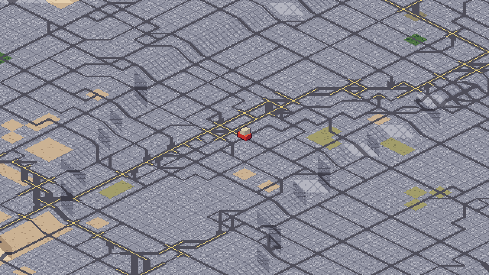

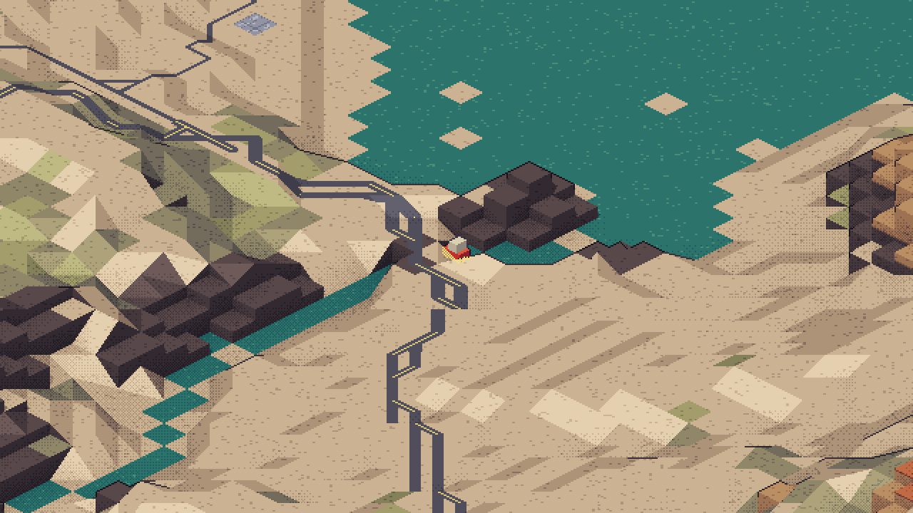

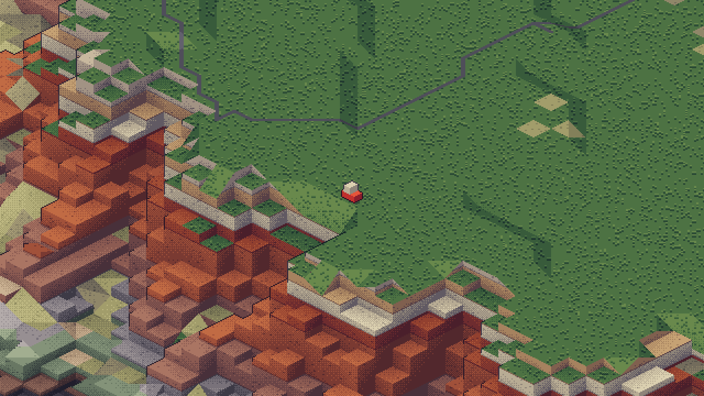

| Exit criterion | Result |
|---|---|
| Whole region explorable at one uniform scale | Done. 1028×700 cells at 400 m (about 410 × 280 km, from the Mojave west of Las Vegas to Flagstaff), 2.5× vertical exaggeration, 187 chunks, 0.63 MB gzipped. Chunks stream on demand; an e2e test checks that a view 680 cells from the start loads under a quarter of the chunks and has no holes. |
| Identical package hash on re-run | Verified: two builds from the same spec and cached inputs give the same `packageHash` (`bccd07e9…`). A pytest covers the hash for synthetic packages. |
| Roads connected and drivable after snapping | Verified by the build's validation report: 26,298 Overture segments became 13,453 road cells and 15,156 edges, with 0 discontinuous edges, 0 over-steep edges, 0 segments split and 0 junctions disconnected. The rover drives the network within its grade limit. |

Also delivered:
- Region spec, `pixelworld build` CLI, pinned and cached sources.
- Geology provinces with per-province strata sets.
- Road decals (motorway and trunk centre lines).
- Desert, urban, grass, farmland and snow surfaces.
- An IndexedDB baked-tile cache (verified by an e2e test across a reload: every tile comes from the cache and the image is pixel-identical).
- A sources screen built from the manifest.

**Known issues** (carried into M2's generalize stage):
- **Dual carriageways show up as "ladders".** OSM maps divided highways as two one-way ways; where they straddle a cell boundary they snap to adjacent cells (e.g. I-15, US-93). Merging them needs vector-level generalization.
- **Busy, spiky mountains.** At 400 m per cell and 2.5× exaggeration, mountain ranges are busy with one-cell pillars. Focus-area scales in M2 change this anyway.
- **Rough geology boundary.** The Colorado Plateau outline is hand-drawn, and strata colour by elevation alone (no dip).

### M1.5: Pixel detail experiment — done

**Goal:** decide how pixel-level detail should look before building it properly. Two small areas, the Desert View area of the Grand Canyon and a stretch of the Las Vegas Strip, are rendered three ways:
1. today's coarse cells
2. pixel-scale terrain: fine cells drawn at reduced pixel size, standing in for micro-terrain
3. pixel-scale terrain plus procedural objects: vegetation, buildings from footprints, 2–3 landmarks, and a night palette with lit windows and neon

**Deliverables:**
- comparison screenshots
- a first set of procedural generators for semantic asset groups (see M3)
- decisions on micro-terrain resolution (K), object pixel scale and outline rules

The experiment code may be throwaway where it doesn't fit the production design.

**Exit criteria:** the look is chosen and recorded in the style guide and decision log; micro-terrain and M3 can start from it.

#### M1.5 results

Every variant uses the same 160 m/cell layout on screen. The K=4 and K=8 worlds are built from 40 m and 20 m cells drawn at ¼ and ⅛ size (`render.scale`), so a K=8 cell is a 4×2 px diamond and one height step is 1 px. Worlds: `fixtures/exp-*`, specs: `worlds/experiment/`.

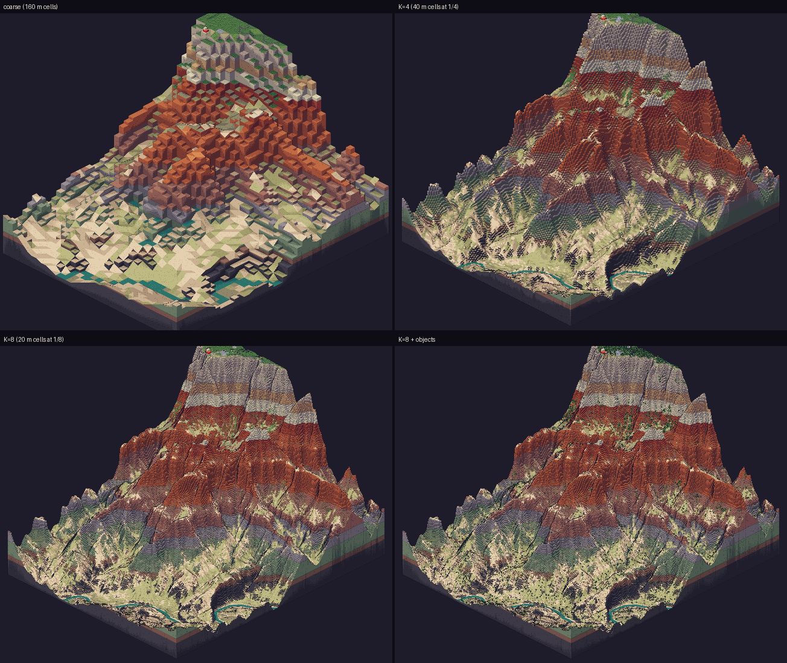

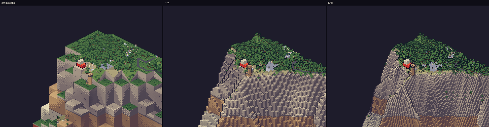

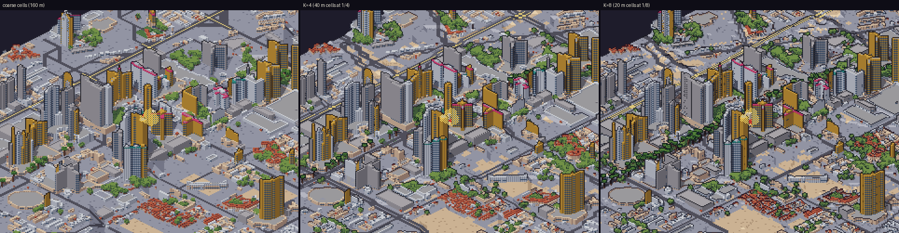

**Findings:**
- **Pixel-scale terrain transforms the canyon.** Side canyons, buttes and the river bend become legible. The strata read as bands of ledges instead of 32 px blocks.
- **K=4 versus K=8 is a matter of taste.** K=4 (8×4 px cells, 2 px steps) gives chunky ledges that look hand-pixelled. K=8 (4×2 px cells, 1 px steps) gives finer landforms, but its 1 px treads read as hatching on steep walls. On flat ground (the Strip) the two look almost the same.
- **Steep ground has to be rock.** With fine cells, a canyon wall is many cells wide. When its treads kept their land-cover colour (woodland, grass) the wall became a green-and-tan herringbone. Making every cell steeper than 0.6 rise over run bare rock fixed it (D-036).
- **Objects make the city.** About 5,500 buildings from Overture footprints, with towers, podiums and houses, turn the Strip from a grey "blocks" pattern into a skyline. The night palette, with lit windows and neon trim, works by swapping the palette alone, without a re-bake (D-035).
- **Iconic beats accurate.** Real proportions made the 21 m watchtower a 5 px stub. Its depicted height is 80 m (×4), and the observation tower is a generic design, not a replica.
- **Occlusion:** in a fixed isometric view, tall towers hide streets and the fountain lake behind them. M3 needs a way to deal with this (cutaways, fading, or relying on the 4 rotations).

**Cost** (SwiftShader, one bake tile per area, mesh + bake):

| Area | Coarse | K=4 | K=8 | K=8 with objects |
|---|---|---|---|---|
| Desert View, 5.6 × 6.9 km | 56 + 315 ms | 421 + 754 ms | 1,379 + 1,085 ms | 1,797 + 2,715 ms (6,808 objects) |
| Strip, 3.6 × 8.2 km | 76 + 308 ms | 212 + 358 ms | 608 + 698 ms | 1,352 + 1,409 ms (9,401 objects) |

- Gzipped terrain costs about 1.5 bytes per fine cell in the canyon and 0.5 in the flat city. Every layer is stored at fine resolution.
- Extrapolated to the whole Southwest, that's roughly 6–17 MB at K=4 and 23–69 MB at K=8, against 0.63 MB today.
- Objects add 100–340 KB per area.
- JavaScript meshing of K=8 terrain takes 0.6–1.4 s per area (1.4–1.8 s with objects). That confirms M1.6's plan to move terrain onto the GPU and store micro-heights only.

**Proposed decisions:** D-032 to D-037 in the [decision log](decisions.md).

**Chosen:** K=4 (D-037), for its cleaner pixel clusters at about a quarter of K=8's data and a third of its meshing time.

**Known issues:**
- The K=8 Strip reports 1 split road segment and 2 disconnected junctions at 20 m cells.
- Street-tree counts vary with K, because road cells block more ground at coarse cells.
- At night the streets stay dark: there are no street lights yet.

### M1.6: Micro-terrain — done (desktop GPU timing: run `pnpm bench`)

**Goal:** pixel-resolution terrain everywhere, without changing the gameplay grid.

- **Data:** a 4×4 grid of fine heights per cell (K=4, D-037), stored as an optional chunk section. Cells keep their base height and shape as the gameplay summary. Only heights are stored at fine resolution; other layers stay per cell (storing every layer finely would cost roughly 10–110× the cell-only package, see M1.5).
- **Pipeline:** builds micro-heights from finer elevation sources. Roads and pads are cut and filled at micro resolution, and water stays flat.
- **Rendering:** terrain moves to the GPU, as a heightfield ray-march or a GPU-built grid mesh, so bake cost scales with pixels rather than with geometry. JavaScript mesh building can't handle 64× the vertices.
- **Gameplay:** vehicles sample micro-heights.

**Exit criteria:**
- The Southwest renders with micro-terrain at every zoom.
- Bake time per tile is within the budget on desktop.
- The package size increase is understood and acceptable. M1.5 measured 0.5–1.5 bytes per fine cell, gzipped, with every layer at fine resolution; micro-heights alone should cost less.

#### M1.6 results

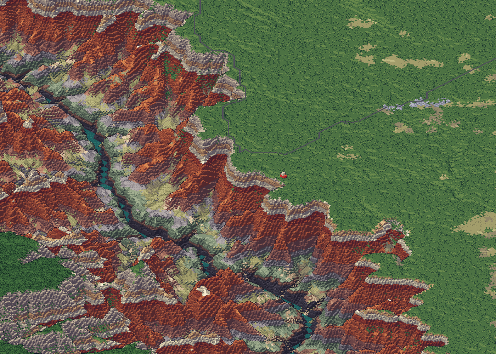

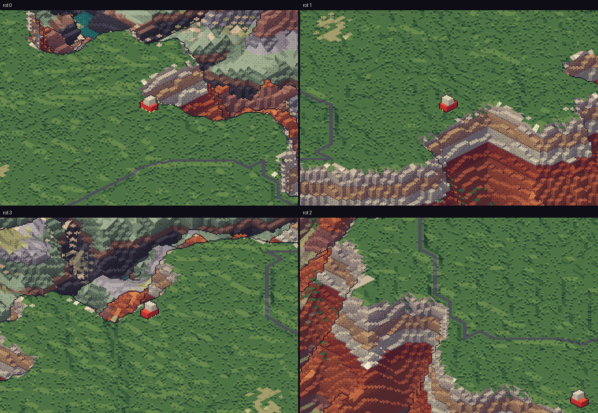

**What was built:**
- **Data:** chunks carry micro-corner heights (`MHGT`, D-038), 4×4 micro-cells per cell with quarter-step heights. The pipeline reads the 30 m DEM's 60 m overview at every micro-corner, keeps water cells flat at their level and cuts road beds along road centre lines from the cells' road profile.
  - The cell layers are unchanged, and so is the road report: 0 discontinuities, 0 split segments, 0 disconnected junctions.
  - Micro-terrain agrees with them closely: the mean micro height per cell is within 0.2 steps of the cell's mean (median), 0.6 at the 95th percentile and 4.5 at most, in steep terraces.
- **Rendering:** the GPU builds the geometry (D-039). The baker gets textures, the vertex shader emits tops and the walls facing the viewer, and an AO pre-pass runs per micro-corner. Steep micro-tops become bare strata, and land-cover borders are jittered per micro-cell.
- **Gameplay:** the rover samples micro heights.

| Exit criterion | Result |
|---|---|
| The Southwest renders with micro-terrain at every zoom | Done. Every tile bakes from micro-terrain. Zoom levels are integer upscales of the same baked tiles. An e2e test checks that Grand Canyon Village is hole-free in all 4 rotations, and the streaming test still finds no holes. The Vegas golden was updated after review. |
| Bake time per tile within the desktop budget (≤ 50 ms on a GPU) | **Not measured on a GPU**: there is none in this environment. In software rendering (SwiftShader), a tile plus its margin takes 256–322 ms against 146–225 ms for cell meshes (table below). The benchmark page (`pnpm bench`, [architecture §12](architecture.md#benchmarks)) now measures it on a desktop GPU. |
| Package size increase understood and acceptable | 0.63 MB → 3.97 MB gzipped (6.3×) for the whole Southwest. Chunks stream on demand, so a view loads a small share of that. |

**Software-rendering cost per tile** (SwiftShader, zoom 2, 960×640 view; mesh or field preparation + bake):

| View | Cells (M1) | Micro-terrain (M1.6) |
|---|---|---|
| Las Vegas, rotation 0 | 44 + 139 ms | 8 + 258 ms |
| Grand Canyon Village, rotation 2 | 65 + 160 ms | 10 + 322 ms |
| Black Canyon below Hoover Dam, rotation 1 | 38 + 108 ms | 8 + 256 ms |

The first GPU version took 1.2 s per tile. Two changes brought it down:
- **Plain draws:** drawing with `gl_VertexID` instead of instancing (SwiftShader runs instances one by one) gave a 4× speed-up, with identical pixels.
- **Walls only where they exist:** this keeps wall cost proportional to actual cliffs.

**Known issues:**
- **Water is still per cell.** Rivers show as chains of 400 m diamonds. Micro-resolution water (river buffers, land-cover water at 100 m) is the fix. *Fixed (D-094):* water is a plane over micro-terrain shaped from the map's water polygons and river lines.
- **Land cover is still per cell.** Jittered borders hide the grid, but small patches still come out cell-sized. *Softened (D-096):* surfaces are chosen per pixel with warped, dithered borders, and rock follows the ground's slope.
- **Steep outcrops** in dark-rock areas show as scattered dark micro-diamonds. *Partly (D-096):* the per-micro-cell rock test is gone and rock follows the smoothed slope; the walls of single micro-steps still show as dark strata marks.
- **Road beds** are 0.3 cells to either side of the centre line, so in mountains they read as wide benches.
- **Not combined yet:** render scale (the M1.5 experiment worlds) and micro-terrain don't work together.

### M2: Elastic map and editor v0 — done

**Goal:** demonstrate the core idea: Las Vegas, Hoover Dam and the Grand Canyon within a short drive.

- `importance` stage: Wikidata, pageviews and OSM tags combined with focus areas into a scale field.
- Warp v1 (separable), then v2 (mesh solve with pins and a fold check).
- Rigid stamping of landmark anchors.
- Vertical exaggeration and per-feature caricature.
- `apps/editor`: scale brush, pins, re-solve through the local pipeline server, live preview.

**Exit criteria:**
- The warp has no folds.
- Roads and rivers stay continuous and recognizable.
- Each focus area hits its target scale within tolerance.
- An editor change shows up in the preview within seconds for the affected area.

#### M2 results

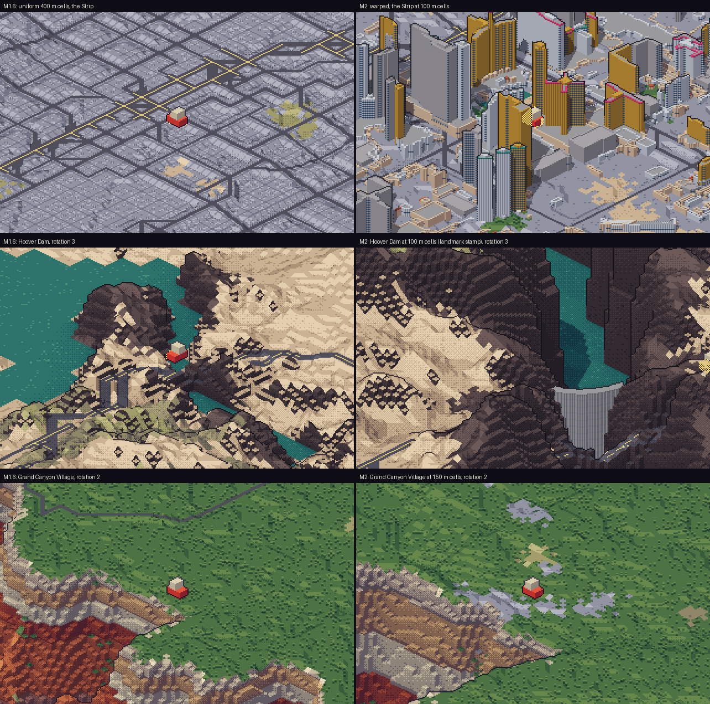

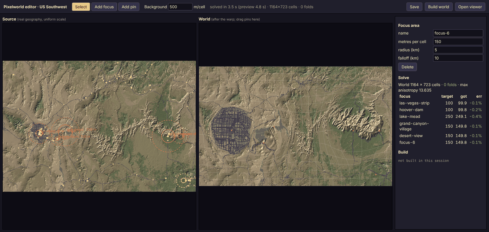

**What was built:**
- **Warp:** a scale field from hand-placed focus areas plus automatic importance, then a mesh solve.
  - v1 is separable; v2 is a fold-free mesh solve with soft pins and a boundary that slides along a rectangle (D-040).
  - The build fails on any fold. Solves are cached by the warp spec's digest.
- **Pipeline on a layout:** every stage samples through a layout: elevation, land cover, roads, rivers, provinces, micro-terrain and objects.
  - The uniform layout changes nothing by itself. The M1.5 fixtures rebuild byte for byte, and the M0 and M1.5 goldens are unchanged.
  - A uniform Southwest build differs from M1.6 only in road beds: 36 cells in 3 of 187 chunks, from D-044.
  - Lines are split about every 1 km before mapping, so they bend with the warp.
- **Vertical caricature:** relief is exaggerated by the local magnification around a smoothed reference (D-041). Strata keep their real elevations through the new `VREF`/`VFAC` layers.
- **Importance:** a committed Wikidata snapshot of 110 places scored by sitelinks adds up to 1.6× magnification (D-042).
- **Rigid stamping:** buildings and landmarks are placed with the local similarity of the map at their anchor. They keep their shape and real size relative to the local cells.
  - Hoover Dam is a new `landmark.dam` stamped along its crest line.
- **Editor v0:** `apps/editor` plus a local pipeline server, `pixelworld serve` (D-043).
  - Focus areas can be added, dragged and resized; each has a scale, radius and falloff. Pins and the background scale are editable too.
  - Each edit re-solves and redraws the preview. Saving writes `worlds/<id>/warp.yaml`; a full build runs in the background.
- **Client:** the manifest records metres per cell for every chunk. The HUD shows the local scale and the real (un-exaggerated) elevation.
- **Fixes the warp needed:**
  - Neighbouring road cells share one level (D-044).
  - Warped land cover is sampled 3×3 per cell (D-045).

| Exit criterion | Result |
|---|---|
| The warp has no folds | 0 folds. The worst cell is stretched 15:1, in a few slivers of the transition rings; p95 is about 3:1. |
| Roads and rivers stay continuous and recognizable | Road report over 24,412 road cells: 0 discontinuous edges, 0 steep edges, 0 split segments, 0 disconnected junctions. Lake Mead and the Colorado through the Grand Canyon are one water body, as in the uniform build; the only split is at Hoover Dam. |
| Each focus area hits its target scale | All five within 0.2% (table below). |
| An editor change shows in the preview within seconds | About 5 s: the warp is re-solved on a 4 km mesh in 3.5 s, then the preview is redrawn. A full build takes 80 s in the background. |

| Focus area | Target | Achieved |
|---|---|---|
| Las Vegas Strip | 100 m/cell | 100.2 |
| Hoover Dam | 100 | 100.0 |
| Lake Mead | 250 | 250.5 |
| Grand Canyon Village | 150 | 150.1 |
| Desert View | 150 | 150.1 |

| | M1.6 (uniform) | M2 (warped) |
|---|---|---|
| World | 1028×700 cells | 1155×709 cells (+14%) |
| Empty desert | 400 m/cell | about 500 m/cell (the background) |
| Strip → Grand Canyon Village, straight line | 684 cells | 718 cells |
| Package, gzipped | 3.97 MB | 5.62 MB of chunks + 0.30 MB of objects |
| Build, with cached sources | 30 s | 80 s, plus 17 s for the first solve of a warp on the 2 km mesh |

**The drive didn't get shorter.** The focus areas and their falloff rings take more cells than the compressed desert gives back. The Strip and the canyon get 16× and 7× more cells per area, but the drive between them grew by 5%. Solving (without building) with a coarser background shows the knob:

| Background | World | Strip → Grand Canyon Village | Focus errors |
|---|---|---|---|
| 500 m (built) | 1155×709 | 718 cells | ≤ 0.2% |
| 800 m | 963×525 | 576 cells | ≤ 0.1% |
| 1200 m | 879×424 | 513 cells | ≤ 0.6% |

Which drive length is right depends on vehicle speed, which M4 sets; the editor's background field changes it in seconds. *M4 set it (D-070): at the game's pace the 718-cell layout is a drive of under four minutes by road, so the 500 m background stays.*

**Known issues:**
- **Transition rings:** stretched cells smear terrain and land cover around the Strip, visible as rings in the warp preview.
- **Black Canyon:** at 100 m cells the relief factor reaches the cap of 4, so the canyon below Hoover Dam is a deep slot. A lower cap per feature is the likely fix. *Fixed: a relief cap per focus area (D-041), see the Southwest loose ends under M3.*
- **Narrow water on warped layouts:** 3×3 samples per cell can still miss a channel narrower than a third of a stretched cell.
- **Importance:** it uses Wikidata sitelinks only; pageviews and OSM tags aren't in. The live service rate-limits queries, so the snapshot is committed.
- **Editor scale brush:** it's circular focus areas only; there's no freehand painting.
- **Objects:**
  - Land-cover scatter (vegetation) isn't supported on warped layouts yet. *The client's scatter (M3, D-054) covers warped levels; the pipeline's land-cover rules (`objects.vegetation` by `landcover`) still don't.*
  - Buildings are only placed around the Strip.
  - The dam is a plain procedural wedge.

### M2.5: Scale levels — first cut done

**Goal:** recognizable and interesting maps at different scales (walking the streets, driving the roads, flying over the region), each tuned through parameters rather than code. The design is in architecture §3.5 (D-046 to D-048).

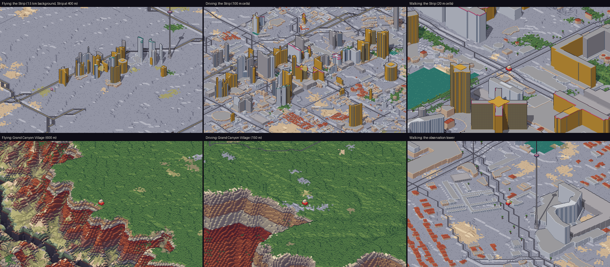

**What was built:**
- **Level specs:** level specs extend the region's spec and override its parameters. The base lists the levels; each level builds its own package with `level`, `levels` and a geo grid in its manifest.
- **New parameters:**
  - `warp.focusScale` coarsens or refines every focus area at once.
  - `objects.depiction` sets buildings' and landmarks' scale, a minimum building height, and the object height stretch.
- **Depiction:** oversized buildings are placed tallest first and skipped where they'd overlap a taller one.
- **Client:**
  - The L key reloads at the same lon/lat in the next level; `at=lon,lat` in the URL does the same.
  - The HUD shows the level and the rover's lon/lat.
  - Arriving outside a level's area lands at that level's start.
- **Southwest levels:** `fly.yaml`, `region.yaml` (driving) and `walk.yaml` (the Strip, from the M1.5 experiment's spec).

| | Flying | Driving | Walking |
|---|---|---|---|
| Cells | 339×219 | 1155×709 | 182×412 (the Strip only) |
| Open desert | 1,500 m/cell | 500 m/cell | — |
| Strip / Hoover Dam / canyon rim | 400 / 400 / 600 m | 100 / 100 / 150 m | 20 m |
| Strip → Grand Canyon Village | 216 cells | 718 cells | — |
| Roads | motorway, trunk | down to secondary | down to secondary |
| Buildings | towers ≥ 80 m, drawn 3×; 53 placed | all footprints ≥ 200 m² on the Strip | all ≥ 40 m², true proportions |
| Landmarks | drawn 5× (not the dam) | true size, rigid stamps | true size |
| Package, gzipped | 0.51 MB | 6.2 MB | 0.52 MB |
| Build, with cached sources | 57 s (including a 15 s warp solve) | 80 s | 12 s |

**Tests:**
- The pipeline tests cover level validation, focus scale, depiction and selection, the geo grid both ways and the editor's save rule.
- A unit test covers the client's geo grid.
- E2e tests check a flying-level golden, that drive → fly → walk keeps the rover within 400 m of where it was, and that a place outside the walking area lands at its start.

**Known issues and next steps:**
- **Walking level:**
  - Roads were one cell (20 m) wide, though Las Vegas Boulevard is about 50 m. Real widths, sidewalks and crosswalks came in M2.7.
  - Its road report was the M1.5 Strip's (1 split segment, 2 disconnected junctions). Snapping (M2.6) cleared it.
- **Flying level:**
  - There's no vegetation or land-cover scatter yet (warped layouts don't support it). *Done since M3: the client scatters by surface on every level, at 0.6 when flying (D-054).*
  - The dam is at real size, so it's tiny.
  - The heights of oversized towers want tuning against the terrain's relief. *Tuned: the level's cells had no relief until the D-041 fix; towers are now stretched 1.5× rather than 2.5×.*
- **Moving between levels** is a page reload. A seamless transition (take-off and landing) belongs with M4's vehicles. *Done in the example game: a new view replaces the old one on the same canvas (D-070); the viewer still reloads.*
- **Editor:** it previews any level's warp (`pixelworld serve worlds/southwest/fly.yaml`). It only saves a warp file the spec owns, so a level that inherits its warp is tuned in its spec file. Depiction and generalization sliders would make tuning faster.

### M2.6: Snapping to the isometric directions — done

**Goal:** roads, street grids and buildings that draw as clean pixel lines instead of jittery staircases. In this projection the 8 grid directions are the clean ones: axes draw as 2:1 lines, diagonals as horizontal or vertical lines (D-049).

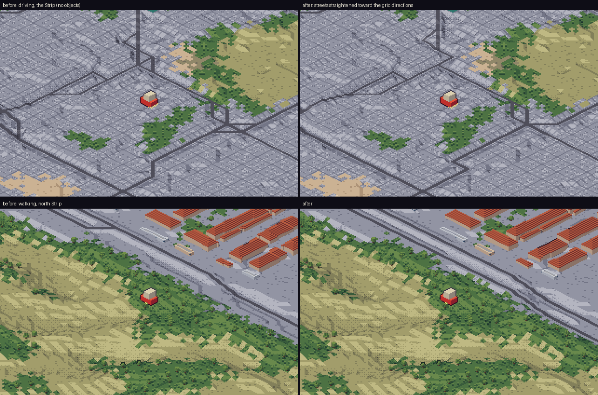

**What was built:**
- **Network straightening:** roads are simplified between the vertices they share. Every edge within 16° of a grid direction is then made to run exactly along it, solving for the smallest junction moves across the whole network, so junctions stay shared.
  - A street grid rotated a degree or two by the projection or the warp comes out aligned. One-cell jogs along a straight street can't be fixed one road at a time, because the junctions force them.
  - Junctions move under 2 cells, and never across the world's edge.
- **Long runs:** each road edge is laid in long runs of grid directions, kept within 1 cell of the true line, instead of a cell-by-cell staircase.
- **Buildings and other objects:** they move with the straightened streets (a smooth field that fades out 3 cells from the roads). Buildings within 12° of a grid direction turn to it, with their parts. Dams stay fitted to their canyon.
- **Parameters:** everything is tunable per level under `snap:` (architecture §3.5). The Southwest sets it in `region.yaml`, and all three levels inherit it.

| | Flying | Driving | Walking |
|---|---|---|---|
| Road cells with a 45° jog | 43.5% → 27.1% | 33.4% → 17.7% | 22.6% → 8.7% |
| Mean straight run | 1.9 → 2.7 cells | 2.7 → 4.4 cells | 4.4 → 10.6 cells |
| Building edges on a grid direction (±1°) | 28% → 37% | 16% → 47% | 40% → 58% |
| Road edges made to run along a grid direction | 694 of 2,349 | 8,955 of 26,813 | 2,031 of 2,951 |
| Junction moves, 99th percentile | 1.0 cell | 1.2 cells | 1.7 cells |

- **Road reports:** they stay clean. The walking level's improved: it's now one connected network, with none of the M1.5 Strip's split segment and disconnected junctions.
- **Cost:** straightening takes about 1.5 s on the driving level.
- **Tests:** pytest covers straight runs, a rotated street grid coming out jog-free and connected, roads along the world edge, building turns and the shift field. The two Southwest goldens were updated after review.

**Known issues:**
- **Remaining jogs:** most are on winding highways and in dense city blocks shorter than a cell, where an in-between angle has no clean answer. A looser `snap.roads.angle` or `deviation` trades position for straightness.
- **Irregular footprints:** buildings whose edges agree on no direction aren't turned.
- **Footprints near streets:** the shift moves objects with their streets, but doesn't check whether a moved footprint now overlaps a road cell. *Fixed on walking levels:* `snap.buildings.clearRoads` nudges or trims them. Driving levels draw roads 1.5–2× real width, so clearing there would reshape the city.

### M2.7: Roads and paths at their real width — done

**Goal:** proper widths for roads and paths at every scale level: street-level boulevards that span several cells with sidewalks and crosswalks, and coarse maps that keep a readable road hierarchy (D-050).

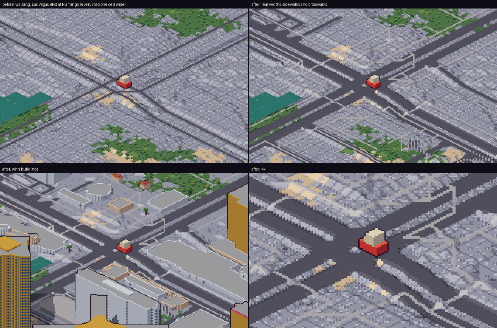

**What was built:**
- **Widths per cell:** every road and path class has a typical real width (one carriageway: 14 m for a primary road, 16 m for a motorway, 3 m for a sidewalk), and specs override them under `widths:`.
  - Each cell stores its widest way's half-width at the local scale (`RWID`, `PWID`), scaled per level (`widths.scale`) and floored (`widths.minCells`).
  - Road beds flatten the terrain across the full width, and the paved band keeps trees off the road.
- **A path network:** sidewalks, crosswalks, footways, pedestrian streets, steps, paths and cycleways have their own layers (`PATH`, `PCLS`), straightened together with the roads.
- **More road classes:** tertiary, residential, unclassified, living streets and service roads, with parking aisles and driveways left out by `sources.roads.excludeSubclasses`.
- **Client:** the micro-terrain shader draws ways across neighbouring cells within their reach.
  - Paths draw over roads; sidewalks and footways in pale concrete, crosswalks as stripes.
  - Roads are never narrower than the style's width for their class, so the driving and flying levels keep their hierarchy.

| Level | Widths | Roads | Paths | Package |
|---|---|---|---|---|
| Walking (20 m cells) | real | 23,359 road cells (was 5,495), 9 classes | 11,365 segments over 18,402 cells | 0.60 MB (was 0.51) |
| Driving | 2× real, at least the style width | unchanged network | — | 6.2 MB |
| Flying | 4× real, at least the style width | unchanged network | — | 0.51 MB |

- **Road reports:** they stay clean. Junctions beyond the world's edge are no longer counted as disconnected.
- **Bake cost:** in software rendering (SwiftShader), a walking-level tile takes about 330 ms instead of 205 ms. One texel per neighbour cell, with loops bounded by the actual reach.
- **Tests:** pytest covers classes, widths, the paved band, road beds, the junction filter and the chunk layers. Vitest covers the codec, style tables and field packing. E2e adds a walking-level golden; the Vegas golden moved by road-edge pixels.

**Known issues:**
- **Walking-level islands:** service roads that only connect through parking aisles (left out) form 53 small separate networks. *Reduced:* `sources.roads.joinIslands` adds the fewest parking aisles to join them, leaving 28 in the Southwest and 21 in San Francisco; the rest connect only through driveways or ramps.
- **Footways through properties:** paths mapped through casino properties draw across plazas and under buildings.
- **Lanes:** there are no lane markings beyond a centre line, and no medians. *Fixed (D-065):* dashed lane lines and medians from way widths and one-way pairs.
- **Pavement over steps:** wide roads are flattened over their whole width, but a pavement band can still cross a micro-terrain step on hilly ground. *Mostly fixed:* sidewalks take their road's profile; steps crossed per 100 cells fell by half.

### M3: Detail pass — components and landmarks — done

**Goal:** the world looks inhabited and the landmarks read instantly.

- **Semantic asset groups.** Every object belongs to a named group, such as `building.residential.colonial`, `building.tower.brutalist`, `tree.conifer`, `tree.coastal-cypress` or `shrub.desert`. A style pack maps each group to an asset source:
  - a **procedural generator** with parameters (the first route)
  - **hand-drawn** sprites or voxel models (supported, and added as needed)

  New groups get new assets as regions need them, and the pipeline only names groups.
- Building generator (massing, roofs, facades) and the `desert-southwest` style pack.
- 3DEP lidar heights and canopy data integrated.
- Vegetation and props, with gameplay-relevant ones placed by the pipeline and decorative scatter added by the client.
- Landmark registry with depiction variants, and generic signage by default.
- First 3 hero landmarks, baked offline and painted over.

**Exit criteria:**
- The Strip, Hoover Dam and the canyon rim are recognizable in blind screenshots.
- Generated buildings match the style sheet.
- Painted-over overrides survive a full re-bake.

#### M3 results

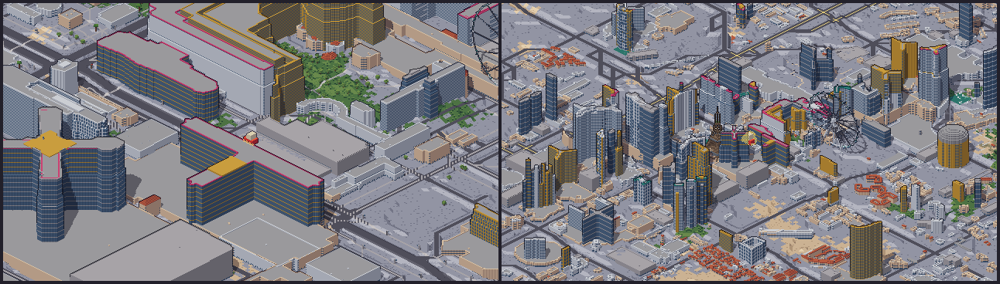

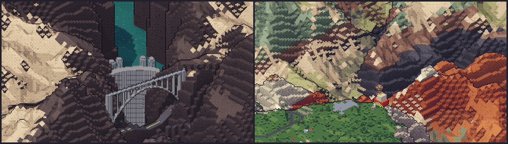

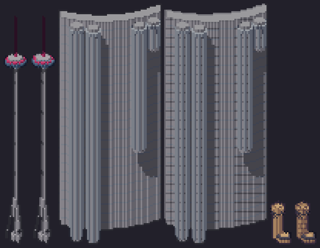

**What was built:**
- **Landmark registry (D-051):** seven landmarks in `worlds/_landmarks/`, referenced by id from every level: the Strat, the Welcome sign, the Eiffel Tower replica, the High Roller, Hoover Dam with four intake towers, the bypass bridge and the Desert View Watchtower. All of them are generic depictions, and `replaces` drops the Overture boxes they stand in for.
- **Lidar massing (D-052):** 3DEP point clouds (Entwine tiles, cached per box) give 1,199 Strip buildings measured heights. Large complexes get 25 tower parts above their podiums.
- **Building generator v2** (style guide §13):
  - roofs from Overture hints: flat, hipped, gabled, pyramidal and dome
  - setbacks, tower facade patterns, storefronts and sign bands, rooftop equipment, penthouses and spires
  - glass on the skin only and no overhangs, checked by tests over 192 generated buildings
  - new generators for a lattice tower, an observation wheel, an arch bridge, intake towers, street lights and traffic signals
- **Vegetation and props (D-054):**
  - **Client scatter:** shrubs, trees and boulders by surface, hashed per world cell and scaled per level.
  - **Walking level:** 5,109 trees from the WRI/Meta canopy height map, palms on Las Vegas Boulevard, and 2,257 street lights and signals.
- **Hero landmarks (D-053):** `tools/hero-bake.mjs` bakes the Strat, Hoover Dam and the Desert View Watchtower offline in all four rotations on every level that has them (28 bakes). Paint-overs are stamped into every tile bake, and `pixelworld heroes` re-packages them without a rebuild. The paints are the tool's demo touch-ups, standing in for an artist's.

| Exit criterion | Result |
|---|---|
| The Strip, Hoover Dam and the canyon rim are recognizable in blind screenshots | Mostly met (table below). Hoover Dam and the Strip were named in every view. Grand Canyon Village was named as the South Rim, but Desert View was not. |
| Generated buildings match the style sheet | Met. Unit tests check the style-guide rules on 192 generated buildings: footprint, overhangs, glass on the skin, style ramps, pyramids and setbacks. |
| Painted-over overrides survive a full re-bake | Met. E2e bakes every tile fresh (`cache=0`): painted pixels appear, `?paint=0` removes them, and a fresh in-browser hero bake equals the stored one. `hero-bake --check` reports all 12 driving-level bakes unchanged. A re-bake re-registers each paint to its landmark's new silhouette (unit-tested). |

**Blind screenshots.** A fresh-context agent saw nine unlabelled 640×360 views in shuffled order, two of them decoys, with no hint of the region. It was asked to name each place from the pixels alone.

| View | Its best guess | Confidence |
|---|---|---|
| Hoover Dam, driving, 2× | Hoover Dam and the bypass bridge | 90 |
| Hoover Dam, driving, 1× | Hoover Dam and Black Canyon | 90 |
| The Strip, walking | the Strip around Caesars, the Flamingo and the High Roller | 75 |
| The Strip, driving | the Strip around the High Roller and Paris | 75 |
| The Strip, flying | the Strip's landmark cluster | 50 |
| Grand Canyon Village, driving | the Grand Canyon South Rim | 45 |
| Desert View, driving, 2× | Sedona (second guess: Red Rock Canyon) | 25 |
| Decoy: forest and ridge | no famous place | 10 |
| Decoy: desert suburb | no famous place | 15 |

The evaluator noted that once it saw Las Vegas, it suspected the whole set was in the Southwest, so the rim guesses were partly helped by that.

**Known issues and next steps:**
- **Hoover Dam's proportions:** the dam reads as a "thick cylinder" rather than a wall across the canyon, because the relief cap of 4 (M2's Black Canyon issue) makes it 17 steps tall on a 3-cell crest.
  - Lake Mead meets the dam 17 steps below its crest. The lake is flat at the level of its real surface where relief isn't exaggerated, while the canyon around the dam is exaggerated up to the cap.
  - Both want a lower relief cap per feature, or a reservoir rule. *Fixed with both, below.*
- **Desert View:** the watchtower is too small to read at 150 m cells, and the blocky red strata suggested Sedona. A larger depiction or a tower-and-rim focus would help. *The tower is drawn 8× and keeps its proportions, below.*
- **Flying level:** only towers of 80 m or more and landmarks are drawn, so the Strip reads as models on an empty plain. A low-rise texture (blocks) would carry the city. *Done: city blocks (D-067), below.*
- **Paint-overs** are the tool's demo touch-ups. An artist pass on the three heroes is still to do.
- **Overture hints are sparse:** on the driving level, 83 of 5,830 buildings carry a roof shape and 10 a facade material. Most roofs and facades come from defaults by use.
- **Occlusion:** tall towers still hide streets behind them in a fixed view. This is for M4's occlusion silhouettes, together with the rotations.

#### Southwest loose ends (with M3.5)

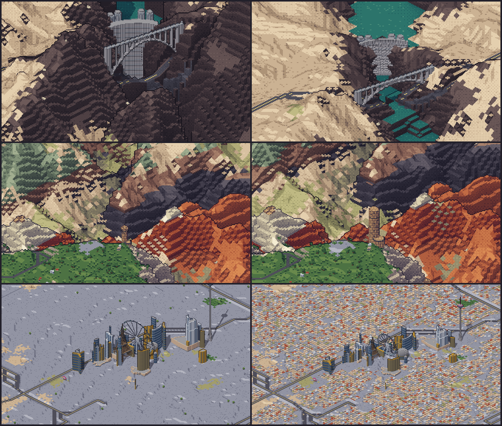

**What was fixed:**
- **The relief reference was zero (D-041).** The smoothed reference is read at 480 m, a level the 1 arc-second DEM doesn't carry; every read failed and was cached as zeros. Since M2, relief was exaggerated around sea level rather than the regional trend.
  - **Driving:** magnified places stood on domes; the canyon rim was drawn at 2.7 × 2,100 m. The height range drops from 0–102 to −10–60 steps, and the flats between focus areas no longer climb into them.
  - **Flying:** 96% of its cells sample that level, so they were flat at sea level, under micro-terrain that still had relief, with rivers cut to sea level through it. The level now has relief everywhere, and forest above 2,300 m.
  - **The fix:** a level coarser than a source's deepest overview is averaged from that overview while it is read, under a new cache key.
- **Hoover Dam:**
  - **Relief cap:** a focus area's `reliefMax` caps the relief factor over the area and its falloff ring. Hoover Dam's is 1.6, Lake Mead's own. The dam stands 4 steps above the river on a 3-cell crest (17 steps on 3 before), at true proportions at its 100 m cells.
  - **Reservoir (D-066):** the dam's `reservoir` (10 m) raises Lake Mead to just under the crest: 1 step below it, where it was 17.
  - **The wall:** the generator stands the upstream face sheer and batters the downstream face from a 120 m foot to a 2-voxel crest, so the dam reads as a thin curved wall with a fanned face. The hero bakes and demo paints were redone on both levels.
- **The Desert View Watchtower:** drawn 160 m tall (8× its real height, was 4×), and the generator widens it with its height (`radiusPerHeight`), so it reads as a stone tower on the rim, not a post.
- **City blocks on the flying level (D-067):** 2,889 built-up cells each become blocks of low buildings between streets on the voxel grid, so Las Vegas, Henderson and the smaller towns read as cities from the air. The objects file grows from 4 KB to 37 KB.
- **Tower heights when flying:** towers (3×) and landmarks (5×) are stretched 1.5× instead of the style's 2.5×, so the skyline stands in proportion to the ranges round the valley.
- **Scatter when flying:** it already worked; the client's scatter (M3) doesn't depend on the layout.
- **Tests:** pytest covers the overview fallback and its cache key, relief caps, reservoirs, the dam's line and the city-block placement. Vitest covers the battered dam, city blocks lining up across cells and the tower's proportions. The e2e hero test now frames the lower dam. The Southwest goldens change.

**Known issues and next steps:**
- **Water stairs below the dam:** the river below the bypass bridge stands 2 steps above the water on either side, where US 93 crosses the canyon floor before its deck takes over. A long lake also still takes one level, so any lake spanning different relief factors meets its shores unevenly.
- **The dam when flying** is still at real size: 0.7 cells long, a step tall.
- **The canyon at Desert View** is still mostly red Supai and Hermit strata from the default view, which suggested Sedona. Untested since: no blind test was run this round.

### M3.5: San Francisco — a city by its fabric — paused after four rounds

**Goal:** a second region recognizable by its ordinary streets, not only by its landmarks. This pulls part of M5 (a second region and style pack) forward.

**Exit criteria** (a per-image blind test: one fresh judge per image, no context hints, two or more decoys from another region):
- Every landmark view names its landmark, at 60% confidence or more.
- At least 4 of 6 landmark-free street views get San Francisco as the best guess.
- No decoy is guessed as San Francisco.

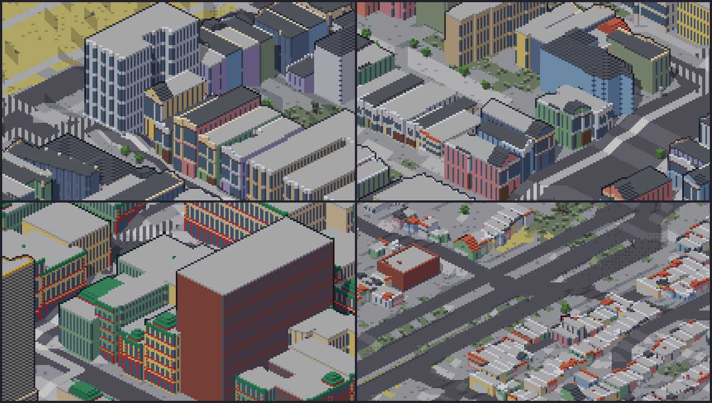

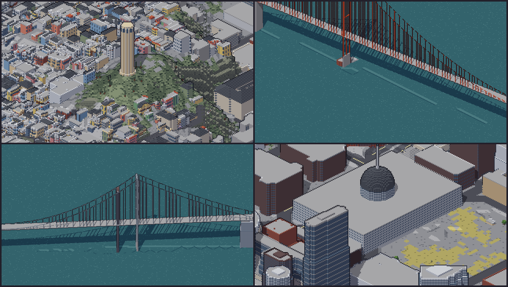

**What was built:**
- **Region:** three levels on uniform layouts.
  - **Driving:** the whole city at 25 m.
  - **Walking:** the northeast at 10 m.
  - **Flying:** the Bay at 100 m.
- **Style pack:** `bay-area`, with 42 ramps: marine light, ten house paints, slate, tile and tar roofs, granite, terracotta, brick, Chinatown red and jade, and orange and grey bridges. The web app now loads the pack a world names.
- **Building typologies (D-055):**
  - **Features:** from geometry and the street: width, depth, shared walls, the front's direction, corner lots, over water.
  - **Facts:** from DataSF's assessor roll and parcels (year built, storeys, use, neighbourhood). 160,796 of 168,883 buildings matched to a lot.
  - **Rules:** in the spec. The driving level has 82,002 stucco rows, 26,961 Edwardian rows, 17,632 Victorian rows, 19,979 houses, 8,542 apartment blocks, 5,150 historic commercial blocks, 2,884 warehouses, 924 Chinatown buildings, 123 pier sheds and 52 1920s towers.
- **Street-facing generators:** `rowhouse` and `block`. They draw bays, false fronts with cornices, painted-lady trim, garages, Queen Anne gables, tile eaves, balconies, pagoda roofs, bulkheads and sawtooth roofs, checked against the style guide on 810 generated models.
- **Landmarks (D-051, D-056):** registry entries and generic generators for the Golden Gate Bridge, the Bay Bridge's west span, the Transamerica Pyramid, Coit Tower, the Ferry Building, City Hall and Sutro Tower.
  - **Long landmarks:** owned per voxel column and cut into pieces that share their line. This cut a Bay Bridge view from 215 s to 22 s of software baking.
  - **Bridges:** each lies on the road it carries, with water under the deck.

**Blind evaluation.** A fresh-context agent saw eleven unlabelled views in shuffled order, two of them decoys from the Southwest, with no hint of the region. It was then asked which guesses had leaned on other views.

| View | Its best guess | Confidence | Leaned on other views |
|---|---|---|---|
| Coit Tower, driving | Coit Tower, San Francisco | 70 | no |
| Golden Gate Bridge, driving | the Golden Gate Bridge | 65 | slightly |
| Bay Bridge, driving | the Bay Bridge west span | 35 | strongly |
| Outer Sunset, driving | San Francisco, the Sunset | 30 | partly |
| Richmond, driving | San Francisco, the Mission | 20 | yes |
| Victorians, walking | San Francisco, SoMa | 15 | yes |
| Mission, walking | San Francisco, Hayes Valley | 10 | yes |
| Chinatown, walking | an older downtown (San Francisco) | 10 | yes |
| Financial District, driving | downtown Los Angeles (San Francisco second) | 30 | no |
| Decoy: the Strip | Las Vegas | 10 | no |
| Decoy: the canyon rim | the Grand Canyon | 35 | no |

- **Landmarks:** they now carry the city on their own. An earlier round, before them, put the Victorian rows in Dublin and Chinatown in Berlin; a second pass on the facades followed it.
- **Fabric:** it reads as San Francisco only once a landmark has suggested the city. In the evaluator's words, "colours, roofs and window textures look the same everywhere", and ordinary street views carry no city signal of their own.

#### Second round: three agents in parallel

The first round's known issues went to three agents, each in its own git worktree, then were merged and the city rebuilt once:
- **Street fabric:**
  - **Roofs:** light (tar and gravel, white, warm gravel), with slate only on Queen Anne gables.
  - **Paint:** schemes per typology and era, with trim and accent tied to the body (style guide §15).
  - **New house forms:** a mid-century form, and houses that take the row form of their era.
  - **Detail:** window hoods, paired windows, corner stores and roof decks at walking scale.
  - **Trees:** 62,296 canopy trees on the driving level.
  - **Typing:** houses with no assessor record (mostly in Daly City) are now typed too.
- **Landmarks:**
  - **Golden Gate:** portal towers with stepped struts and grooved legs, and an orange truss.
  - **Bay Bridge:** X-braced towers and a double deck, and Overture's tower boxes are now replaced.
  - **Transamerica Pyramid:** a solid spire, with its wings moved to the east and west faces.
  - **Ferry Building:** a fuller clock tower.
  - **New:** Salesforce Tower (`obeliskTower`) and the Palace of Fine Arts (`rotunda`).
- **Pipeline:**
  - **Bridges:** water under decks is flat in the micro-terrain too.
  - **Edge roads:** ways grazing the world's edge stay in one piece (D-058), so the walking level's road report is clean.
  - **Objects file:** version 2 with relative footprints (D-057).

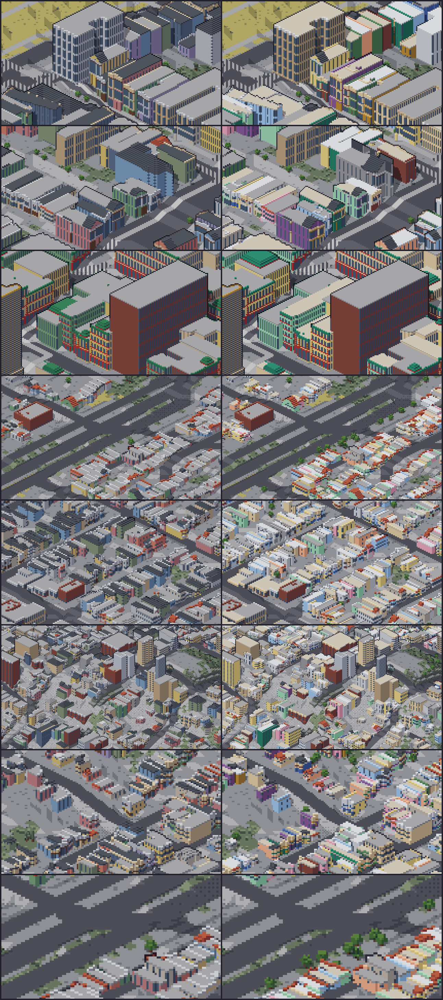

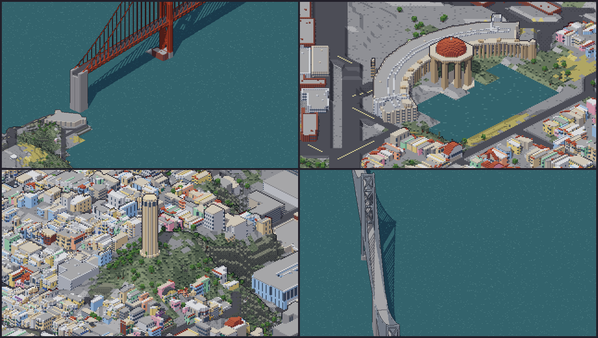

**Blind evaluation, second round.** This time each image had its own judge, who saw only that image, so no guess could lean on another view. Each judge also reported any place hint in its context; none found one. An earlier per-image run on the first round's images may have been nudged: one of its judges found the user's request, which mentions San Francisco data, in its context. Its numbers, the "before" column, are an upper bound.

| View | Best guess | Confidence | Before (first round, per image) |
|---|---|---|---|
| Golden Gate Bridge, driving | the south end of the Golden Gate Bridge | 90 | 70 |
| Palace of Fine Arts, driving | the Palace of Fine Arts | 85 | — (new) |
| Coit Tower, driving | Coit Tower | 72 | 80 |
| Bay Bridge, driving (along its axis) | the Bay Bridge west span | 35 | 40 (side-on) |
| Mission, walking | San Francisco, Victorian rows | 45 | 35 |
| Victorians, walking | San Francisco (Nob Hill or Western Addition) | 22 | 30 |
| Financial District, driving | downtown Los Angeles | 30 | 30 |
| Outer Sunset, driving | a Latin American city's outskirts | 15 | San Francisco, 35 |
| Richmond, driving | Havana | 15 | San Francisco, 40 |
| Russian Hill, driving | no famous place (Latin American) | 12 | — |
| Chinatown, walking | no famous place (European) | 12 | 15 |
| Decoy: the Strip, walking | Las Vegas | 22 | 12 |
| Decoy: the canyon rim, driving | no famous place | 10 | 10 |

- **Landmarks:** they now carry the city clearly on their own. The Golden Gate rose to 90, and the Palace of Fine Arts is read at 85 on first sight.
- **Fabric:** it's still the open problem.
  - The Victorian rows of the Mission and Western Addition read as San Francisco on their own (45 and 22).
  - The Sunset and Richmond stucco rows now read as Latin American. Judges called out the pastel stucco with red tile accents and the absence of hills, fog or the ocean.
  - The Financial District still reads as Los Angeles: Salesforce Tower and the Transamerica Pyramid aren't in that frame.

**Known issues after the second round** (taken up in the third):
- **The avenues:**
  - Fewer red tile copings and more bay windows on stucco rows (the "junior five" picture window over the garage).
  - The ocean, Golden Gate Park and Sutro Tower on the horizon; the driving level's views are too tight to show them.
  - Fog.
- **Hills:**
  - Russian Hill and Nob Hill don't read as steep at street level: 1.0× exaggeration at 10 m cells, terraced micro-terrain.
  - Steep pavements draw as striped terraces.
- **Street life:** cable-car and Muni lines, and street trees on sidewalks. Placement keeps road cells clear, so canopy trees land in parks and backyards rather than along streets.
- **Downtown views:** frames that include Salesforce Tower and the Transamerica Pyramid; the evaluation's Financial District frame shows neither.
- **Bay Bridge from its axis:** at that angle the bracing is seen edge-on, so the towers read as single poles.
- **Parks:** canopy trees replace the client's cypress and eucalyptus scatter where they stand, so Golden Gate Park mixes in lawn-green trees.
- **Heroes:** none of the San Francisco landmarks are heroes (D-053) yet.

#### Third round: the avenues, the hills, downtown, and traffic

Three more agents in worktrees, merged with the traffic thread (D-060) and rebuilt once:
- **The avenues:**
  - **Stucco fronts:** the "junior five" rows of the Sunset and Richmond: an entry stair in a recess beside a white garage door, a box, canted or curved bay over it, parapets by seed, and fewer red tile copings.
  - **Sidewalk trees:** 19,332 along the avenues, from the canopy map.
  - **Parks:** cypress and eucalyptus on tree-covered land.
- **The hills:**
  - **Rails in the street (D-061):** cable-car tracks with their slot on Powell, Mason, Hyde and California Streets; streetcar and light-rail tracks.
  - **Pavement on slopes:** lit by its way's grade, so steep streets read as one slope, not stripes.
  - **Walking level:** hills at 2×, and Lombard Street's block kept from snapping (`snap.roads.keep`).
- **Downtown and the coast:**
  - **Towers by era** (`towers.ts`): deco piers and crowns, white and granite slabs, postmodern stone tops, pale glass. Buildings in parts now take their building's year, so 409 towers are typed.
  - **New landmarks:** the Dutch and Murphy windmills, and Alcatraz's cellhouse and lighthouse.
- **Traffic (D-060), as an optional layer:** cars, buses, cable cars, streetcars, light rail, trains and ferries.

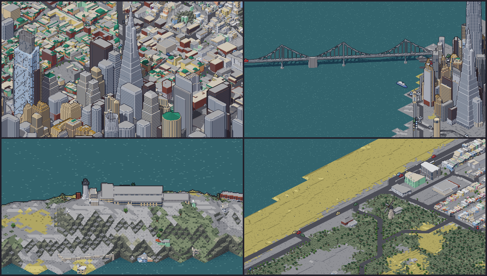

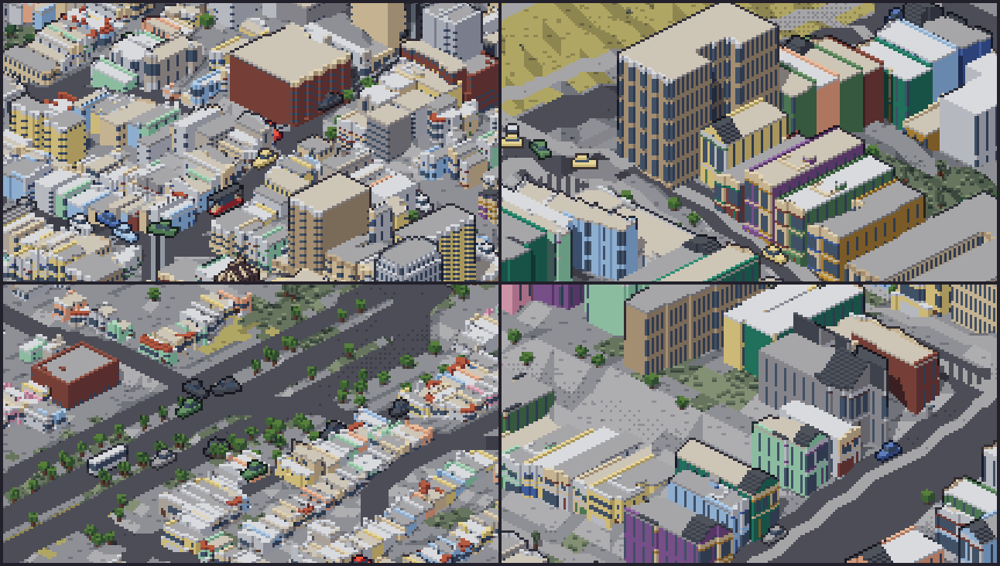

**Blind evaluation, third round.** As in the second round: one fresh judge per image, no context hint found by any judge, 16 views in shuffled order, three of them decoys (a new one: a Las Vegas block of warehouses and tile-roofed houses). Traffic was on, at a fixed time. Two landmark frames cut their landmark short, so they were reframed and judged again by fresh judges; both results are listed.

| View | Best guess | Confidence | Second round |
|---|---|---|---|
| Golden Gate Bridge, driving | the Golden Gate Bridge, south end | 88 | 90 |
| Palace of Fine Arts, driving | the Palace of Fine Arts | 80 | 85 |
| Coit Tower, driving | Coit Tower, Telegraph Hill | 78 | 72 |
| Downtown, driving | San Francisco, the Transamerica Pyramid | 72 | Los Angeles, 30 |
| Alcatraz, driving | Alcatraz | 72 | — (new) |
| Dutch Windmill, driving, by Ocean Beach (reframed) | Golden Gate Park's windmill, Ocean Beach | 78 | — (new) |
| Dutch Windmill, driving, in the park | Golden Gate Park's windmill | 20 | — |
| Bay Bridge, flying, whole span with the skyline (reframed) | the Bay Bridge west span | 55 | 35 |
| Bay Bridge, flying, its middle two towers | the Bay Bridge west span | 25 | — |
| Mission, walking | San Francisco, Victorian rows | 30 | 45 |
| Victorians, walking (hills at 2×) | Valparaíso (San Francisco second) | 12 | San Francisco, 22 |
| Outer Sunset, driving | a Gulf city | 15 | Latin America, 15 |
| Richmond, driving | Havana | 12 | Havana, 15 |
| Russian Hill, driving, with a cable car | Tokyo | 12 | no famous place, 12 |
| Chinatown, walking | northern Europe | 12 | Europe, 12 |
| Decoy: the canyon rim | the Grand Canyon | 38 | no famous place |
| Decoy: the Strip | Las Vegas | 12 | Las Vegas |
| Decoy: Las Vegas warehouses (new) | no famous place (an industrial estate) | 12 | — |

**Against the exit criteria:**
- **Landmarks:** every landmark is named, and 6 of 7 reach 60% in frames that show the whole landmark. The Bay Bridge stops at 55: the judge read its towers as a generic lattice.
- **Streets:** 1 of 6 street views is guessed as San Francisco (the Mission). Not met.
- **Decoys:** none is guessed as San Francisco.

**What the judges say about the streets:**
- **Colour and form:** "pastel colours look procedurally assigned"; flat roofs and one window grid everywhere. At 25 m cells the bays and garages of the rows are too small to read, so the Sunset reads as a Gulf city and the Richmond as Havana.
- **Ground:** dusty grey between the houses, very little green, and trees that read as palms. The avenues read as arid.
- **Parks at 2×:** Alamo Square reads as "bare, eroded ochre hillside with gullies": micro-terrain noise exaggerated twice, in a dry grass colour.

**Known issues after the third round** (taken up in the fourth):
- **The avenues from the driving level:** green block interiors (backyards) and front gardens instead of grey lots; the rows' rhythm at the roof line, and white garage doors that read at 25 m; rounder street trees.
- **Parks:** greener lawn in the city's parks; smooth micro-terrain on lawns, so the 2× walking level doesn't carve them into gullies.
- **The Bay Bridge:** X-braced towers that read from the air.
- **Fog and the horizon:** the ocean and the hills in street views; fog over the avenues.
- **Traffic scale:** a car is drawn at least 0.55 cells long, so on the flying level it is 55 m long and dwarfs the bridges.
- **The walking level has no sidewalk trees:** its `streetTrees` list holds only lights and signals.
- **Lombard's hairpins** don't read at 10 m cells; a depiction that widens the bends and paints the block brick red may.
- **Curving rails** (the Embarcadero) draw as steps. *Fixed:* tracks cut corners and a street's tracks join.
- **Heroes:** none of the San Francisco landmarks are heroes (D-053) yet.

#### Fourth round: ground, fronts, fog, landmarks

Four agents in worktrees, on the third round's list, merged and rebuilt once:
- **Ground (D-062):**
  - **Lawns:** parks, golf courses, pitches, gardens and cemeteries from Overture's land use become lawn: 25,121 cells driving, 22,175 walking. Steep parks and natural grassland stay golden.
  - **Smoothing:** lawns are smoothed in the micro-terrain, so the walking level's 2× hills no longer carve Alamo Square into gullies.
  - **Yards:** open cells beside houses become green yards (43,558 driving, 92,652 walking).
  - **Other:** street trees are round crowns, beaches are sand, and the walking level gets 9,181 sidewalk trees.
- **Fronts:**
  - **Paint by place:** stucco rows are about four in five white, cream, beige or grey. Victorian and Edwardian paint follows the neighbourhood.
  - **Rows:** they step house by house, and the stucco bay rises to the roof under a white cap.
  - **Chinatown:** balconies, vertical signs, a jade eave round every wall, pagoda corners and roof pavilions, 114 lantern strings over Grant Avenue and Stockton Street, and the Dragon Gate.
- **Fog (D-063):** a dithered marine layer over the Pacific, the Golden Gate and the outer avenues, drawn by a compositor pass. Towers and hills rise out of it. It's an optional layer like traffic (`fog=0/1`, G).
- **Landmarks and scale:**
  - **Bay Bridge (D-056):** the towers' X-bracing reads side-on, and the cables sag.
  - **Vehicles:** the flying level caps how much they are enlarged (`vehicleScale`), so a car is 18 m, not 55 m.
  - **Lombard Street:** its crooked block swings wider, in brick, between garden beds.
  - **Driving-level hills:** kept at 1.5× after comparing 2×.

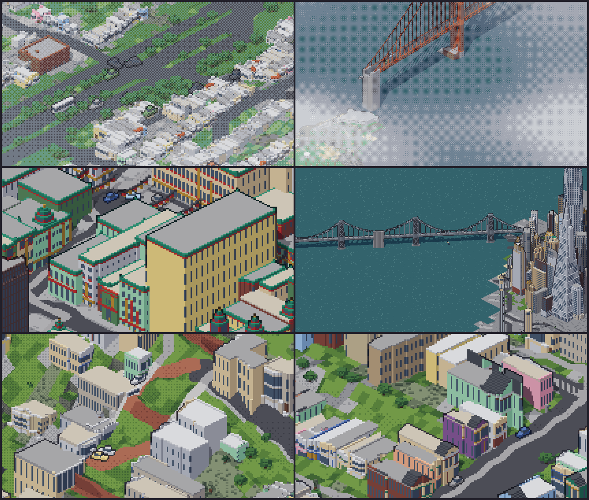

**Blind evaluation, fourth round.** As before: one fresh judge per image, no context hint found, 17 views shuffled, three decoys. Traffic and fog were on, as a visitor sees them, at a fixed time. Landmark frames show the whole landmark (the third round's reframed views), and the Dragon Gate is new.

| View | Best guess | Confidence | Third round |
|---|---|---|---|
| Golden Gate Bridge, driving, in fog | the Golden Gate Bridge, south end | 88 | 88 |
| Palace of Fine Arts, driving | the Palace of Fine Arts | 85 | 80 |
| Alcatraz, driving | Alcatraz | 72 | 72 |
| Dutch Windmill by Ocean Beach, driving, in fog | Golden Gate Park's windmill, Ocean Beach | 72 | 78 |
| Coit Tower, driving | Coit Tower | 70 | 78 |
| Downtown, driving | the Transamerica Pyramid | 68 | 72 |
| Bay Bridge, flying, with the skyline | the Bay Bridge west span | 68 | 55 |
| Dragon Gate, walking (new) | San Francisco's Chinatown, the Dragon Gate | 50 | — |
| Mission, walking | San Francisco, Victorian rows | 40 | 30 |
| Outer Sunset, driving | San Francisco, the Outer Sunset | 30 | a Gulf city, 15 |
| Chinatown, walking | Lhasa (a Chinese city) | 22 | northern Europe, 12 |
| Russian Hill, driving | Seoul | 20 | Tokyo, 12 |
| Victorians, walking | Valparaíso | 15 | Valparaíso, 12 |
| Richmond, driving, in fog | Tel Aviv | 10 | Havana, 12 |
| Decoys: the canyon rim, the Strip, Las Vegas warehouses | no famous place (all three) | 10–15 | — |

**Against the exit criteria:**
- **Landmarks:** all eight are named, and the seven from earlier rounds all reach 60%. The Bay Bridge rose from 55 to 68. The Dragon Gate, new this round, stops at 50: it is small among the towers at Grant and Bush.
- **Streets:** 2 of 6 are guessed as San Francisco (the Sunset, newly, and the Mission). Not met.
- **Decoys:** none is guessed as San Francisco.

**What the judges say now:**
- **The Sunset** reads as San Francisco from its white stucco rows and the planted median.
- **Chinatown** now reads as Chinese, but as a city in China: the red and jade trim repeats on every building, and nothing ties it to an American city (bay windows, fire escapes, the hills).
- **The Richmond in fog** reads as a white Mediterranean city: the veil drains its colours toward white.
- **Russian Hill** is "generic boxes" with no hills that show from the driving level.
- **The Victorians** read as Valparaíso: colourful flat-roofed rows below a green hill. The real painted ladies on Alamo Square have tall Queen Anne gables, which were removed in the first round because pitched slate read as Dublin.

**Known issues and next steps:**
- **Hills from the driving level:** Russian Hill and Nob Hill need to read as steep there; 2× vertical alone didn't help, since buildings hide the slope.
- **Chinatown in an American city:** bay windows and fire escapes on its fronts, less uniform trim, and views that include the hill and the Transamerica Pyramid.
- **Postcard Row:** the painted ladies' Queen Anne gables, against the downtown skyline from Alamo Square.
- **Fog over the inner avenues:** lighter, with more gaps, so the rows keep their colour.
- **The Dragon Gate:** larger, or seen down Grant Avenue.
- **Data:**
  - A 7-storey "building" in the middle of Alamo Square is a 45 m², 22 m Overture footprint, likely a tree, matched to the park's parcel. *Fixed:* `objects.buildings.implausible` drops tiny, tall, unclassed footprints in parks (D-062).
  - Sloped lawns still band in their micro-terrain steps. *Fixed:* lawns are lit by their smoothed slope (`light: "slope"`).
- **Carried over:**
  - Lombard's bends read only from some rotations.
  - Curving rails draw as steps (since fixed).
  - None of the San Francisco landmarks are heroes yet.

### M4: Drive, fly, build

**Goal:** make the world playable, through a public engine API that other games and interaction modes can use: pixelworld becomes a library and an asset generation tool ([library.md](library.md)). The engine comes first; M4's flying and driving game is an example client built only on its public API.

- Car on the road network and terrain slopes, with grid collision.
- Plane with an arcade flight model, drop shadow and canyon collision, on the flying level (M2.5), with take-off and landing moving between levels.
- Occlusion silhouettes.
- Speeds tuned to the compressed layout.
- **The example game (D-070), done:** `apps/game` (`@pixelworlds/game`), built only on the engine's public API ([library.md](library.md) §7.10).
  - **Car:** arcade physics on the drawn roads and terrain: top speeds by road class (motorway 11 cells/s on the Southwest driving level) and surface off-road, nothing on water, slopes slowing climbs, cliffs; bridge decks from the routes; collisions with buildings (`query.objectsAt`) and traffic (`vehiclesNear`); a road assist; a chase camera with a look-ahead; the style's player car with a silhouette.
  - **Plane:** an arcade flight model on the flying level (throttle, pitch, bank), a dithered drop shadow on the ground below, terrain, canyon and tower collisions with a reset; `vehicle.plane` in both style packs.
  - **Between levels:** a take-off (fast on a long straight road, T) and a landing (low and slow over a road) load the other level at the same lon/lat in a view that replaces the old one on the same canvas without a flash (`createWorldView({ replace })`); no page reload.
  - **Pace:** speeds in cells per second, scaled per level by its metres per cell. The scripted run, Las Vegas Boulevard → Hoover Dam → the South Rim, takes 3 min 31 s of play for 1,317 cells; the canyon flight 48 s, landing on I-40 at Williams.
  - **HUD:** speed, level, nearest landmark or town, minimap, key help. Starts on Las Vegas Boulevard and the Embarcadero; `?world=`, `?start=lon,lat`, `?run=1`.
  - **Tests:** unit tests for the physics, roads, decks, route planner, pilots and controllers; `e2e/game.spec.ts` scripts the Strip, a building, take-off, flight over the shadow and landing.
  - **Frames:** under SwiftShader at 1280×720 with traffic, the real-time run's frames have a median and 95th percentile of 16.7 and 16.8 ms; 2.6% take over 20 ms, while tiles bake in software and at the two level changes.
  - **Left:** the car doesn't join traffic's routes or obey junctions, and traffic doesn't yield to it; no runways; the 60 fps check on a desktop GPU (`?run=1` reports its frame times).
- Grid building mode (place and remove) with local re-bake.
- Palette LUT variants (day/night) and water palette cycling.
- **Ambient traffic (D-060), done:**
  - **Routes:** `pixelworld routes` exports routes from each built package: the drawn roads, bridge decks at their height, rail matched onto the streets (San Francisco's cable cars and F line) or laid on their own, and ferry lines. All six San Francisco and Southwest levels have them.
  - **Simulation:** `packages/sim` runs cars, buses, cable cars, streetcars, light rail, trains and ferries deterministically around the view, at speeds compressed per level, and serializes its state.
  - **Drawing:** procedural voxel models from the style pack (D-064): car body types, buses, cable cars, streetcars, light rail, trains with mixed wagons, ferries. They are baked per heading and depth-tested by the compositor; the e2e suite checks movement, a car on the Golden Gate's deck and a fixed-time golden.
  - **Left for the drivable car:** a vehicle controller on the same routes (lane changes, turning at junctions under player control), leaving a route for free driving on the road bits and slopes, collisions with traffic, and traffic lights or yielding at junctions. Rails are drawn in the street (D-061).

**Exit criteria:**
- A complete Vegas → Hoover Dam → Grand Canyon run by car, then a canyon flight, at 60 fps on desktop.
- A placed building appears immediately and persists.

### M5: Scale out

**Goal:** prove the system generalizes beyond one region.

- Zoom-level (semantic LOD) bakes: blocks → city silhouettes → landmark icons.
- More regions from coverage tier 1, in order (D-078): New York, then Paris, then Amsterdam. CityJSON/CityGML ingestion comes with Amsterdam (3D BAG).
  - **New York, walking level: built** (`nyc-walk`, Lower Manhattan at 10 m). Its buildings are typed from NYC Open Data (D-080) and drawn by the `new-york` pack and the `city-nyc` generators (D-081). In the game, the player sees through the towers in front of it (D-079). Still to come: the driving and flying levels, the blind test, heights from the city's footprints, and stacked setback tiers.
  - **New York, Manhattan: built** (D-083). A driving level for the whole island at 25 m (`nyc`, the Battery to Inwood, with the waterfronts across both rivers), and the walking level extended through Midtown to 86th Street; the two switch between each other. Setback towers keep their stacked tiers, and Midtown's landmarks and the Williamsburg, Queensboro and George Washington Bridges joined the registry. Still to come: the walking level north of 86th Street, the flying level, the blind test, and heights from the city's footprints.
  - **Paris, walking level: built** (`paris-walk`, from the Eiffel Tower to the Marais at 10 m). Its sources were checked directly (second-region.md §8); its buildings are typed from APUR's periods and fabric classes and IGN's BD TOPO, with heights from APUR where Overture has none, on IGN's RGE ALTI terrain (D-084), and drawn by the `paris` pack and the `city-paris` generators: Haussmann blocks, faubourg houses, HBM blocks, a cathedral and a triumphal arch (D-085, D-086). Still to come: the driving and flying levels, the blind test, pans coupés and courtyards, street trees from the city's records.
  - **Kyoto, walking level: built** (`kyoto-walk`, from Nakagyō's machiya streets across the Kamo to Gion, Higashiyama and Kiyomizu-dera, and south to Kyoto Tower, at 10 m). Its buildings are typed from PLATEAU's building models (structure, year, storeys, usage code, LoD2 roof) and Overture's building class, on GSI's elevation tiles (D-089), and drawn by the `kyoto` pack and the `city-kyoto` generators: machiya with lattice fronts and pent roofs, wooden houses, mid-rises, temple and shrine halls under hip-and-gable roofs, and the landmarks Kiyomizu-dera's hall on its stage, two pagodas, two gates and Kyoto Tower (D-090, D-091). Its driving level (`kyoto`, the city centre at 25 m) and flying level (`kyoto-fly`, the basin at 100 m) followed, with PLATEAU's roofs drawn, halls typed by their grounds and names, kura, torii, poles and lanterns, and a blind test in which every view read as Kyoto (D-100, D-101). Then Kyoto's mid-rises, rows split into houses, wires on the poles, Kinkaku-ji and the palaces of Nijō and the Imperial Palace (D-102). Ponds and moats from Overture's water areas, the palace's courts left paved and wires along diagonal streets followed (D-103). Then walls from OSM's retaining walls (Nijō's ishigaki), the palace's corridors and wires on the 2:1 streets (D-104). Then its wires strung pole to pole in one-pixel lines at any angle, Tokyo's wire spans, with one pole group (D-106).
  - **Tokyo, walking level: built** (`tokyo-walk`, Shibuya to Shinjuku at 10 m). Its buildings are typed from PLATEAU's models (D-089), which in Tokyo carry use, storeys and height but no year: by use, storeys, footprint size and neighbourhood boxes (a new typology rule field, `bounds`), on GSI's elevation tiles, and drawn by the `tokyo` pack and the `city-tokyo` generators: zakkyo under stacked signs that glow at night, mansions with their balconies, detached houses, utility poles, and four landmarks (D-092, D-093). Still to come: the driving and flying levels, the blind test, Tokyo's fire-resistance codes as facts, and wires that follow streets at any angle.
  - **Hong Kong, Kowloon's walking level: built on open data alone** (`hongkong-walk`, Tsim Sha Tsui to Prince Edward at 10 m). Hong Kong's own building and terrain data can't be adapted under its terms, so it is the global path's first city (D-107): Copernicus GLO-30 with its buildings filtered off, OSM's floors, and each neighbourhood's typical height from the spec, drawn by the `hongkong` pack and the `city-hongkong` generators: tong lau, composite buildings, pencil towers and neon signs hung across the streets (D-108, D-109). What open data loses there was measured against the Lands Department's data (docs/cities.md). Still to come: the Mid-Levels' streets and stairs, the driving and flying levels, and the Lands Department's data if it grants its use.
  - **Hong Kong Island's walking level: the whole island on open data** (`hongkong-island`, Kennedy Town to Shek O at 10 m, D-115, D-117): Central's and Wan Chai's towers (Two IFC, the Bank of China Tower and Central Plaza, generic), the Convention Centre, Sheung Wan's tong lau, the trams and the Peak Tram, the Peak's villas and the south side's village houses, the country parks' woods drawn by the client's scatter. Road tunnels aren't drawn, and GLO-30's ground filter runs only in town, so the hills keep their height (D-115).
  - **Hong Kong's details and its harbour** (D-132, D-133): the hills interpolated from GLO-30 rather than terraced; the trams and buses as double-deckers; sampans, fishing boats and junks in the typhoon shelters and on the harbour; the open ridges as scrub; grey shotcrete cut slopes; neon in Sheung Wan, North Point and Shau Kei Wan; Hopewell Centre; and a driving level (`hongkong`) with both shores of Victoria Harbour. Still to come: towers on podiums, the escalator, the Mid-Levels' ground, a flying level.
  - **Hong Kong's markets, temples, estates, night and cloud** (D-134): market stalls under tarpaulins and bulbs on the Ladies' Market, Temple Street and the island's market streets; Man Mo and the Tin Hau temples; public-housing estates in their colours, found by the estate's name on its land; vertical signs and rooftop billboards; the landmark towers lit white at night; mist on the island's ridge.
- A second style pack.
- CDN hosting with archive range requests.
- Performance budgets met on mid-range phones.

**Exit criteria:**
- The second region is built with no code changes beyond new ingest adapters and its style pack.
- Mobile hits its budgets.

### Later (exploratory)

- Full 3D mode: a live chase camera on the same scene, materials and palette.
- WebGPU backend.
- Multiplayer: keep the simulation deterministic and its state serializable from M4 onward so this stays possible.
- Linking regions and traveling between them.
- Seasons.
- Imagery segmentation to fill feature gaps.
- Roof fitting from lidar.

**Order of work** (decided after M1): M1.5 experiment → M1.6 micro-terrain → M2 elastic map → M3 detail pass → M4 → M5. M1.5 through M3 are done (with M2.5–M2.7 in between). M3.5 (San Francisco) is paused after four rounds: its landmarks pass the blind test, and 2 of its 6 ordinary street views do. M4's ambient traffic is done, and so are the library steps: the engine API (D-069), the example game (D-070), city packs as plugins (D-071, D-074) and the npm package. A developer-experience review then had four newcomers each build something with pixelworld; the fix pass after it covers the tile cache keyed by code and contained model failures (D-072), view lifecycle and game API (D-073), style pack validation (D-075), pipeline spec checks and a world-building guide ([worlds.md](worlds.md), D-076), and contributor tooling ([CONTRIBUTING.md](../CONTRIBUTING.md), D-077). Next: the rest of M4 (grid building mode, water palette cycling, the 60 fps check on a desktop GPU), then M5.

## 3. Technology tracks

| Track | M0–M1 | M2–M3 | M4–M5 | Later |
|---|---|---|---|---|
| **Grid and world format** | projection, rotations, cell model; format v0 + codecs | instances, landmark stamps, overrides in the format | player-edit delta layer; LOD levels in the manifest | region linking |
| **Rendering and bake** | client bake (WebGL2 worker), palette composite, cleanup, compositor | building/landmark bakes, offline bake CLI, paint-over pipeline | palette LUT variants, palette cycling, semantic LOD bakes | WebGPU; full 3D mode |
| **Geo pipeline and semantics** | fetch → export at uniform scale; DEM, OSM, NLCD/WorldCover, NHD | importance stage; 3DEP lidar heights; canopy | CityJSON/CityGML adapters (tier 1); second region | imagery segmentation; lidar roof fitting |
| **Elastic map** | none (uniform) | v1 separable → v2 mesh solve, pins, fold check, caricature | tuning for multi-focus regions | automatic pin suggestions |
| **Content generation** | terrain + strata materials | buildings, roads, vegetation, landmark DSL / `.vox`, style pack #1 | style pack #2, LOD representations | landmark DSL drafts with LLM assistance |
| **Editor and tooling** | — (spec files by hand) | editor v0: scale brush, pins, preview; local pipeline server | override editing, landmark placement, depiction variant switch | collaborative editing |
| **Gameplay and simulation** | placeholder sprite with depth | — | vehicles, flight, grid building | multiplayer; full 3D physics (Rapier) |
| **Platform** | monorepo, CI, golden-image tests, persistent cache | reproducibility checks, package hashing | CDN hosting, range-request archive, mobile performance | — |

## 4. Risks

| Risk | Mitigation |
|---|---|
| Procedural bakes don't look hand-made | M0 is dedicated to the look; style reference sheet; cleanup passes; paint-over for hero assets |
| Client baking too slow on phones | Measure in M0; prioritize visible tiles; smaller bake tiles; serve pre-baked tiles from the CDN for busy areas (estimated and deferred: about 2.6 GB for eight levels in four rotations, [architecture.md](architecture.md) §8.1) |
| GPU rasterization differs across devices | Compare palette indices with tolerance in tests; hero assets are baked offline only |
| Warp distorts or folds | Shape-preserving solver, fold check, editor pins; v1 separable as a fallback |
| Thin data outside the US / Europe / Japan | Prefer tier 1–2 regions first; procedural fallbacks for every layer |
| Licensing or depiction problems | Rules in [data-sources.md](data-sources.md), attribution manifest, depiction variants, generic signage, legal review before commercial launch |
| Scope creep | Curated regions only; milestone exit criteria |

## 5. Open questions

The current defaults are in parentheses.

1. **Multiplayer:** single-player through M5, but keep the simulation deterministic so it stays possible.
2. **Hand-authoring budget:** about 10–20 hero landmarks per region.
3. **Second region: decided (D-078).** All three top candidates from [second-region.md](second-region.md), in order: New York (PLUTO, footprints, LPC), Paris (APUR, BD TOPO), Amsterdam (3D BAG, BAG, AHN). New York's sources are checked in second-region.md §7.
4. **Target devices:** desktop and modern mobile browsers; WebGL2 required.
5. **Commercial intent: fully open source** (decided). Code, style packs and world packages are published under open licences ([library.md](library.md) §3.6); world packages stay ODbL as derived databases.
6. **Grid building:** core gameplay loop or sandbox tool?
