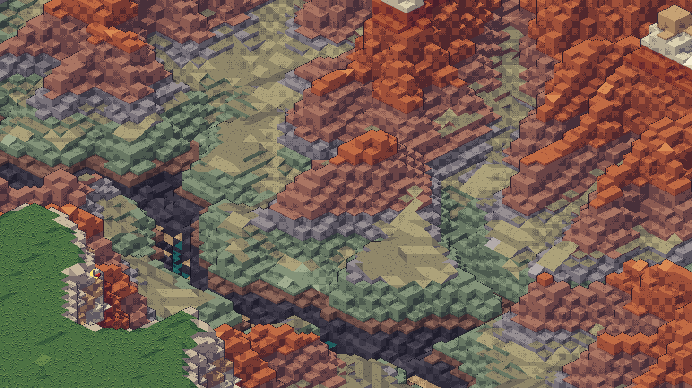
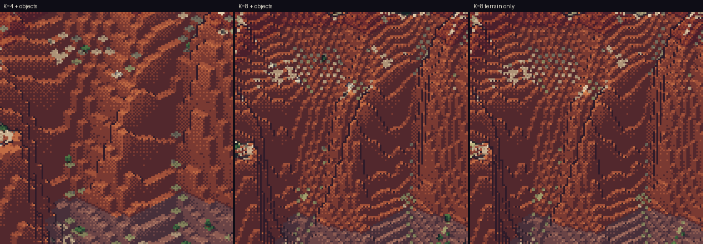
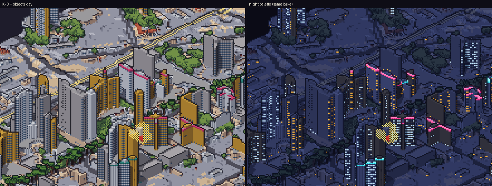
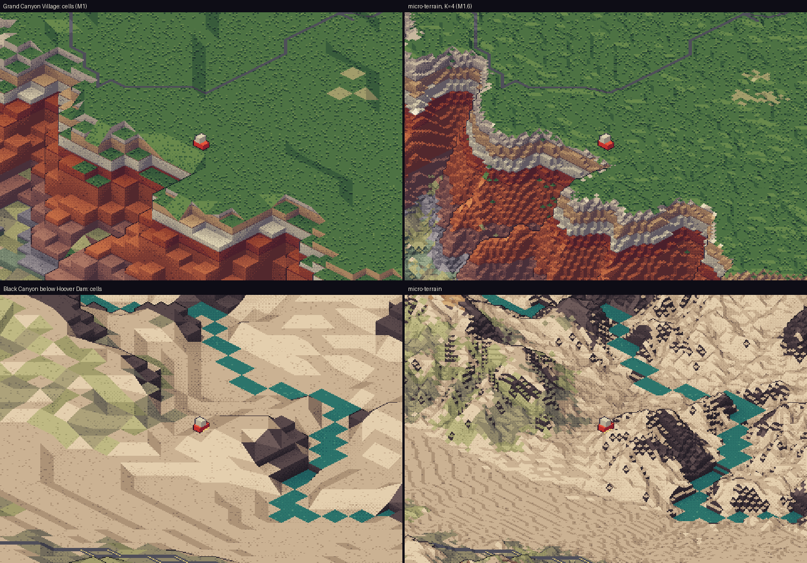
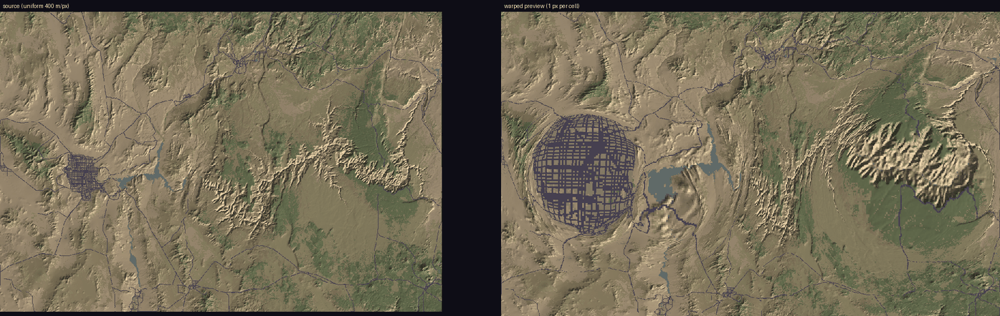

# Roadmap

Status: living document. Milestones are ordered and each has exit criteria. The technology tracks show how each part of the stack grows across milestones. Architecture details are in [architecture.md](architecture.md).

## 1. Technology choices

| Area | Choice | Notes |
|---|---|---|
| Client language | TypeScript (strict) | Shared by player app, editor and offline baker. |
| Monorepo / build | pnpm workspaces + Vite | |
| Bake renderer | Raw WebGL2 with the integer projection in the vertex shader (D-019) | WebGL2 is the baseline because it runs headless in CI via SwiftShader. Three.js is reserved for the later live 3D mode. |
| Runtime compositor | Small custom WebGL2 renderer | Draws indexed + depth quads, applies the palette LUT, upscales by integer factors. |
| Background baking | Web workers with OffscreenCanvas + WebGL2 | |
| Client cache | Memory, plus IndexedDB / OPFS | Keyed by chunk hash + rotation + style version. |
| Gameplay physics | Custom grid-aware kinematics | Rapier gets evaluated if and when full 3D mode needs it. |
| Geo pipeline | Python 3.12+, managed with uv | numpy, rasterio/GDAL, pyproj, shapely 2, geopandas, pyosmium, DuckDB (spatial) for Overture GeoParquet, PDAL/laspy for lidar, cjio/lxml for CityJSON/CityGML, scipy.sparse for the warp solver. |
| Editor ↔ pipeline | Local FastAPI server | Wraps pipeline stages for interactive re-solve and re-export. |
| Offline baking | Playwright + headless Chromium (`tools/bake-cli`) | Same bake code as the client. |
| Art tools | Aseprite (indexed palettes, paint-over), MagicaVoxel (`.vox` hero assets) | |
| Tests | Vitest, pytest, Playwright golden images | |
| Hosting | Static files on a CDN | Possibly one archive read with HTTP range requests. |

## 2. Milestones

### M0: Grid and bake slice — done

**Goal:** prove the look and the grid on one hardcoded piece of the Grand Canyon, before investing in data.

- Monorepo scaffold, CI (lint, typecheck, tests).
- `packages/grid`: projection constants, 4 rotations, cell model (RCT-style base height + slope + cliffs).
- DEM fixture: a small excerpt, about 128×128 cells, committed with attribution, converted to cells by a throwaway script.
- `packages/generators`: terrain mesh with top, slope and cliff faces, plus elevation-band strata materials.
- `packages/bake`: raster passes, palette composite, outline and cleanup passes, indexed + depth output, run in a worker.
- `packages/runtime`: compositor, pixel-snapped camera, integer zoom, rotation, and a placeholder sprite drawn with per-pixel depth and a silhouette when hidden.
- First style reference sheet: palette, ramps, outline rules.
- `docs/world-format.md` v0, plus TS/Python codecs with golden files.

**Exit criteria:**
- At 1× zoom, screenshots pass review against the style sheet: clean staircases, no stray pixels, consistent ramps.
- Scrolling doesn't shimmer, and all 4 rotations work.
- The sprite hides correctly behind cliffs.
- Bake time per tile has been measured on desktop and on a phone, and budgets are recorded.

#### M0 results

| Exit criterion | Result |
|---|---|
| Screenshots pass review at 1× against the style sheet | Done. Reviewed over several iterations (outline threshold, AO dead zone, terrain smoothing); see [style-guide.md](style-guide.md). |
| No shimmer while scrolling | Verified by an e2e test: a ¼-pixel pan at 4× shifts the output by exactly one device pixel. |
| All 4 rotations work | Verified: an e2e test finds zero holes or seams in every rotation. |
| Sprite hides correctly behind cliffs | Verified: the e2e test finds the silhouette when the rover is hidden and none when it's in the open. |
| Bake time measured on desktop and phone | **Partly.** Measured only on software rendering (SwiftShader, headless): about 45 ms mesh generation in JS (about 53k vertices for a tile plus margin) + 105 ms bake per 32×32 tile, max 235 ms; compositing ran at about 30 fps at 1280×720. No GPU desktop or phone has been measured yet. |

**Proposed budgets** (to confirm on real hardware):
- ≤ 50 ms per tile on a desktop GPU and ≤ 150 ms on a recent phone.
- Compositing at 60 fps on both.

If phones miss the bake budget, the first step is profiling mesh generation (per-vertex AO sampling is a likely cost). After that, try smaller tiles or a smaller context margin.

### M1: Real region at uniform scale — done

**Goal:** the Southwest region from real data, end to end, without warping.

- `pipeline` CLI for fetch, normalize, semantics (terrain, water, land cover, roads), gridify and export.
- Region spec format (`worlds/southwest/region.yaml`).
- Road snapping to 8 directions with cut-and-fill.
- Chunk streaming and persistent cache in the client.
- Attribution screen built from the manifest.

**Exit criteria:**
- The whole region is explorable at one uniform scale.
- Re-running the pipeline produces an identical package hash.
- Roads stay connected and drivable after snapping.

#### M1 results

| Exit criterion | Result |
|---|---|
| Whole region explorable at one uniform scale | Done. 1028×700 cells at 400 m (about 410 × 280 km, from the Mojave west of Las Vegas to Flagstaff), 2.5× vertical exaggeration, 187 chunks, 0.63 MB gzipped. Chunks stream on demand; an e2e test checks that a view 680 cells from the start loads under a quarter of the chunks and has no holes. |
| Identical package hash on re-run | Verified: two builds from the same spec and cached inputs give the same `packageHash` (`bccd07e9…`). A pytest covers the hash for synthetic packages. |
| Roads connected and drivable after snapping | Verified by the build's validation report: 26,298 Overture segments became 13,453 road cells and 15,156 edges, with 0 discontinuous edges, 0 over-steep edges, 0 segments split and 0 junctions disconnected. The rover drives the network within its grade limit. |

Also delivered:
- Region spec, `pixelworld build` CLI, pinned and cached sources.
- Geology provinces with per-province strata sets.
- Road decals (motorway and trunk centre lines).
- Desert, urban, grass, farmland and snow surfaces.
- An IndexedDB baked-tile cache (verified by an e2e test across a reload: every tile comes from the cache and the image is pixel-identical).
- A sources screen built from the manifest.

**Known issues** (carried into M2's generalize stage):
- **Dual carriageways show up as "ladders".** OSM maps divided highways as two one-way ways; where they straddle a cell boundary they snap to adjacent cells (e.g. I-15, US-93). Merging them needs vector-level generalization.
- **Busy, spiky mountains.** At 400 m per cell and 2.5× exaggeration, mountain ranges are busy with one-cell pillars. Focus-area scales in M2 change this anyway.
- **Rough geology boundary.** The Colorado Plateau outline is hand-drawn, and strata colour by elevation alone (no dip).

### M1.5: Pixel detail experiment — done

**Goal:** decide how pixel-level detail should look before building it properly. Two small areas, the Desert View area of the Grand Canyon and a stretch of the Las Vegas Strip, are rendered three ways:
1. today's coarse cells
2. pixel-scale terrain: fine cells drawn at reduced pixel size, standing in for micro-terrain
3. pixel-scale terrain plus procedural objects: vegetation, buildings from footprints, 2–3 landmarks, and a night palette with lit windows and neon

**Deliverables:**
- comparison screenshots
- a first set of procedural generators for semantic asset groups (see M3)
- decisions on micro-terrain resolution (K), object pixel scale and outline rules

The experiment code may be throwaway where it doesn't fit the production design.

**Exit criteria:** the look is chosen and recorded in the style guide and decision log; micro-terrain and M3 can start from it.

#### M1.5 results

Every variant uses the same 160 m/cell layout on screen. The K=4 and K=8 worlds are built from 40 m and 20 m cells drawn at ¼ and ⅛ size (`render.scale`), so a K=8 cell is a 4×2 px diamond and one height step is 1 px. Worlds: `fixtures/exp-*`, specs: `worlds/experiment/`.

**Findings:**
- **Pixel-scale terrain transforms the canyon.** Side canyons, buttes and the river bend become legible. The strata read as bands of ledges instead of 32 px blocks.
- **K=4 versus K=8 is a matter of taste.** K=4 (8×4 px cells, 2 px steps) gives chunky ledges that look hand-pixelled. K=8 (4×2 px cells, 1 px steps) gives finer landforms, but its 1 px treads read as hatching on steep walls. On flat ground (the Strip) the two look almost the same.
- **Steep ground has to be rock.** With fine cells, a canyon wall is many cells wide. When its treads kept their land-cover colour (woodland, grass) the wall became a green-and-tan herringbone. Making every cell steeper than 0.6 rise over run bare rock fixed it (D-036).
- **Objects make the city.** About 5,500 buildings from Overture footprints, with towers, podiums and houses, turn the Strip from a grey "blocks" pattern into a skyline. The night palette, with lit windows and neon trim, works by swapping the palette alone, without a re-bake (D-035).
- **Iconic beats accurate.** Real proportions made the 21 m watchtower a 5 px stub. Its depicted height is 80 m (×4), and the observation tower is a generic design, not a replica.
- **Occlusion:** in a fixed isometric view, tall towers hide streets and the fountain lake behind them. M3 needs a way to deal with this (cutaways, fading, or relying on the 4 rotations).

**Cost** (SwiftShader, one bake tile per area, mesh + bake):

| Area | Coarse | K=4 | K=8 | K=8 with objects |
|---|---|---|---|---|
| Desert View, 5.6 × 6.9 km | 56 + 315 ms | 421 + 754 ms | 1,379 + 1,085 ms | 1,797 + 2,715 ms (6,808 objects) |
| Strip, 3.6 × 8.2 km | 76 + 308 ms | 212 + 358 ms | 608 + 698 ms | 1,352 + 1,409 ms (9,401 objects) |

- Gzipped terrain costs about 1.5 bytes per fine cell in the canyon and 0.5 in the flat city. Every layer is stored at fine resolution.
- Extrapolated to the whole Southwest, that's roughly 6–17 MB at K=4 and 23–69 MB at K=8, against 0.63 MB today.
- Objects add 100–340 KB per area.
- JavaScript meshing of K=8 terrain takes 0.6–1.4 s per area (1.4–1.8 s with objects). That confirms M1.6's plan to move terrain onto the GPU and store micro-heights only.

**Proposed decisions:** D-032 to D-037 in the [decision log](decisions.md).

**Chosen:** K=4 (D-037), for its cleaner pixel clusters at about a quarter of K=8's data and a third of its meshing time.

**Known issues:**
- The K=8 Strip reports 1 split road segment and 2 disconnected junctions at 20 m cells.
- Street-tree counts vary with K, because road cells block more ground at coarse cells.
- At night the streets stay dark: there are no street lights yet.

### M1.6: Micro-terrain — done (desktop GPU timing to confirm)

**Goal:** pixel-resolution terrain everywhere, without changing the gameplay grid.

- **Data:** a 4×4 grid of fine heights per cell (K=4, D-037), stored as an optional chunk section. Cells keep their base height and shape as the gameplay summary. Only heights are stored at fine resolution; other layers stay per cell (storing every layer finely would cost roughly 10–110× the cell-only package, see M1.5).
- **Pipeline:** builds micro-heights from finer elevation sources. Roads and pads are cut and filled at micro resolution, and water stays flat.
- **Rendering:** terrain moves to the GPU, as a heightfield ray-march or a GPU-built grid mesh, so bake cost scales with pixels rather than with geometry. JavaScript mesh building can't handle 64× the vertices.
- **Gameplay:** vehicles sample micro-heights.

**Exit criteria:**
- The Southwest renders with micro-terrain at every zoom.
- Bake time per tile is within the budget on desktop.
- The package size increase is understood and acceptable. M1.5 measured 0.5–1.5 bytes per fine cell, gzipped, with every layer at fine resolution; micro-heights alone should cost less.

#### M1.6 results

**What was built:**
- **Data:** chunks carry micro-corner heights (`MHGT`, D-038), 4×4 micro-cells per cell with quarter-step heights. The pipeline reads the 30 m DEM's 60 m overview at every micro-corner, keeps water cells flat at their level and cuts road beds along road centre lines from the cells' road profile.
  - The cell layers are unchanged, and so is the road report: 0 discontinuities, 0 split segments, 0 disconnected junctions.
  - Micro-terrain agrees with them closely: the mean micro height per cell is within 0.2 steps of the cell's mean (median), 0.6 at the 95th percentile and 4.5 at most, in steep terraces.
- **Rendering:** the GPU builds the geometry (D-039). The baker gets textures, the vertex shader emits tops and the walls facing the viewer, and an AO pre-pass runs per micro-corner. Steep micro-tops become bare strata, and land-cover borders are jittered per micro-cell.
- **Gameplay:** the rover samples micro heights.

| Exit criterion | Result |
|---|---|
| The Southwest renders with micro-terrain at every zoom | Done. Every tile bakes from micro-terrain. Zoom levels are integer upscales of the same baked tiles. An e2e test checks that Grand Canyon Village is hole-free in all 4 rotations, and the streaming test still finds no holes. The Vegas golden was updated after review. |
| Bake time per tile within the desktop budget (≤ 50 ms on a GPU) | **Not measured on a GPU**: there is none in this environment. In software rendering (SwiftShader), a tile plus its margin takes 256–322 ms against 146–225 ms for cell meshes (table below). |
| Package size increase understood and acceptable | 0.63 MB → 3.97 MB gzipped (6.3×) for the whole Southwest. Chunks stream on demand, so a view loads a small share of that. |

**Software-rendering cost per tile** (SwiftShader, zoom 2, 960×640 view; mesh or field preparation + bake):

| View | Cells (M1) | Micro-terrain (M1.6) |
|---|---|---|
| Las Vegas, rotation 0 | 44 + 139 ms | 8 + 258 ms |
| Grand Canyon Village, rotation 2 | 65 + 160 ms | 10 + 322 ms |
| Black Canyon below Hoover Dam, rotation 1 | 38 + 108 ms | 8 + 256 ms |

The first GPU version took 1.2 s per tile. Two changes brought it down:
- **Plain draws:** drawing with `gl_VertexID` instead of instancing (SwiftShader runs instances one by one) gave a 4× speed-up, with identical pixels.
- **Walls only where they exist:** this keeps wall cost proportional to actual cliffs.

**Known issues:**
- **Water is still per cell.** Rivers show as chains of 400 m diamonds. Micro-resolution water (river buffers, land-cover water at 100 m) is the fix.
- **Land cover is still per cell.** Jittered borders hide the grid, but small patches still come out cell-sized.
- **Steep outcrops** in dark-rock areas show as scattered dark micro-diamonds.
- **Road beds** are 0.3 cells to either side of the centre line, so in mountains they read as wide benches.
- **Not combined yet:** render scale (the M1.5 experiment worlds) and micro-terrain don't work together.

### M2: Elastic map and editor v0 — done

**Goal:** demonstrate the core idea: Las Vegas, Hoover Dam and the Grand Canyon within a short drive.

- `importance` stage: Wikidata, pageviews and OSM tags combined with focus areas into a scale field.
- Warp v1 (separable), then v2 (mesh solve with pins and a fold check).
- Rigid stamping of landmark anchors.
- Vertical exaggeration and per-feature caricature.
- `apps/editor`: scale brush, pins, re-solve through the local pipeline server, live preview.

**Exit criteria:**
- The warp has no folds.
- Roads and rivers stay continuous and recognizable.
- Each focus area hits its target scale within tolerance.
- An editor change shows up in the preview within seconds for the affected area.

#### M2 results

**What was built:**
- **Warp:** a scale field from hand-placed focus areas plus automatic importance, then a mesh solve.
  - v1 is separable; v2 is a fold-free mesh solve with soft pins and a boundary that slides along a rectangle (D-040).
  - The build fails on any fold. Solves are cached by the warp spec's digest.
- **Pipeline on a layout:** every stage samples through a layout: elevation, land cover, roads, rivers, provinces, micro-terrain and objects.
  - The uniform layout changes nothing by itself. The M1.5 fixtures rebuild byte for byte, and the M0 and M1.5 goldens are unchanged.
  - A uniform Southwest build differs from M1.6 only in road beds: 36 cells in 3 of 187 chunks, from D-044.
  - Lines are split about every 1 km before mapping, so they bend with the warp.
- **Vertical caricature:** relief is exaggerated by the local magnification around a smoothed reference (D-041). Strata keep their real elevations through the new `VREF`/`VFAC` layers.
- **Importance:** a committed Wikidata snapshot of 110 places scored by sitelinks adds up to 1.6× magnification (D-042).
- **Rigid stamping:** buildings and landmarks are placed with the local similarity of the map at their anchor. They keep their shape and real size relative to the local cells.
  - Hoover Dam is a new `landmark.dam` stamped along its crest line.
- **Editor v0:** `apps/editor` plus a local pipeline server, `pixelworld serve` (D-043).
  - Focus areas can be added, dragged and resized; each has a scale, radius and falloff. Pins and the background scale are editable too.
  - Each edit re-solves and redraws the preview. Saving writes `worlds/<id>/warp.yaml`; a full build runs in the background.
- **Client:** the manifest records metres per cell for every chunk. The HUD shows the local scale and the real (un-exaggerated) elevation.
- **Fixes the warp needed:**
  - Neighbouring road cells share one level (D-044).
  - Warped land cover is sampled 3×3 per cell (D-045).

| Exit criterion | Result |
|---|---|
| The warp has no folds | 0 folds. The worst cell is stretched 15:1, in a few slivers of the transition rings; p95 is about 3:1. |
| Roads and rivers stay continuous and recognizable | Road report over 24,412 road cells: 0 discontinuous edges, 0 steep edges, 0 split segments, 0 disconnected junctions. Lake Mead and the Colorado through the Grand Canyon are one water body, as in the uniform build; the only split is at Hoover Dam. |
| Each focus area hits its target scale | All five within 0.2% (table below). |
| An editor change shows in the preview within seconds | About 5 s: the warp is re-solved on a 4 km mesh in 3.5 s, then the preview is redrawn. A full build takes 80 s in the background. |

| Focus area | Target | Achieved |
|---|---|---|
| Las Vegas Strip | 100 m/cell | 100.2 |
| Hoover Dam | 100 | 100.0 |
| Lake Mead | 250 | 250.5 |
| Grand Canyon Village | 150 | 150.1 |
| Desert View | 150 | 150.1 |

| | M1.6 (uniform) | M2 (warped) |
|---|---|---|
| World | 1028×700 cells | 1155×709 cells (+14%) |
| Empty desert | 400 m/cell | about 500 m/cell (the background) |
| Strip → Grand Canyon Village, straight line | 684 cells | 718 cells |
| Package, gzipped | 3.97 MB | 5.62 MB of chunks + 0.30 MB of objects |
| Build, with cached sources | 30 s | 80 s, plus 17 s for the first solve of a warp on the 2 km mesh |

**The drive didn't get shorter.** The focus areas and their falloff rings take more cells than the compressed desert gives back. The Strip and the canyon get 16× and 7× more cells per area, but the drive between them grew by 5%. Solving (without building) with a coarser background shows the knob:

| Background | World | Strip → Grand Canyon Village | Focus errors |
|---|---|---|---|
| 500 m (built) | 1155×709 | 718 cells | ≤ 0.2% |
| 800 m | 963×525 | 576 cells | ≤ 0.1% |
| 1200 m | 879×424 | 513 cells | ≤ 0.6% |

Which drive length is right depends on vehicle speed, which M4 sets; the editor's background field changes it in seconds.

**Known issues:**
- **Transition rings:** stretched cells smear terrain and land cover around the Strip, visible as rings in the warp preview.
- **Black Canyon:** at 100 m cells the relief factor reaches the cap of 4, so the canyon below Hoover Dam is a deep slot. A lower cap per feature is the likely fix.
- **Narrow water on warped layouts:** 3×3 samples per cell can still miss a channel narrower than a third of a stretched cell.
- **Importance:** it uses Wikidata sitelinks only; pageviews and OSM tags aren't in. The live service rate-limits queries, so the snapshot is committed.
- **Editor scale brush:** it's circular focus areas only; there's no freehand painting.
- **Objects:**
  - Land-cover scatter (vegetation) isn't supported on warped layouts yet.
  - Buildings are only placed around the Strip.
  - The dam is a plain procedural wedge.

### M3: Detail pass — components and landmarks

**Goal:** the world looks inhabited and the landmarks read instantly.

- **Semantic asset groups.** Every object belongs to a named group, such as `building.residential.colonial`, `building.tower.brutalist`, `tree.conifer`, `tree.coastal-cypress` or `shrub.desert`. A style pack maps each group to an asset source:
  - a **procedural generator** with parameters (the first route)
  - **hand-drawn** sprites or voxel models (supported, and added as needed)

  New groups get new assets as regions need them, and the pipeline only names groups.
- Building generator (massing, roofs, facades) and the `desert-southwest` style pack.
- 3DEP lidar heights and canopy data integrated.
- Vegetation and props, with gameplay-relevant ones placed by the pipeline and decorative scatter added by the client.
- Landmark registry with depiction variants, and generic signage by default.
- First 3 hero landmarks, baked offline and painted over.

**Exit criteria:**
- The Strip, Hoover Dam and the canyon rim are recognizable in blind screenshots.
- Generated buildings match the style sheet.
- Painted-over overrides survive a full re-bake.

### M4: Drive, fly, build

**Goal:** make the world playable.

- Car on the road network and terrain slopes, with grid collision.
- Plane with an arcade flight model, drop shadow and canyon collision.
- Occlusion silhouettes.
- Speeds tuned to the compressed layout.
- Grid building mode (place and remove) with local re-bake.
- Palette LUT variants (day/night) and water palette cycling.

**Exit criteria:**
- A complete Vegas → Hoover Dam → Grand Canyon run by car, then a canyon flight, at 60 fps on desktop.
- A placed building appears immediately and persists.

### M5: Scale out

**Goal:** prove the system generalizes beyond one region.

- Zoom-level (semantic LOD) bakes: blocks → city silhouettes → landmark icons.
- A second region from coverage tier 1 (open 3D city models, e.g. NYC, a Dutch city or a PLATEAU city), with CityJSON/CityGML ingestion.
- A second style pack.
- CDN hosting with archive range requests.
- Performance budgets met on mid-range phones.

**Exit criteria:**
- The second region is built with no code changes beyond new ingest adapters and its style pack.
- Mobile hits its budgets.

### Later (exploratory)

- Full 3D mode: a live chase camera on the same scene, materials and palette.
- WebGPU backend.
- Multiplayer: keep the simulation deterministic and its state serializable from M4 onward so this stays possible.
- Linking regions and traveling between them.
- Seasons.
- Imagery segmentation to fill feature gaps.
- Roof fitting from lidar.

**Order of work** (decided after M1): M1.5 experiment → M1.6 micro-terrain → M2 elastic map → M3 detail pass → M4 → M5. M1.5 and M1.6 are done; M2 is next.

## 3. Technology tracks

| Track | M0–M1 | M2–M3 | M4–M5 | Later |
|---|---|---|---|---|
| **Grid and world format** | projection, rotations, cell model; format v0 + codecs | instances, landmark stamps, overrides in the format | player-edit delta layer; LOD levels in the manifest | region linking |
| **Rendering and bake** | client bake (WebGL2 worker), palette composite, cleanup, compositor | building/landmark bakes, offline bake CLI, paint-over pipeline | palette LUT variants, palette cycling, semantic LOD bakes | WebGPU; full 3D mode |
| **Geo pipeline and semantics** | fetch → export at uniform scale; DEM, OSM, NLCD/WorldCover, NHD | importance stage; 3DEP lidar heights; canopy | CityJSON/CityGML adapters (tier 1); second region | imagery segmentation; lidar roof fitting |
| **Elastic map** | none (uniform) | v1 separable → v2 mesh solve, pins, fold check, caricature | tuning for multi-focus regions | automatic pin suggestions |
| **Content generation** | terrain + strata materials | buildings, roads, vegetation, landmark DSL / `.vox`, style pack #1 | style pack #2, LOD representations | landmark DSL drafts with LLM assistance |
| **Editor and tooling** | — (spec files by hand) | editor v0: scale brush, pins, preview; local pipeline server | override editing, landmark placement, depiction variant switch | collaborative editing |
| **Gameplay and simulation** | placeholder sprite with depth | — | vehicles, flight, grid building | multiplayer; full 3D physics (Rapier) |
| **Platform** | monorepo, CI, golden-image tests, persistent cache | reproducibility checks, package hashing | CDN hosting, range-request archive, mobile performance | — |

## 4. Risks

| Risk | Mitigation |
|---|---|
| Procedural bakes don't look hand-made | M0 is dedicated to the look; style reference sheet; cleanup passes; paint-over for hero assets |
| Client baking too slow on phones | Measure in M0; prioritize visible tiles; smaller bake tiles; serve pre-baked tiles from the CDN for busy areas |
| GPU rasterization differs across devices | Compare palette indices with tolerance in tests; hero assets are baked offline only |
| Warp distorts or folds | Shape-preserving solver, fold check, editor pins; v1 separable as a fallback |
| Thin data outside the US / Europe / Japan | Prefer tier 1–2 regions first; procedural fallbacks for every layer |
| Licensing or depiction problems | Rules in [data-sources.md](data-sources.md), attribution manifest, depiction variants, generic signage, legal review before commercial launch |
| Scope creep | Curated regions only; milestone exit criteria |

## 5. Open questions

The current defaults are in parentheses.

1. **Multiplayer:** single-player through M5, but keep the simulation deterministic so it stays possible.
2. **Hand-authoring budget:** about 10–20 hero landmarks per region.
3. **Second region:** a tier-1 city with open 3D city models.
4. **Target devices:** desktop and modern mobile browsers; WebGL2 required.
5. **Commercial intent and timeline:** affects when legal review happens and which depiction variants are the defaults.
6. **Grid building:** core gameplay loop or sandbox tool?
