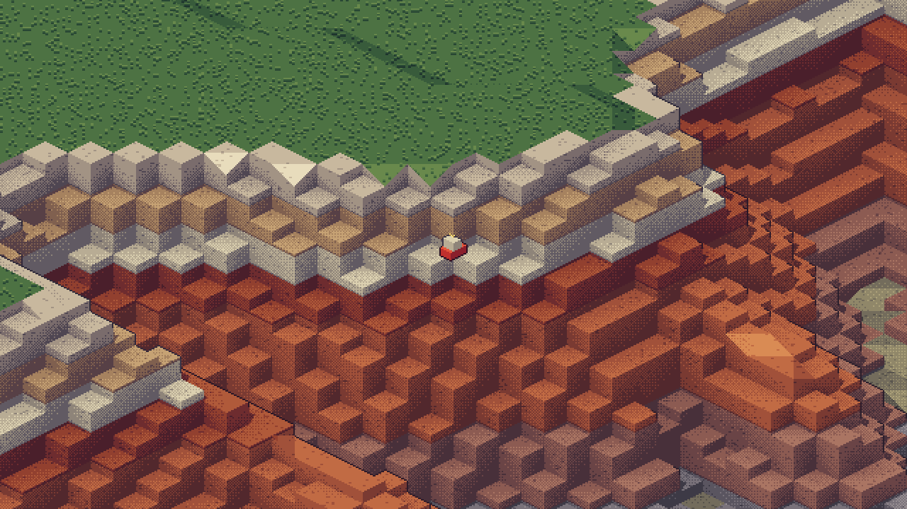
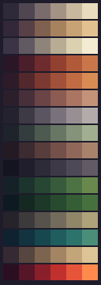
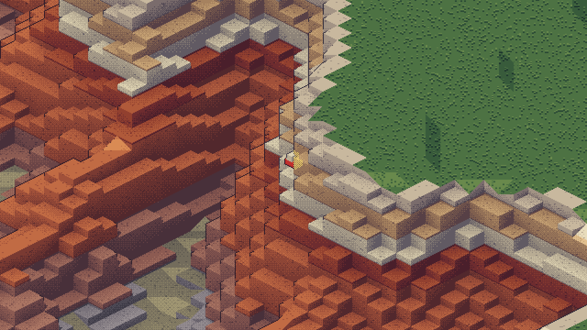

# Style guide (reference sheet)

Status: v0, set in M0. It describes the rules every baked pixel follows. The style pack data lives in `worlds/_styles/<pack>/style.json`; the rules are implemented in `packages/bake/src/shaders.ts`. Change both together, and update the golden images (`pnpm test:e2e --update-snapshots`) only after a visual review.

## 1. Geometry and projection

- **Cell:** a 32×16 px diamond. **Height step:** 8 px. All geometry sits on the grid, so edges are exact 2:1 staircases or straight vertical/horizontal screen lines. See [architecture.md](architecture.md) §3.
- **Rotations:** 4 fixed views, each baked separately. Nothing is rendered at an angle in between.
- **Zoom:** whole-number zoom levels only, with nearest-neighbour upscaling. 1× is the native art scale. Normal play is 2–4×.

## 2. Palette

The palette is indexed: 256 entries, and every baked pixel stores an index.

Rows from top to bottom: `kaibab`, `toroweap`, `coconino`, `hermit`, `supai`, `redwall`, `muav`, `tonto`, `tapeats`, `vishnu` (rock strata), `pine`, `conifer`, `scrub`, `water`, `sand`, `marker` (the placeholder rover).

- **Ramps have 6 shades.** Shade 0 is reserved for outlines. Lighting uses shades 1–5.
- **Ramps shift hue as well as brightness.** Shadows lean cool and purple, highlights warm, so shading never turns into flat grey-black.
- **Layout:** index 0 is the background and empty pixels. Index `1 + ramp·6 + shade` is a ramp colour. Index 253 is the silhouette highlight.
- **Applying the palette:** it happens at runtime through a lookup texture, so later palette variants (day/night, seasons, compliance styles) won't need a re-bake.

## 3. Light and shading

- **Light is relative to the view:** the sun always comes from the upper-left of the screen (`SUN_DIR` in `packages/grid`).
- **Standard faces:** a lit top face lands on shade 4, a left-facing wall on 3 and a right-facing wall on 2. Slopes facing the sun reach 5; slopes facing away drop to 3.
- **Cast shadows** subtract 1.6 levels, then round. Shadows come from a per-tile shadow map that includes neighbouring terrain, so they cross tile seams correctly.
- **Shading is quantized, not smooth.** A face has one shade. Gradients exist only through dithering (§5).

## 4. Materials

- **Strata.** Rock surfaces and every cliff face take their ramp from the elevation of the pixel, using the style pack's `strata` table (Kaibab at the top down to Vishnu schist at the river). Cliffs therefore show horizontal bands. A one-pixel darker bedding line marks the bottom of each band on cliff faces.
- **Surfaces.** Top faces use the ramp of their surface class (`woodland` uses `pine`, `forest` uses `conifer`, and so on). Patterns:

| Pattern | Effect | Used by |
|---|---|---|
| `trees` | 2-px-wide clumps: highlight row, body row, shadow row | woodland, forest |
| `speckle` | sparse 2-px darker flecks | rock, scrub, sand, cliffs |
| `sparkle` | sparse 2-px lighter flecks | water |

- **Anchoring and density.** Patterns are anchored to absolute screen pixels for each rotation, so they're stable across tiles and re-bakes. Densities live in the style pack. Keep them low: texture should read as material, not noise.

## 5. Ambient occlusion and dithering

- **How AO is calculated:** per vertex, from the horizon angle of nearby terrain in 8 directions. It darkens cliff feet and canyon floors.
- **Dead zone:** occlusion below a threshold is ignored, so open ground stays a clean flat colour.
- **How occlusion becomes shades:** it's mapped to whole shade steps with a 4×4 ordered (Bayer) dither anchored to screen pixels. Dithering appears only where there's real occlusion.

## 6. Outlines

- **Silhouettes:** a pixel gets shade 0 of its own ramp when a neighbour is more than **2.0 depth units** farther away. That outlines cliffs of 2 steps or more where they stand in front of farther terrain.
  - 1-step terraces aren't outlined.
  - A slope triangle seen edge-on (a 1-step drop over half a cell) also produces a 1.33-unit jump, which is why the threshold sits above it.
- **World edge:** pixels next to empty background are outlined, which frames the diorama.
- **No black:** outlines use the darkest shade of the pixel's own ramp, never pure black.

## 7. Cleanup

- **Lone pixels:** a pixel whose four neighbours all agree with each other but not with it takes their ramp and shade.
- **Not affected:** patterns, bedding lines and dithers survive, because they're at least 2 px wide or have matching neighbours along one axis.
- **Not needed yet:** majority-vote downsampling and line-run straightening are only needed for geometry that isn't on the grid (landmarks, M3). Terrain doesn't use them.

## 8. Terrain quantization (pipeline)

These choices live in the gridify stage and the fixture script, but they're style decisions:

- **Bilateral smoothing** (1.5 cells, 1.2 steps) runs before quantizing. It flattens noisy benches into coherent terraces and leaves cliffs sharp.
- **Steep cells become flat terraces** at their mean height (`steep="flat"`), which gives the stepped "temple" look of canyon buttes. The alternative `"slope"` mode was rejected in the M0 review: it made walls into sawtooth triangle facets.
- **Vertical scale:** 40 m per step at 160 m per cell (about 1.6× vertical exaggeration).

## 9. Player sprites

- **Baking:** sprites are baked from 3D boxes through the same passes, without shadows.
- **When hidden:** where terrain covers a player sprite, its hidden pixels are drawn as a checkerboard of index 253 (the silhouette colour).

