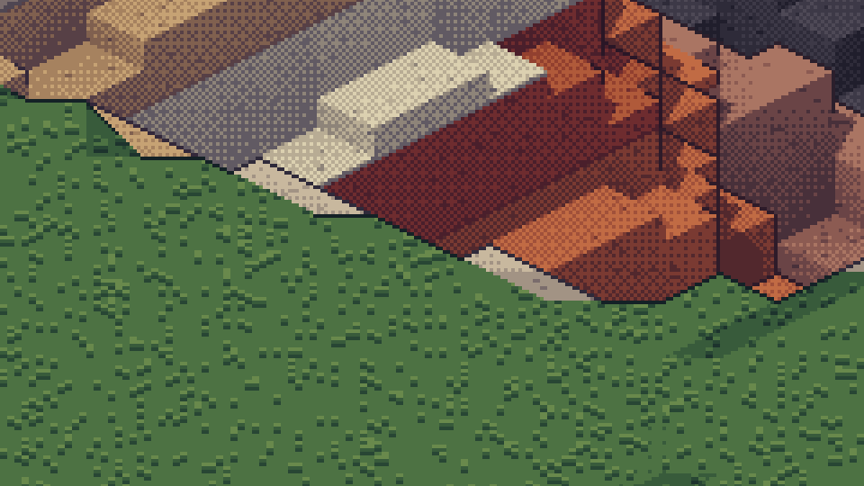
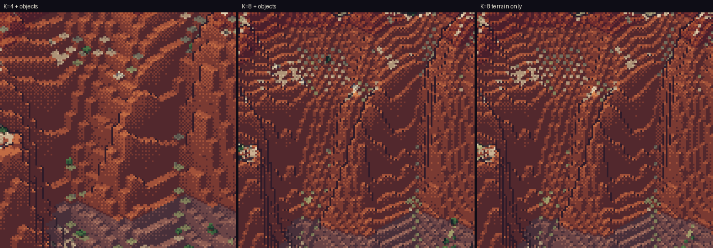
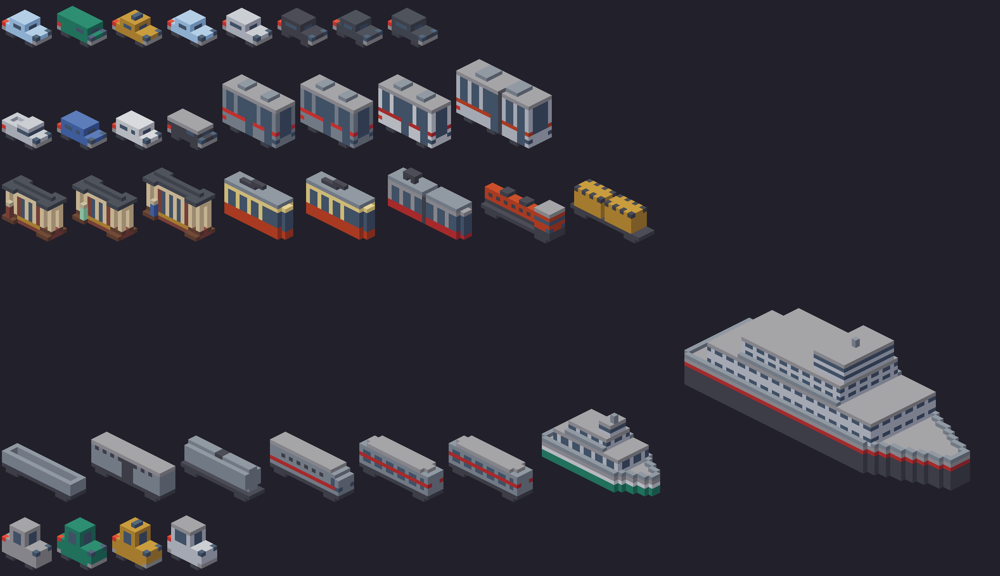
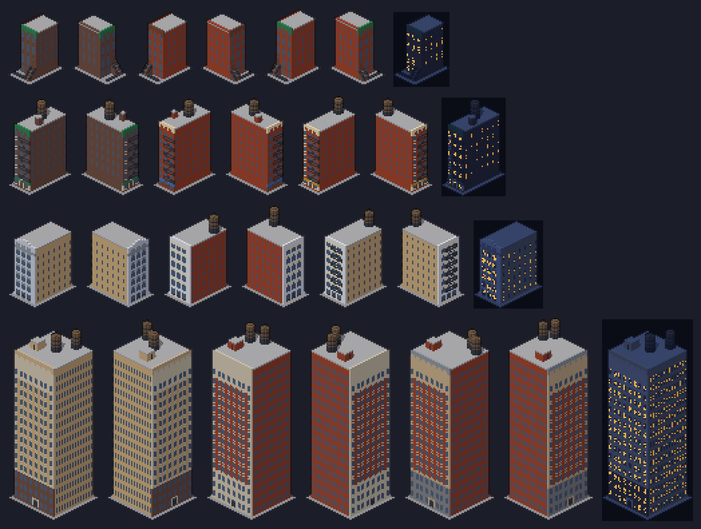
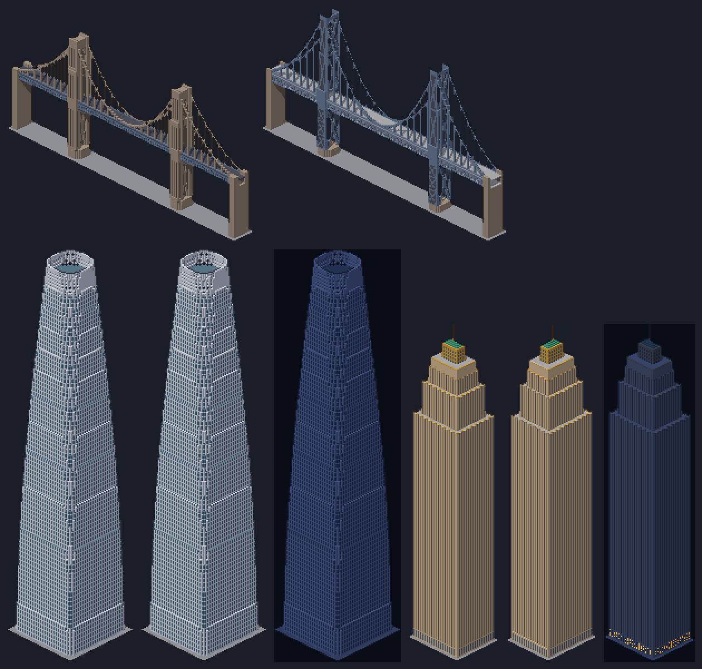

# Style guide (reference sheet)

Status: v0, set in M0. It describes the rules every baked pixel follows. The style pack data lives in `worlds/_styles/<pack>/style.json`; the rules are implemented in `packages/bake/src/shaders.ts`. Change both together, and update the golden images (`pnpm test:e2e --update-snapshots`) only after a visual review.


## 1. Geometry and projection

- **Cell:** a 32×16 px diamond. **Height step:** 8 px. All geometry sits on the grid, so edges are exact 2:1 staircases or straight vertical/horizontal screen lines. See [architecture.md](architecture.md) §3.
- **Rotations:** 4 fixed views, each baked separately. Nothing is rendered at an angle in between.
- **Zoom:** whole-number zoom levels only, with nearest-neighbour upscaling. 1× is the native art scale. Normal play is 2–4×.

## 2. Palette

The palette is indexed: 256 entries, and every baked pixel stores an index.


Rows from top to bottom: `kaibab`, `toroweap`, `coconino`, `hermit`, `supai`, `redwall`, `muav`, `tonto`, `tapeats`, `vishnu` (rock strata), `pine`, `conifer`, `scrub`, `water`, `sand`, `marker` (the placeholder rover).

- **Ramps have 6 shades.** Shade 0 is reserved for outlines. Lighting uses shades 1–5.
- **Ramps shift hue as well as brightness.** Shadows lean cool and purple, highlights warm, so shading never turns into flat grey-black.
- **Layout:** index 0 is the background and empty pixels. Index `1 + ramp·6 + shade` is a ramp colour. Index 253 is the silhouette highlight.
- **At most 42 ramps:** baked tiles store the index in 8 bits, so 1 + 42 × 6 = 253 indices fit below the silhouette. `bay-area` uses all 42 and `desert-southwest` 41; a variant that needs a colour drops one it doesn't use (§18).
- **Applying the palette:** it happens at runtime through a lookup texture, so later palette variants (day/night, seasons, compliance styles) won't need a re-bake.

## 3. Light and shading

- **Light is relative to the view:** the sun always comes from the upper-left of the screen (`SUN_DIR` in `packages/grid`).
- **Standard faces:** a lit top face lands on shade 4, a left-facing wall on 3 and a right-facing wall on 2. Slopes facing the sun reach 5; slopes facing away drop to 3.
- **Cast shadows** subtract 1.6 levels, then round. Shadows come from a per-tile shadow map that includes neighbouring terrain, so they cross tile seams correctly.
- **Shading is quantized, not smooth.** A face has one shade. Gradients exist only through dithering (§5).
- **Natural ground (D-095):** surfaces drawn with trees or speckle (woods, scrub, grass, sand, desert, rock) are lit on their tops by the ground's slope over about a cell, not by each micro-tile, so a hillside reads as one slope rather than as triangle facets. Its light falls between shades in a 4×4 ordered dither. Ground a fifth of a step or more below the mean of a ring a cell around it (a hollow, a gully) is dithered a shade darker, fully at 0.7 steps; ground as far above it (a ridge, a knoll) a shade lighter. World-anchored patches about 2.5 cells across are a shade darker or lighter, with dithered rims (not on strata). Walls keep their own light and strata.
- **Ground surfaces (D-096):** chosen per pixel from the cells' land cover, with borders bent by world-anchored noise and dithered over a few pixels; natural ground is bare rock where it's steeper than the style's `terrain.steepRockSlope` (varied by noise, dithered at its edge), and cliff cells show the ground beside them where gentle.
- **Water (D-094):** a flat plane at the water's level; the shoreline is where the ground crosses it. Water within a micro-step of the ground under it is a shade lighter, dithered half-and-half down to two micro-steps.

## 4. Materials

- **Strata.** Rock surfaces and every cliff face take their ramp from the elevation of the pixel, using the style pack's `strata` table (Kaibab at the top down to Vishnu schist at the river). Cliffs therefore show horizontal bands. A one-pixel darker bedding line marks the bottom of each band on cliff faces.
- **Surfaces.** Top faces use the ramp of their surface class (`woodland` uses `pine`, `forest` uses `conifer`, and so on). Patterns:

| Pattern | Effect | Used by |
|---|---|---|
| `trees` | 2-px-wide clumps: highlight row, body row, shadow row | woodland, forest |
| `speckle` | sparse 2-px darker flecks | rock, scrub, sand, cliffs |
| `sparkle` | sparse 2-px lighter flecks | water |

- **Anchoring and density.** Patterns are anchored to absolute screen pixels for each rotation, so they're stable across tiles and re-bakes. Densities live in the style pack. Keep them low: texture should read as material, not noise.

### Strata sets and geology provinces (M1)

- **Strata sets:** a style pack defines several (`strataSets`). Each cell's geology province (`GEOL`, from the region spec's province polygons) picks one through `provinces`, and worlds without geology use `defaultStrata`.
- **Desert Southwest pack:**
  - `colorado-plateau` uses the Grand Canyon bands.
  - `basin-and-range` uses `desert-ranges`: basalt below 800 m, ochre volcanics, red sandstone from 1300 m, grey limestone from 1700 m, dolomite above 2600 m.

  Without this split, Vegas's ranges would wear Grand Canyon colours.

### Surfaces added in M1

| Surface | Ramp | Pattern |
|---|---|---|
| desert | `desert` (pale tan) | sparse speckle |
| grass | `grass` (dry olive) | speckle |
| farmland | `farmland` | `fields`: world-anchored patchwork, a third of a cell per field |
| urban | `urban` (blue-grey concrete) | `blocks`: world-anchored streets every third of a cell, with sparse lit roofs |
| snow | `snow` | sparkle |

**Added in M3.5** (D-062), where a region spec's `ground` section asks for them:

| Surface | Ramp (`bay-area`) | Pattern |
|---|---|---|
| lawn | `lawn` | speckle: park lawns, golf courses, pitches, gardens and cemeteries |
| yard | `lawn` | a world-anchored patchwork with paved squares: backyards and front gardens beside houses, with garden shrubs and trees scattered on them |

In the `bay-area` pack, `desert` (WorldCover's bare land) draws in `sand`, so beaches are pale sand; `grass` stays the dry gold of wild hills.

World-anchored patterns follow the terrain through rotations and slopes. Screen-anchored ones (speckle, trees) are stable for each rotation.

### Roads (M1)

- **Drawn as decals** in the bake: a top-face pixel is road when it's within the class's half-width of the cell's road centre lines. These run from the cell centre to the edge midpoint or corner of each connected neighbour, plus diagonal roads crossing the cell's corners.
- **Pixel-clean:** roads follow the same 8 directions as the grid, so their edges are 2:1, horizontal or vertical lines.
- **Widths** (half-widths in cells): motorway 0.2, trunk 0.17, primary 0.1, secondary 0.07. Narrowing primary and secondary was needed to stop Las Vegas's arterial grid from overpowering the city.
- **Colours:** `asphalt` ramp; motorways and trunks get a one-pixel `marking` centre line. Roads are lit like the terrain under them. A class may name its own `ramp`: the `bay-area` pack's `brick` class (a kept street drawn as its own class, D-049) paves Lombard Street's crooked block in `brick`.
- **Pavement on slopes (M3.5):** where micro-terrain draws a way, its pavement is lit by the way's grade over about two cells, not by its micro-tiles, so a steady climb drawn as flats and ramps reads as one slope instead of stripes. Terrace walls (risers) on pavement take the pavement's colour a shade darker. Crosswalk stripes are drawn only on gentle crossings: on a steep street, screen-space stripes stand up like a fence.
- **Rails (M3.5, D-061):** a style's `roads.rail` ramp draws the `RAIL` layer on top of the way: two rails about a pixel wide, street tracks on their road's centre line, cable-car tracks with a dark slot between the rails, train tracks on a ballast bed. A style without `roads.rail` draws no rails (the `bay-area` pack uses `bridge-grey`). Where a track bends from one run to the next it cuts the corner by a quarter cell, so tracks on curving and slanted streets read as continuous lines rather than steps.
- **Lanes (M3.5, D-065):** on worlds with lane counts (the `LANE` layer), a style's `roads.lanes` draws classes marked `lanes: true` (motorway to tertiary in both packs) as lanes:
  - **Lane lines:** dashed, one pixel thick, in `lanes.ramp` (`concrete`): a dash of one lane width and a gap of two (`dash: [1, 2]`), anchored to the world. A two-way road's middle line is a solid centre line in `marking`; a one-way carriageway has none.
  - **Legibility:** no lane is drawn narrower than `minPixels` (4) across: a road with narrower lanes draws fewer, wider ones (in pairs on the Strip's 20 m cells), and none below two, so the driving and flying levels stay clean.
  - **Steps:** lines follow the road's centre line with its steps cut, as rails do, and stop at junctions.
  - **Medians:** between a divided road's carriageways, a one-pixel `concrete` kerb a shade lighter edges the ground between them (Sunset Boulevard's planted median, Las Vegas Boulevard's palms); where the drawn carriageways meet, a strip `median` lanes wide (1) of `concrete` a shade darker is carved between them. Cross streets cut through.
  - **Without it:** a style without `roads.lanes`, or a world without lane counts, keeps the plain asphalt and the one-pixel `marking` centre line on motorways and trunks.

## 5. Ambient occlusion and dithering

- **How AO is calculated:** per vertex, from the horizon angle of nearby terrain in 8 directions. It darkens cliff feet and canyon floors.
- **Dead zone:** occlusion below a threshold is ignored, so open ground stays a clean flat colour.
- **How occlusion becomes shades:** it's mapped to whole shade steps with a 4×4 ordered (Bayer) dither anchored to screen pixels. Dithering appears only where there's real occlusion, in natural ground's light, hollows and patches (§3) and in shallow water.

## 6. Outlines

- **Silhouettes:** a pixel gets shade 0 of its own ramp when a neighbour is more than **2.0 depth units** farther away. That outlines cliffs of 2 steps or more where they stand in front of farther terrain.
  - 1-step terraces aren't outlined.
  - A slope triangle seen edge-on (a 1-step drop over half a cell) also produces a 1.33-unit jump, which is why the threshold sits above it. Steeper slope tiles that face away from the camera can exceed 2.0. They then get a silhouette line along their ridge, which is correct: they really do hide terrain behind them.
- **World edge:** pixels next to empty background are outlined, which frames the diorama.
- **No black:** outlines use the darkest shade of the pixel's own ramp, never pure black.

## 7. Cleanup

- **Lone pixels:** a pixel whose four neighbours all agree with each other but not with it takes their ramp and shade.
- **Not affected:** patterns, bedding lines and dithers survive, because they're at least 2 px wide or have matching neighbours along one axis.
- **Not needed yet:** majority-vote downsampling and line-run straightening are only needed for geometry that isn't on the grid (landmarks, M3). Terrain doesn't use them.

## 8. Terrain quantization (pipeline)

These choices live in the gridify stage and the fixture script, but they're style decisions:

- **Bilateral smoothing** (1.5 cells, 1.2 steps) runs before quantizing. It flattens noisy benches into coherent terraces and leaves cliffs sharp.
- **Steep cells become flat terraces** at their mean height (`steep="flat"`), which gives the stepped "temple" look of canyon buttes. The alternative `"slope"` mode was rejected in the M0 review: it made walls into sawtooth triangle facets.
- **Vertical exaggeration:** 2.5× true proportions (26.1 m per step at 160 m per cell). In the comparison, 1.63× (M0's original 40 m/step) looked flat, 2.5× made cliffs and strata bands bold while walls stayed coherent, and 3.5× and 5× broke walls into one-cell pillars, because noise in the elevation data becomes several steps. Going above about 3× needs more smoothing to match.
- **Slope tiles rise at most 2 steps per cell** (`--max-slope`, 1–3). In the comparison:
  - 1 (the original one-step model) made gentle benches stepped.
  - 2 made benches, the Tonto Platform and lower butte flanks continuous while the walls kept crisp stepped cliffs.
  - 3 smoothed further but gave a faceted low-poly look, with contrasting triangles and spiky folds.

  Walls steeper than the limit still become terraces and cliffs. Going up, rises of 1–3 steps per cell keep edges horizontal, 2:1 or 1:1. Going down, a 2-step rise gives slightly uneven 2:3 lines, which is acceptable at play zoom.
- **Smoothing and surface classes use real metres** (bilateral range σ = 48 m; cliff threshold 80 m), so changing the exaggeration doesn't change which cells are woodland or rock.

## 9. Player sprites

- **Baking:** sprites are baked from 3D boxes through the same passes, without shadows.
- **When hidden:** where terrain covers a player sprite, its hidden pixels are drawn as a checkerboard of index 253 (the silhouette colour).




## 10. Pixel-scale terrain (M1.5 experiment, M1.6 micro-terrain)

Micro-terrain (M1.6) uses K=4: 8×4 px micro-cells with 2 px height steps. The M1.5 experiment worlds draw fine cells smaller instead (`render.scale`). These rules apply to both (D-032, D-036, D-039):

- **Steep cells are bare rock.** Every fine cell or micro-cell steeper than 0.6 rise over run takes the strata ramp, whatever its land cover. Canyon walls then read as bands of ledges rather than a green-and-tan herringbone. For micro-terrain the shader applies it per micro-cell (style `terrain.steepRockSlope`); water and snow keep their surface.
- **Ragged land-cover borders.** Land cover is still per 400 m cell. Each micro-cell takes its surface from a point jittered by up to ±0.4 cell, hashed in world coordinates, so borders are ragged at micro-cell scale rather than following the cell grid. Water keeps its exact cells, because its geometry is flat only there.
- **Patterns keep their pixel size.** Field and city-block patterns, and road widths, are measured in render units. Road widths are capped at one cell.
- **K=4 (chosen, D-037):** its ledges form 2 px clusters; K=8 gave 1 px hatching. See [roadmap](roadmap.md) M1.5 and M1.6.



## 11. Objects (M1.5 experiment)

Objects are voxel models generated per semantic group (D-030) and baked with the terrain through the same passes: lighting, shadows, AO, outlines and palette.

- **Scale (D-033):**
  - A voxel is a 2×1 px top and 1 px tall at native zoom, whatever the map scale.
  - Heights are `metres × heightStretch ÷ voxel metres`, with `heightStretch` 2.5.
  - Trees and palms are deliberately oversized (a conifer is 5 voxels across) so they read as trees.
- **Catalog:** the style pack's `assets` maps a group to a generator, role ramps and parameters. The longest dotted prefix wins (`tree.conifer.ponderosa` falls back to `tree.conifer`, then `tree`).

  | Generator | Groups (desert-southwest) | Notes |
  |---|---|---|
  | `conifer` | `tree.conifer` | layered skirts |
  | `blob` | `tree`, `tree.pinyon-juniper`, `shrub` | ellipsoid crown with holes, optional trunk |
  | `palm` | `tree.palm` | `reach` sets frond length |
  | `boulder` | `rock.boulder` | |
  | `building` | `building.residential`, `building.commercial`, `building.parking`, `building.tower`, `building.tower.hotel` | `style` 0 hip roof, 1 low-rise with parapet and a window band, 2 tower with a window grid and crown |
  | `lookoutTower` | `landmark.tower.lookout` | round stone tower, slits, crenellation, optional round room; `radiusPerHeight` widens it with its height |
  | `cityBlocks` | `city.blocks` | a coarse level's built-up cell: blocks of low buildings between one-voxel streets on the world's voxel grid (`pitch`), each block houses, a commercial box, apartments, a park or a lot, by place (D-067) |
  | `observationTower` | `landmark.tower.observation` | generic shaft, legs and pod; no replica |
  | `sign` | `landmark.sign` | generic diamond roadside sign with a neon rim |

- **Role variants:** a role can name several ramps (`wall`, `wall.gold`, `wall.concrete`), and each building picks one by its seed.
- **Repeated objects** use 6 variants per group and 4 quarter-turns, drawn instanced.
- **Ramps added:** `bark`, `palm`, `stucco`, `roof-tile`, `roof-flat`, `glass`, `lit`, `lit-cool`, `tower-white`, `tower-gold`, `concrete`, `neon-pink`, `neon-cyan`.
- **Ground under objects:** when a world has objects, the style's `objects.surfaces` replaces surface styles; the urban block pattern becomes a light speckle, because real buildings stand there.


## 12. Night palette (M1.5 experiment)

- **One bake, two palettes (D-035):** night is a palette variant, so switching (T in the app, `?palette=night`) needs no re-bake.
- **Ordinary ramps** are desaturated to 55%, multiplied by (0.30, 0.34, 0.52) and lifted by (4, 6, 16). The result is a moonlit blue that keeps the day shading.
- **Emissive ramps** get their own night colours, bright across all shades:
  - `lit` (warm windows)
  - `lit-cool` (cool windows, the observation tower's pod)
  - `neon-pink` and `neon-cyan` (trim and signs)
  - `marker` (the rover)
- **Lit windows:** by day, `lit` and `lit-cool` equal `glass`. The generator assigns about 35–60% of window voxels to them, so each building has a fixed pattern of lit windows.


## 13. Buildings and landmarks (M3)

Buildings come from data, Overture footprints with lidar heights and massing (D-052), and are drawn by the `building` generator (v2). Landmarks come from the registry (D-051) and have generators of their own. A style pack can draw typed buildings with generators of its own: San Francisco's are in §15.

**Massing**
- **Heights:** real metres × `heightStretch` (2.5 when driving, 1.5 when flying, where towers and landmarks are drawn 3× and 5×, and 1.0 when walking).
- **Lidar towers:** large complexes get tower parts where lidar sees roofs well above the podium, so Caesars, the Venetian, Excalibur and New York-New York keep their skylines.
- **Setbacks:** towers 30 voxels or taller step back once or twice in their top third (about 60% of towers, by seed).
- **No overhangs:** every voxel rests on another. Buildings stay inside their footprint, and nothing floats.

**Roofs**

| Roof | Where | Drawn as |
|---|---|---|
| flat | low-rises and towers by default | parapet (neon trim on hotel towers); rooftop equipment on large low-rise roofs; a penthouse, spire or beacon on towers |
| hipped | houses by default, or from Overture | inset one voxel per layer |
| gabled | from Overture | a ridge along the longer side |
| pyramidal | from Overture | a cap on a tower; a large, broad footprint becomes a pyramid from the ground up, with a dark glass skin |
| dome | from Overture | a hemispherical cap |

**Facades**
- **Glass on the skin only:** windows are glass, or `lit`/`lit-cool` at night, and only on outer walls.
- **Towers** use one pattern by seed:
  - punched windows (every other column on odd floors)
  - ribbon windows (whole odd floors)
  - vertical fins (two columns of glass, one of wall)
  - a curtain wall (glass except every sixth floor), always for gold-walled or glass-faced towers
- **Low-rises** have storefront glass at street level and windows every third floor. Large ones carry a band of neon at the top: a sign with no lettering.
- **Houses** have windows on every third floor and tiled hip roofs.

**Landmarks** (generic depictions: shapes, no names or logos)

| Group | Generator | Landmark |
|---|---|---|
| `landmark.tower.observation` | `observationTower` | the STRAT tower |
| `landmark.tower.lattice` | `latticeTower` | the Eiffel Tower replica at Paris Las Vegas: four legs, base arches, two lit platforms, a spire |
| `landmark.wheel` | `wheel` | the High Roller: rim, spokes, 28 lit cabins, A-frame legs |
| `landmark.sign` | `sign` | the Welcome sign: a diamond with a neon rim, no lettering |
| `landmark.dam` | `dam` | Hoover Dam, bowed upstream: a sheer upstream face, the downstream face battered from its foot to a thin crest (`crest`, `batter`, D-066) |
| `landmark.dam.intake` | `intakeTower` | its four intake towers in the lake |
| `landmark.bridge.arch` | `archBridge` | the Hoover Dam bypass bridge: arch rib, columns, deck |
| `landmark.tower.lookout` | `lookoutTower` | the Desert View Watchtower |

**Checked in tests** (`packages/generators/test/buildings.test.ts`, 192 generated buildings):
- no voxel outside the footprint
- no overhangs
- glass only on the skin
- only style ramps
- pyramids where the data says so
- setbacks inside the footprint

**Hero paint-overs** (D-053)
- **Format:** paint in the style palette only: open `paint/<world>/r<n>.png` (indexed, the palette embedded) over `hero/<world>/r<n>-view.png`. Index 0 keeps the baked pixel.
- **What to paint:** details the generator can't make, such as window bands, masonry, joints and signage shapes (still no lettering or logos). Use the ramp the bake already uses and move along it, so the paint swaps cleanly to the night palette.
- **Outlines:** a selective outline (a darker shade of the inner colour instead of shade 0 on lit edges) is allowed on heroes.
- **Beyond the silhouette:** single pixels such as warning lights only. They show over background and over what lies behind the landmark, never over what stands in front of it.
- **Shadows:** leave cast shadows to the bake. Paint covers whatever shading the tile has there.

## 14. Vegetation and props (M3)

- **Client scatter** (D-054): the style pack's `scatter` rules give objects per cell by surface:
  - woodland: 2.4 pinyon-juniper
  - forest: 3.0 conifers
  - scrub: 0.9 shrubs
  - grass: 0.2 shrubs
  - desert: 0.12 desert shrubs and 0.04 boulders
  - rock: 0.06 boulders
  - sand: 0.02 boulders
  - urban: 0.06 trees

  Objects keep a fixed pixel size, so a density reads the same on every level. `depiction.scatter` scales it per level.
- **Kept clear:** water, roads, paths, a band beside wide roads, cliffs and cells under placed objects.
- **Canopy trees** (pipeline): a region spec can place trees where a canopy height map shows them (`objects.vegetation` with `canopy`), and `byLandcover` picks species by land cover, so San Francisco's tree-covered parks get cypress and eucalyptus.
- **Round street trees** (`roundTree`, generators/trees.ts): a lobed crown wider than it is tall, on a one- or two-voxel trunk, in the `leaf` ramp a shade deeper than lawn. A blob on a tall trunk read as a palm from the driving level.
- **Sidewalk trees** (`objects.streetTrees` with `canopy`, group `tree.street`): road cells are kept clear of everything else, so sidewalk trees stand on the verge just past the drawn asphalt, in rows along straight road cells, where the canopy map shows trees beside the real road. This is the one exception to keeping a band beside roads clear.
- **Street furniture** (walking level): `prop.streetlight` every 45 m along main streets, 13 m from the centre line, and `prop.signal` at junctions of three or more street segments. Both are thin iron poles with a lit head, so they read as points of light at night.
- **Strung across a street** (`across: true`, optionally limited by `name` and a lon/lat `bounds`): one prop on the road's line, turned across it. San Francisco strings `prop.lanterns` (a sagging wire of red and gold lanterns) over Grant Avenue and Stockton Street in Chinatown.
- **One-pixel lines** (D-098, D-099): a model may draw its thinnest parts as lines a native pixel wide at any angle (`VoxelModel.line`), in the ramp's darkest shade, casting no shadow. Options, off by default: `streetLight` and `trafficSignal` with `lines: 1` (a slender mast with an arm curving out to the lamp; a pole with a mast arm over the street and a three-lamp head, `reach` voxels out), `lanterns` with `lines: 1` (the wire), `utilityPoles` with `lines: 1` (its arms and stay wires). Every pack in the repository turns them on (`desert-southwest` at half the voxels, its walking level's cells being twice the size).

## 15. San Francisco (the `bay-area` pack)

The city is read by its fabric first (D-055): row houses on 25-foot lots, the stucco rows of the Sunset and Richmond, corniced apartment blocks, Chinatown and the piers. Its landmarks come second.

**Roofs**
- **Flat roofs are light:** grey tar and gravel, a white coating or warm gravel. Large apartment blocks are never white, because white glares at that size.
- **Slate** goes only on Queen Anne gables, which are short and on 10–30% of Victorians.
- **Lot lines:** each row house raises a one-voxel parapet on one lot line, in its body colour for two voxels and then in the roof's, so a row of flat roofs still reads as separate houses without pastel stripes across the roofs.
- **Roof line:** each house in a row is a voxel taller or shorter than its neighbours (two on taller houses), and never lower than its storeys (`fl`), so a row steps house by house instead of reading as one block.

**Paint schemes** (`facades.ts` in the city pack, `packages/city-sf`)
- **What a scheme is:** the role variants that share a name, such as `wall.blue`, `trim.blue` and `accent.blue`. Trim and accent come from the body's scheme, never at random.
- **Per typology and era:**

| Typology | Body | Trim and accent |
|---|---|---|
| Victorian rows (before 1906) | saturated painted ladies: blue, mustard, green, plum, teal, oxblood, a few pastels. In Pacific Heights, Russian Hill, Nob Hill, North Beach, the Marina, the Richmond and the Sunset (`.pale`, by typology rule): mostly white, cream and grey, some deep blue and sage | cream or white trim, a contrasting accent on the frieze and door |
| Edwardian rows (1906–1920) | creams, whites, pale tones; in the Mission, the Haight, the Western Addition and Hayes Valley (`.painted`) more saturated | white trim, dentils |
| Stucco rows (1920–1960) | about four in five white, cream, beige, pale grey or sand; the rest mint, rose, sky or butter | white garage doors (a shade darker on white houses) and copings; tiled pent roofs and storybook gables mostly before 1940 |
| Mid-century (rowhouse type 3) | white and grey | a band of sliding windows, a flat fascia, sometimes a brick or stone veneer |
| Apartments | cream, white, grey, brick, terracotta | white cornices, stacked bays with white panels between them |
| Houses without a row (`building.house`) | the row-house form of their era (type -1), white and grey | — |
| Chinatown | cream, butter, mint, brick | piers and window bays; balconies with red rails and balusters, or windows on red or jade sills; vertical signs (red with gold caps, or gold with red) and a sign band, no lettering; a red frieze and a jade eave with upturned corners round every visible wall; pagoda towers on some corner lots and pavilions on some roofs |
| Historic commercial | buff, cream, granite, brick | cornices, storefronts |

- **Shades:** walls only show shades 2–3 of a paint ramp, so paint ramps are tuned for those two.

**Stucco fronts** (`stuccoRow`): the entry stair sits in a recess on one side, beside a white garage door, with a box, canted or curved bay over it, drawn by stepping the rest of the upper front back. The bay rises to the roof line under a white cap, with the parapet set back behind it, so the bump reads from above at 25 m cells (a front is about 5 voxels wide there). Parapets are raised, pedimented, stepped, curved or plain, with end piers on some. A light well on one lot line breaks each roof, so a row reads as separate houses from above.

**Towers** (`towers.ts`, by year built, D-055)

| Kind | Years | Drawn as |
|---|---|---|
| deco (`building.tower.deco`) | 1906–1950, at most 140 m | terracotta, buff, cream or granite piers between recessed window bays over dark spandrels; one or two setbacks with pinnacles; a stepped crown with gold dentils, a pinnacled one, or a lantern with a copper cap |
| slab | 1950–1983 | white slabs with fins and notched corners; a few dark granite ones |
| postmodern | 1983–2000 | stone towers with setbacks and a pyramid, stepped or spire top |
| glass | after 2000 | pale sky-blue panels in white mullions; a sloped, stepped, open-fin or spire crown |

- **No dark-glass boxes:** downtown reads light. Towers with no record take a kind by seed (deco 0.30, glass 0.25, slab 0.20, postmodern 0.20, granite 0.05), and Overture's `facade_material: glass` forces glass.
- **Diagonal faces:** faces turned 45° (the grid south of Market) get flush windows. Round footprints never step back.

**Street detail (walking level):** window hoods and accent aprons, paired windows beside the bay, corner stores on some corner lots, and roof decks with a stair penthouse. Stoops aren't drawn, because they would overhang the street or leave the footprint.

**Landmarks** (generic depictions, D-051)

| Group | Generator | Landmark |
|---|---|---|
| `landmark.bridge.suspension` | `suspensionBridge` (portal towers, stepped struts, grooved legs) | the Golden Gate Bridge: orange towers, truss and railings |
| `landmark.bridge.suspension.double` | `suspensionBridge` (X-braced towers, braced on their sides too over dark plates so they read side-on; cables sagging clear of the deck and onto a raised central anchorage; double deck) | the Bay Bridge's west span, grey |
| `landmark.tower.pyramid` | `pyramidTower` | the Transamerica Pyramid: a spire, wings on two faces, an arcade at the foot |
| `landmark.tower.obelisk.diagonal` | `obeliskTower` | Salesforce Tower: corners rounding as it rises, a lattice crown |
| `landmark.tower.column` | `column` | Coit Tower |
| `landmark.hall.clock` | `towerHall` | the Ferry Building: clock faces, an arched stage, a lantern, a flagpole |
| `landmark.hall.domed` | `domedHall` | City Hall |
| `landmark.rotunda` | `rotunda` | the Palace of Fine Arts: a red dome on column clusters, a curved colonnade |
| `landmark.tower.mast` | `tripodMast` | Sutro Tower, in red and white bands |
| `landmark.windmill` | `windmill` | the Dutch and Murphy windmills in Golden Gate Park: octagonal smock mills, a cap, four sails facing the sea, drawn 1.35× to read over the park's trees |
| `landmark.lighthouse` | `lighthouse` | the Alcatraz light: a tapering tower, a gallery, a lantern lit at night |
| `landmark.cellhouse` | `cellhouse` (a line landmark) | the Alcatraz cellhouse: a long hall of barred windows, a skylight monitor, a taller head block |
| `landmark.gate` | `gate` (`chinatown.ts` in the city pack) | the Dragon Gate at Grant Avenue and Bush Street: a three-opening gate with stone piers, red beams, a blank gold plaque, jade hipped roofs with upturned corners |

## 16. Atmosphere: fog (D-063)

- **Look:** fog is dithered, never blended. Each palette colour has a lookup per veil level (0.3, 0.55, 0.8, 1) that moves it toward the fog's colour: the nearest palette colour no more saturated and no farther in lightness from the fog. Levels are dithered on the 4×4 Bayer pattern of absolute screen pixels, so panning doesn't make it swim.
- **Shape:** coverage is the area's density times how far a pixel lies below the ceiling, times drifting patches (noise on a plane inside the fog). Low ground is buried; hills, towers and the bridges' towers rise out.
- **Night:** fog draws at 0.8 of its day coverage, and the night palette turns it into a dim blue veil; lit windows and glowing ramps show through.
- **`bay-area`:** fog in `tower-white` shade 5; a ceiling of 220 m (drawn metres) with a 150 m fade under it; patches about 450 m across drifting east-south-east.

  | Area | Density | Soft edge |
  |---|---|---|
  | the Pacific, with Ocean Beach | 0.85 | 800 m |
  | the Golden Gate | 0.85 | 1,500 m |
  | the outer avenues: the Sunset, the Richmond, Golden Gate Park's west end, thinning toward Twin Peaks | 0.45 | 2,500 m |

  Walking levels get none.

## 17. Traffic vehicles (D-064)



- **Same voxels as buildings:** 2×1 px tops and 1 px tall. A car is about 9 × 4 × 5 voxels on the driving and walking levels, a bus 14 × 5 × 11, a ferry 26 × 10 × 11 driving and 64 × 19 × 20 walking.
- **Read by shape first:** a car's body type shows in its hood, cabin and trunk lengths; a bus's in its long window band and roof units; a cable car's in its open ends and posts; a train's in its locomotive and the mix of wagons behind it.
- **Paint:** cars mostly neutral (white, silver, grey, black) with a few colours, listed in the pack as `paint.*` (repeat a ramp to make it commoner); transit in paired liveries (`body`/`band`, `upper`/`lower`, `loco`/`stripe`, `hull`/`band`).
- **Lights:** headlights in `lit-cool` and transit windows in `lit` glow at night; tail lights are `marker` red.
- **No lettering:** signs, destination boards and the taxi's roof sign are blank.

## 18. The pack file: schema, validation, limits and `extends` (D-075)

A pack is `worlds/_styles/<id>/style.json`, named by a world's manifest (`style`). Its shape is a JSON Schema, and every pack is checked against it before anything is drawn.

**The schema**
- **File:** `packages/style/schema/style-pack.v1.schema.json` (draft-07). It is generated from `packages/style/src/schema.ts` (the shape) and `schemaDocs.ts` (each key's description): edit those, and `pnpm vitest run packages/style -u` rewrites it. The test fails while the file is stale.
- **npm:** `pixelworld/style-pack.v1.schema.json`, in `node_modules/pixelworld/dist/`.
- **In an editor:** a pack names it first, for completion, hover text and squiggles (VS Code, JetBrains):

  ```json
  { "$schema": "../../../packages/style/schema/style-pack.v1.schema.json", "id": "my-pack", … }
  ```

  From npm, the path is relative to the pack: `"$schema": "./node_modules/pixelworld/dist/style-pack.v1.schema.json"`.
- **Versions:** the major version is in the file name and `$id`. Optional keys are added to v1. Removing or renaming a key, or changing what one means, makes a v2 beside it. A pack whose `$schema` names a version the library doesn't read is refused rather than read as typos.

**What is checked** (`validateStyle`, or `styleIssues` for the list without throwing; `createWorldView` runs both checks)
- **The shape:** types, ranges, required keys, and unknown keys, with a "did you mean": `assets["building.residential"]: unknown key "generater" (did you mean "generator"?)`.
- **Names the pack refers to:** the ramps strata bands, surfaces, roads, paths, asset roles, night ramps and fog name; strata sets; the surfaces and asset groups scatter names. Strata run from the highest down. Example: `assets["building.residential"].ramps.wall: no ramp named "stuco" (did you mean "stucco"?)`.
- **Messages:** each names the pack and a path into it, and all of a pack's problems are listed at once: `style pack "desert-adobe": ramps.desert[0]: bad colour "#3a2f3": want "#rrggbb"`. A `StyleError` carries `pack` and `issues` (`{ path, message }`).
- **Not a pack at all:** HTML where JSON was expected, a JSON module instead of its default export, or an object with none of a pack's keys each get a message of their own.
- **Generators, when a view starts:** once its plugins are registered, every asset's `generator` must be registered: `assets["building.residential"].generator: no generator named "adobee" (did you mean "adobe"?)`. For a generator of this repository's city packs, the message names the plugin to add to `plugins`. The check is skipped while a plugin the pack names isn't loaded, because that is warned about already and its generators can't be told from typos.
- **Roles, when a model is generated:** `ctx.ramp(role)` for a role the asset doesn't map throws a `MissingRoleError` naming the asset, generator and role: `assets["building.shed"] has no ramp for the role 'wall', which its generator 'adobe' draws with: add "wall": "<ramp>" to its "ramps" (it has roof, door)`.
  - `ctx.ramps(role)` is empty for a role the asset lacks, which makes the role optional.
  - A model given `undefined` for a material (`ctx.ramps("wall")[0]` of a missing role) throws instead of drawing in no colour.
  - Roles aren't declared by generators and checked against packs in advance: they're dynamic (variants by seed, `deco:` scopes falling back to plain roles, optional roles), so the check happens when a generator asks.
- **JSON syntax:** `parseStyleJson(text, file)` names the file, line and column: `worlds/_styles/bay-area/style.json: invalid JSON at line 3, column 20: Expected double-quoted property name`. The viewer reads each pack only for the worlds that use it, so a broken pack fails only those worlds, with the error in the HUD.
- **Resolvers:** an error thrown by `createWorldView`'s style resolver names the pack it was asked for (`style pack "bay-area" (from your style resolver): …`). A resolver that answers with another pack than the one asked for is a warning.

**Limits**

| Limit | Value | Why |
|---|---|---|
| Ramps | 42 | baked tiles store the palette index in 8 bits: index 0 the background, 6 shades a ramp from index 1, 253 the silhouette, so 1 + 42 × 6 = 253 |
| Shades | 6 | shade 0 the outline, 1–5 lighting (§2, §3) |
| Strata sets and bands | 4 sets of 1–16 bands | shader uniforms |
| Surfaces, road and path classes, geology provinces | 16 ids each, from the world | shader tables indexed by the world's ids, not by the pack's names |

- **Full packs:** every ramp of `bay-area` (42) and `desert-southwest` (41) is used. A San Francisco variant that needs a new colour first points a use at another ramp, then deletes the freed one (`"ramps": { "chert": null }` in a pack that extends). Deleting a ramp moves the ones after it to lower indices, which is harmless: tiles are cached by the merged pack.
- **Raising the cap isn't cheap (D-075):** the index would need a ninth bit (the alpha channel only says "covered"), and with it the G-buffer's ramp, a 512-entry palette texture, the fog's per-index lookups, the night palette and the hero paint-overs, which are 8-bit indexed PNGs. Goldens could stay identical, since packs within 42 ramps keep their indices. A per-world palette of the ramps a world uses is the other way, but entities added at run time (traffic paints, an app's models) can name any ramp.
- **Swatches:** `node tools/swatches.mjs <pack id or path>` prints a pack's ramps by day and night with their palette indices and what uses each, and lists the ramps nothing in the pack uses.

**Variants: `extends`**

A variant names its parent and only what changes:

```json
{
  "$schema": "../../../packages/style/schema/style-pack.v1.schema.json",
  "extends": "desert-southwest",
  "id": "desert-adobe",
  "name": "Desert Southwest (adobe variant)",
  "plugins": ["@pixelworlds/city-demo"],
  "ramps": { "adobe": ["#3a2a30", "#62423f", "#8b5d4c", "#b86c5a", "#d4886c", "#e0b089"] },
  "assets": {
    "building.residential": { "generator": "adobe", "ramps": { "wall": "adobe", "door": "bark" }, "params": { "style": null } }
  }
}
```

- **The merge rule** is the region specs' `extends:` rule. Objects merge key by key, and the child's value wins. Anything else (a ramp's colours, strata bands, fog areas, `plugins`) replaces whole. `null` deletes the parent's key.
- **Order:** keys keep the parent's order and new ones follow, so the parent's ramps keep their palette indices and the child's come after them.
- **Own keys:** a pack that extends another needs its own `id`, and `extends` isn't inherited. Chains work, up to 8 packs; a circle is an error naming it.
- **In an editor:** the schema accepts a pack with `extends` without the keys its parent has, and with `null`s.
- **Where it is merged:** `resolveStyleExtends(pack, load)` in `@pixelworlds/style`. `createWorldView` merges with its style resolver; a pack given as an object must be merged already. The viewer's loader merges, so `?style=<variant>` works. The merged pack keys the tile cache, so editing a parent re-bakes its variants.
- **Example:** `packages/style/test/fixtures/desert-adobe.json` is the content review's adobe variant in 1 KB instead of a 16 KB copy, and its test checks the merge against the parent.

## 19. New York (the `new-york` pack, D-081)





A full pack (`worlds/_styles/new-york/style.json`), laid out like `bay-area` but with its own 41 ramps and no fog. It names two plugins, `["@pixelworlds/city-sf", "@pixelworlds/city-nyc"]`: San Francisco's for `block`, `decoTower`, `sfTower` and `lanterns`, New York's for the four generators below (`packages/city-nyc`).

**Ramps**
- **Masonry:** `brownstone` (a cool chocolate), `brick` (orange-red), `brick-buff`, `limestone`, `granite` (neutral grey), `terracotta` (buff), `bridge-stone`.
- **Metal and glass:** `castiron-cream` and `castiron-grey` (painted cast iron), `iron` (black: fire escapes, railings, stands), `verdigris` (copper roofs and cornices), `bridge-steel` (blue-grey), `curtain-glass` (glass towers' panels), `glass`, `lit` and `lit-cool`.
- **Street:** `asphalt`, `sidewalk`, `marking`, harbour `water`, `cedar` (water tanks), shop signs (`sign-red`, which glows at night, `sign-green`, `paint-navy`, `gold`), `taxi` yellow and `ferry-orange`.

**The fabric** (`buildings.ts` in `packages/city-nyc`)

| Group | Generator | Drawn as |
|---|---|---|
| `building.brownstone`, `building.house` | `brownstone` | 3–5 storeys counting the garden level. A high stoop with iron rails climbs to the parlour floor's door, and an areaway fence runs beside it. The facade is flat, with stone hoods over the windows (taller on the parlour floor), a hood and pediment over the door and a dark bracketed cornice. Brownstone, red brick or limestone; `building.house` is the brick and painted version. |
| `building.tenement`, `building.residential`, `building.tenement.chinatown` | `tenement` | 5–7 storeys of brick over two shops and the tenants' door. Each shop has glass over a bulkhead and a sign band with no lettering, and a corner shop wraps round the corner. Windows sit under stone lintels. Most have a black fire escape over two or three bays, with platforms, rails and stairs that turn at each landing. A pressed-metal bracketed cornice, a stair bulkhead, and a water tank on the taller ones. The Chinatown variant has red and gold signs and red doors. |
| `building.loft.castiron` | `castIronLoft` | 4–7 storeys with a front of columns and entablatures painted cream, grey or white, on brick party walls. Big windows with arched heads at the walking scale, and a glass ground floor over a dark bulkhead. The cornice is bracketed over every column, with a raised pediment on some. A water tank on many, a fire escape on some. |
| `building.apartment.prewar`, `building.commercial.historic` | `prewarBlock` | Base, shaft and cap at any height, with no storey cap. A stone base of one to three storeys has the entrance in a stone surround. Above it: a belt course, a brick shaft with lintels and quoins, one or two storeys of stone or terracotta, and a heavy cornice. On the roof, wooden water tanks on steel stands and an elevator penthouse. `building.commercial.historic` is the limestone, granite and terracotta office version. |

- **Projections are drawn flush or made room for** (the building rules, §13). Cornices and fire escapes are painted on the wall. A cornice reads by its brackets and a lip on the roof; a fire escape by its two iron bars per floor and its diagonal stair. A stoop needs room in front of the house, so the facade stands back from the footprint's front by the stoop's run (about 3 m at walking scale). Narrow or shallow lots get no stoop.
- **Water tanks** stand only where every column of the tank sits on the roof. A tank is a solid dark stand under a cylinder of cedar staves with iron hoops and a conical roof, which reads as legs from street height.
- **Storeys:** the record's (`fl`) within each type's range, otherwise by seed. For `prewarBlock` the storeys come from the height, 8 voxels a storey at the walking level (param `storey`).
- **Paint schemes:** as in San Francisco (§15), trim, base, stoop and cornice follow the wall's variant when they list the same variants. Brownstone fronts take dark trim (`bark`), so hoods read as shadowed relief on monochrome stone.

**Reused from San Francisco:** `building.commercial`, `building.industrial` and `building.pier` use `block`. `building.tower` and `building.tower.slab`, `.postmodern` and `.glass` use `sfTower` with New York's stone, buff brick, verdigris and curtain glass. `building.tower.deco` uses `decoTower`.

**Landmarks** (generic depictions, D-051)

| Group | Generator | Landmark |
|---|---|---|
| `landmark.bridge.suspension` | `suspensionBridge` (portal towers, two struts, massive legs) | the Brooklyn and Manhattan Bridges: stone towers and anchorages, a steel truss |
| `landmark.bridge.suspension.steel` | `suspensionBridge` (braced towers, side-braced, double deck) | a steel suspension bridge in blue-grey, for the Manhattan Bridge where a spec wants it apart |
| `landmark.tower.obelisk.diagonal` | `obeliskTower` (turned 45°) | One World Trade Center: a tapering glass tower with a lattice crown; `landmark.tower.obelisk` is the same, square to the grid |
| `landmark.tower.gothic` | `decoTower` (two setbacks, a lantern crown) | the Woolworth Building: pale terracotta with gold trim, and a lantern under a pointed copper cap with a finial |
| `landmark.hall.domed` | `domedHall` | City Hall: limestone, with a copper dome |

**Street and traffic:** every `prop.*` and `vehicle.*` group that `bay-area` has, in New York's palette. Street lights and signals are grey, with yellow signal heads. Yellow cabs are commoner than the generator's own share: the `taxi` paint is listed twice among the `paint.*` variants, and the player's car is a cab. Buses are white with a blue band. One ferry livery is orange.

## 20. Paris (the `paris` pack, D-085)

A full pack (`worlds/_styles/paris/style.json`), laid out like `new-york` with its own 41 ramps and no fog. It names `["@pixelworlds/city-sf", "@pixelworlds/city-paris"]`: San Francisco's for `block` and `sfTower` (post-war blocks, warehouses, towers), Paris's for the twelve generators below (`packages/city-paris`).

**Ramps**
- **Stone and render:** `limestone` (the cream Lutetian stone of the Haussmann front), `limestone-warm` (an older, warmer stone, and the trim on cream fronts), `stone-grey` (weathered stone, the cathedral's buttresses), `plaster`, `plaster-ochre` and `plaster-grey` (the faubourg's renders), `brick` (HBM's red-orange) and `brick-pale` (its buff bands), `calcaire` (the bedrock, for cuttings).
- **Roofs:** `zinc` (the blue-grey mansards), `slate`, `terracotta` (tiles and chimney pots), `verdigris` (copper domes).
- **Iron and paint:** `iron` (black balconies and railings), `wallace-green` (kiosks, street lights, fountains, shopfronts, shutters), `oxblood` and `shop-navy` (shopfronts and doors), `awning-red` (café awnings), `gold` (gilt), `eiffel-brown` (the tower's bronze paint), `steel-grey` (bridges).
- **Street:** pale grey `asphalt`, `sand` as the parks' pale gravel, a grey-green Seine (`water`), plane trees (`leaf`, and `bark` pale and mottled). Only `lit`, `lit-cool` and `marker` glow at night: nothing else is lit, the Eiffel Tower included (its lighting is a protected work, data-sources.md §7).

**The fabric** (`buildings.ts` in `packages/city-paris`). Storeys are counted as in France and as BD TOPO counts them: the ground floor (rez-de-chaussée) is storey 0, and the hint's count includes it and the storeys in the roof.

| Group | Generator | Drawn as |
|---|---|---|
| `building.haussmann`, `building.residential`, `building.commercial`, `building.civic` | `haussmann` | 6–7 storeys in all. At the street, shopfronts in green, oxblood, navy or black frames (some with a red café awning), the porte-cochère in the middle bay of wider fronts, under a stone band; dressed-stone coursing on the bare wall of the lower storeys. Tall French windows in regular bays, under lintels. A continuous black-iron balcony on storeys 2 and 5, painted flush: a stone slab, balusters and a handrail. A stone cornice, then a zinc (or slate) mansard: a steep brisis stepping in a voxel for every three up, from a voxel behind the cornice, then the near-flat terrasson; dormers framed in stone over every bay but the ends; chimney stacks with terracotta pots on the party walls. `building.residential` has fewer shops, `building.commercial` shops on every front and a balcony on every storey, `building.civic` (APUR's remarkable buildings: ministries, palaces, museums) no shops and no iron, under slate. |
| `building.faubourg` | `faubourg` | Before 1850: narrow, 3–5 storeys, rendered in off-white, ochre or grey, with plain window surrounds and, on half of them, shutters folded back beside the windows. A steep pitched roof of tile, slate or zinc with its ridge along the street, a dormer or two, tall chimneys. At the street, a small shop or windows, and a carriage door. |
| `building.hbm` | `hbm` | The 1920s–30s (habitations à bon marché): 6–7 storeys of red-orange or buff brick on a pale stone base, pale bands at every floor line, windows in bays with a bay of flush bow-windows framed in trim every few, loggias on the top storey, a low tiled roof with brick stacks. |
| `building.palace` | `palace` | A French palace on any footprint, courtyards included (D-088), typed by name (the Louvre, the Hôtel des Invalides): three storeys on every face, a rusticated ground storey with arched windows, a principal storey between pilasters, an attic, under a high slate roof that rises from every wall, the courtyards' too, so it follows each wing and stands higher where wings meet; dormers along its foot. Its height comes from the wing (walls 1.6 and roof 1.0 voxels for each voxel of half-width), or the record's where taller. |

- **Courtyards** (D-088): with `objects.buildings.courtyards` on, a footprint keeps its holes, and every roof steps in from a courtyard's walls as from the front and rear, with windows on them.
- **Nothing projects** (the building rules, §13): balconies and cornices are painted on the wall; a mansard or a pitched roof steps in layer by layer inside the footprint, so every voxel stands on another; a dormer is filled back into the roof, and its glass is painted only where it shows.
- **Paint schemes:** trim and doors follow the wall's variant when they list the same variants (§15): a cream front takes warm trim and a warm front cream trim.

**Reused from San Francisco:** `building.modern` (post-war slabs and blocks: concrete, pale stone, curtain glass) and `building.industrial` use `block`; `building.tower` uses `sfTower`.

**Landmarks** (generic depictions, D-051; drawn on the proportions of their Paris landmark, D-087)

| Group | Generator | Landmark |
|---|---|---|
| `landmark.tower.lattice` | `latticeArchTower` (Paris's) | the Eiffel Tower: four hollow X-braced lattice piers on the tower's own curve (their outer edges 0.186·e^(−z/0.30H) + 0.003 of H from the axis), splayed at the foot and merging toward the top; a great arch between the piers on each face; the first platform a hollow square with a gilt-flecked frieze and glazed pavilions, the second with two decks, the top platform with a glazed campanile and a mast; bronze-brown and unlit |
| `landmark.cathedral.gothic` | `cathedral` (Paris's) | Notre-Dame: two square west towers with two tall lancets on every face and a pierced balustrade, three portals, the gallery of kings, a west rose with tracery and the open gallery above it; a nave with clerestory windows and pinnacled flying buttresses; transept roses with tracery; the chevet's flying buttresses radiating round the apse; a slender spire over the crossing; no statues |
| `landmark.arch.triumphal` | `triumphalArch` (Paris's) | the Arc de Triomphe: a stone block with one great round arch through its wide faces, framed by an archivolt and springing from an impost band, smaller arches through its narrow faces; the four great groups at the piers' feet, the reliefs above them and over the side arches as panels recessed a voxel, so they catch shadow; a frieze, a cornice, the attic with its shields; no figures |
| `landmark.hall.opera` | `operaHouse` (Paris's) | the Palais Garnier: an arcade of seven arches under a loggia of paired columns, a frieze and an attic, between end pavilions crowned with gilt blocks, under a copper hipped roof; the foyer block with a copper cupola; the auditorium's drum under a low copper dome with gilt ribs and a crown, with a domed rotunda each side; the stage house, the tallest block, with pediment gables and gilt blocks at its apexes; the administration block behind; no statues |
| `landmark.bridge.arch.steel` | `steelArchBridge` (Paris's) | the Pont Alexandre III: a very flat arch of fifteen steel ribs between stone abutments, open spandrels of posts and rings on its faces, a deck with stone sidewalks, a balustrade and lamp standards (they glow at night), and the four stone pylons at its corners crowned in gilt (it replaces Overture's four pylon footprints); no statues |
| `landmark.church.domed` | `domedChurch` (Paris's) | the Dôme des Invalides: a square base of two orders between pilasters with a pedimented frontispiece and a balustrade; a drum ringed with paired columns and tall windows, an attic; a dome taller than a hemisphere, gilded between dark lead ribs; a gilt lantern and spire |
| `landmark.hall.glass` | `glassPalace` (Paris's) | the Grand Palais: stone walls with a rusticated base, a colonnade and an entablature, a portico in the middle of the main front and plain bronze-green blocks for the quadrigas; barrel vaults of pale glass on green iron ribs over the nave and the transept; a ribbed glass dome over the crossing with a lantern and a flagpole; the stone wing behind with its own dome |
| `landmark.bridge.stone`, `.short` | `stoneArchBridge` (Paris's) | the Pont Neuf's two arms (seven arches and five): round arches between piers with pointed cutwaters, a half-round bastion over each pier with a lamp, a cornice of plain mascarons, stone pavements |

**Street and traffic:** `prop.streetlight` and `prop.signal` in Wallace green, plane trees for `tree` and `tree.street` (broad pale-green crowns on pale trunks), and `bay-area`'s vehicles in Paris's palette, with white river boats.

## 21. Tokyo (the `tokyo` pack, D-092)

A full pack (`worlds/_styles/tokyo/style.json`), laid out like `paris` with its own 42 ramps and no fog. It names `["@pixelworlds/city-sf", "@pixelworlds/city-tokyo"]`: San Francisco's for `block`, `decoTower` and `sfTower` (civic blocks, warehouses, towers), Tokyo's for the seven generators below (`packages/city-tokyo`).

**Ramps**
- **Cladding:** `tile-beige`, `tile-brown` and `tile-white` (the tile of Tokyo's mid-rises and mansions), `concrete`, `granite`, `mortar` (houses' render), `siding` (houses' blue-grey metal siding), `tower-white`.
- **Roofs:** `roof-metal` (galvalume, blue-grey), `roof-tile` (kawara, dark grey), `roof-flat`, `copper` (the shrine's roofs).
- **Glass:** `glass`, `lit`, `lit-cool` and `curtain-glass` (blue-green curtain walls).
- **Signs:** `neon-pink`, `neon-cyan`, `neon-yellow`, `sign-white` and `sign-red`, which glow at night with `lit`, `lit-cool` and `marker`: Tokyo by night is its signs.
- **Street:** `asphalt`, `sidewalk`, white `marking` and `crosswalk` (the zebras' white), `pole` and `wire` (utility poles and their lines), `jr-green` (the Yamanote's band, buses, pharmacy signs), `steel` (rails, frames, the twin towers' dark stone), `taxi` (the indigo of Tokyo's taxis), `gravel` (the shrine's approaches), `cypress` (unpainted shrine timber), `zelkova` (street trees) and `forest` (the evergreen Meiji forest and the parks).

**The fabric** (`buildings.ts` in `packages/city-tokyo`). Storeys are PLATEAU's, which count those above ground.

| Group | Generator | Drawn as |
|---|---|---|
| `building.zakkyo`, `building.zakkyo.quiet`, `building.commercial` | `zakkyo` | The narrow mixed-use building (雑居ビル), any height, storeys from the record. At the street, a shopfront under a lit sign band, the stair's door on one side. Above, ribbon windows, punched windows or a glass front, with a tenant's sign panel across the spandrel of most floors. On most, a vertical sign board of stacked boxes, one a floor, stands on the shop's canopy in front of an upper front set back a voxel for it, and rises past the parapet; on some, a billboard on the roof; a stair and lift penthouse. Tile, concrete or granite. `.quiet` (narrow offices outside the entertainment districts, low shops) has fewer panels and boards; `building.commercial` is between them. |
| `building.office` | `zakkyo` (`office: 1`) | A mid-rise office: ribbon windows or a glass front in curtain glass, few signs, no boards or billboards. |
| `building.mansion`, `building.residential` | `mansion` | The apartment slab (マンション): its long side to the south, whatever the street, with a balcony at every floor: a light parapet band, the sliding doors' glass behind it, partitions between flats, an air conditioner's outdoor unit on some, all painted flush. The entrance hall's glass in the middle of the street floor, or shops under signs. The back is the open corridor: a parapet band at each floor over the flats' doors. A lift penthouse, and a water tank on a steel stand on some. Any height (tower flats too). |
| `building.kodate`, `building.shophouse`, `building.shrine` | `kodate` | The detached house (戸建て): two storeys (one to three), siding, mortar or tile, under a gabled roof (its ridge along the longer side), a hipped one, a flat one on modern boxes or a shed roof, in metal or tile. A yard in front behind a low block wall open for the car; the door and a window at the street; a balcony's rail painted across the upper floor. `building.shophouse` puts a shopfront under a sign band on the street floor and has no yard. `building.shrine` draws the Meiji Shrine's halls: cypress walls under steep copper gables, no glass. |

- **Nothing projects** (the building rules, §13): balconies are painted on the wall; a vertical sign board stands on a canopy in front of a front set back for it; a pitched roof steps in layer by layer inside the footprint.
- **Paint schemes:** trim follows the wall's variant when they list the same variants (§15): a mansion's parapets are a shade lighter than its tile.

**Reused from San Francisco:** `building.civic` (schools, hospitals, offices of government) and `building.industrial` use `block`; `building.tower` and `building.tower.shinjuku` use `sfTower` in white slabs, dark granite, tile-clad postmodern towers and blue-green glass (Shinjuku's mix has more slabs and granite); `landmark.tower.spire` uses `decoTower`.

**Landmarks** (generic depictions, D-051; no names, logos, crests or clock faces)

| Group | Generator | Landmark |
|---|---|---|
| `landmark.hall.twin` | `twinTowerHall` (Tokyo's) | the Tokyo Metropolitan Government Building No. 1: a slab whose upper third splits into a square tower at each end, each chamfered at its top storeys into a square turned 45° under a plant room and a mast; a grid of light stone piers and floor bands round dark panels and glass, dark stripes up the towers; a tall glazed lobby |
| `landmark.tower.spire` | `decoTower` (San Francisco's) | the NTT Docomo Yoyogi Building: a slender tower stepping in at its top storeys under a tall spire |
| `landmark.tower.cylinder` | `cylinderTower` (Tokyo's) | Shibuya 109's cylinder, on its own round footprint: silver bands between bands of glass, a lit band under the top, a blank fin on top where the sign stands |
| `landmark.gate.torii` | `myojinTorii` (Tokyo's) | the Meiji Shrine's great torii: two round pillars on dark bases, a tie beam through them, a strut, a second beam, and the lintel whose ends curve up, capped dark; unpainted cypress |

**Rails:** in corridors (D-097): a line's parallel tracks within 20 m drawn as one band along its centre line, its tracks side by side on one ballast bed, in `steel`.

**Street and traffic:** utility poles (`prop.pole`, `utilityPoles`, below), street lights (slender masts with curved arms) and signals (mast arms over the street) drawn in one-pixel lines (D-099), zelkovas for `tree.street` and the dark evergreen `forest` for `tree`, and `bay-area`'s vehicles in Tokyo's palette: silver trains with a green band, indigo taxis, white buses with a green band.

**Utility poles and wires** (`utilityPoles`, `wireSpan`, D-098): a pole every 30 m on one side of each residential street, 3 m off its centre line, its crossarm across the street and a transformer on some; streets run on through junctions where they go straight. From each pole to the next, a wire span: a one-pixel line (a voxel model's `lines`, drawn as GL lines in the ramp's darkest shade) at the street's own angle, from a voxel over the crossarm at one pole to the same at the next, sagging between them and climbing where the ground does.

## 22. Kyoto (the `kyoto` pack, D-090)

A full pack (`worlds/_styles/kyoto/style.json`), laid out like `paris` with its own 40 ramps and no fog. It names only `["@pixelworlds/city-kyoto"]` (`packages/city-kyoto`): every building group is drawn by Kyoto's generators.

**Ramps**
- **Timber and lattice:** `timber` (dark weathered wood: pillars, beams, the boards of party walls), `timber-dark` (near black: the gaps between slats, slits and doorways, and the shadow under deep eaves), `koshi` (the lattice's red-brown, bengara), `bamboo` (the inuyarai fence at a machiya's foot).
- **Roofs and walls:** `kawara` (grey tile) and `kawara-light` (silvered tile and ridges), `hiwada` (cypress bark), `copper-green` (copper roofs and ridges), `plaster` (white shikkui), `tsuchi` (earthen plaster), `stone` (granite platforms and steps).
- **Shrines and temples:** `vermilion` (shrine lacquer), `gold` (ornaments), `bronze` (a pagoda's finial).
- **Greens and water:** `moss` (lawns and temple grounds), `pine` (the Higashiyama hills' woods), `maple` (garden and street trees), `leaf`, `water` (the shallow grey-green Kamo), `gravel` (its banks and temple courts).
- **The modern town:** `tile-beige` and `tile-brown` (the tile cladding of mid-rises), `concrete`, `concrete-white`, `curtain-glass`, `steel-grey`, `ai` (indigo noren and signs).
- **Night:** `lit`, `lit-cool`, `marker` and `chochin` (the red paper lanterns of Gion's fronts, D-100) glow; nothing else does.

**The fabric** (`buildings.ts`). Storeys are counted as in Japan and in PLATEAU: the ground floor is the first.

| Group | Generator | Drawn as |
|---|---|---|
| `building.machiya` | `machiya` | Narrow and deep, two storeys. The ground storey's front is a lattice of red-brown slats with dark gaps (glass glowing behind some at night), between end pillars, over a stone sill and under a beam; a door at one end, a noren over it on some, a red paper lantern beside it on some, a bamboo fence at the lattice's foot on some; on some the party walls rise through the pent roof as plastered firewalls (udatsu). A footprint wider than two houses (a row OSM mapped as one) is drawn as a row of houses, each with its own wall height, tiles, door and front, paired pillars at the party walls between them (D-102). A pent roof of grey tile over the ground floor: the low upper storey stands back a voxel or two behind it, so nothing projects. The upper storey's earthen or white plaster front has mushiko-mado, plastered bars with dark slits between. A gabled tile roof, its ridge along the street and silvered, rising a voxel for every two in; a deep lot has a front house and wings behind it under roofs of their own. Party walls show dark boards below and plaster above. |
| `building.house.gabled`, `building.house`, `building.residential` | `machiya` | The wooden town after the machiya: the same pent roof and gable, glass windows in place of most lattices and slits, earthen, white or tile-clad walls; `building.house` under hipped roofs, `building.residential` (untyped) under hipped or gabled roofs. |
| `building.midrise`, `building.commercial`, `building.tower`, `.hotel`, `building.parking` | `midrise` | A modest block under a flat roof with a parapet and a stair and lift house: flats with a balcony across every storey (a slab, a steel rail, glass doors behind, the units' partitions), or offices and shops with windows in bays, a shopfront under a sign band and a vertical sign board on a front corner (no lettering). On some a rim of grey tile round the roof; on some a pent eave of tile over the ground floor, the storeys above set back a voxel (Kyoto's landscape rules); vertical louvres before an office's glass on some; air conditioners' boxes on some flats' balconies; an old water tank on some roofs (D-102). |
| `building.palace`, `.gosho` | `templeHall` | Nijō Castle's palaces and gates under tile, and the Imperial Palace's halls and gates under cypress bark, typed by their names (D-102): white walls between dark pillars under shallow eaves, hip-and-gable roofs. |
| `building.kura` | `kura` | A storehouse: thick white plaster over a skirt of namako (dark tiles in a diagonal grid of white joints), a door at the street and a small shuttered window high above it, a steep gabled tile roof along the longer side. |
| `building.temple`, `building.shrine` | `templeHall` | A stone platform; walls whose deep eaves are drawn by filling the space under them with shadow, pillars on its face, a band of plaster and of brackets under the roof; a hip-and-gable roof (irimoya) whose ridge runs along the longer side, flat at the eaves and steepening toward the ridge, lifted at the corners, the gable plastered with a gilt ornament under its apex and the ridge's ends raised. Temples in tile on dark timber; shrines with shallow eaves, white walls between vermilion pillars, under cypress bark or copper. |

- **Roofs from the data** (D-100): with `roofHints`, PLATEAU's LoD2 roof shape is each building's hint. `machiya` draws gabled, hipped and shed roofs from it, and flat ones only where the asset sets `flat` (the untyped `building.residential`), since most wooden houses' flat LoD2 roofs are pitched roofs the model left out. `midrise` puts a pitched tile roof on a block the data says is gabled or hipped. `templeHall` draws a plain gable (kirizuma) for `gabled` and a pyramid (hōgyō) for `pyramidal`.
- **Nothing projects** (the building rules, §13): the pent roof stands on the ground storey's front, deep eaves are filled with their shadow, balconies and signs are painted flush.

**Landmarks** (generic depictions, D-051)

| Group | Generator | Landmark |
|---|---|---|
| `landmark.temple.stage` | `templeHall` (`stage`, `open`) | Kiyomizu-dera's main hall: a hall under a cypress-bark hip-and-gable roof on a stone terrace, and to the south its stage of boards with a rail on a lattice of pillars and tie beams over the slope, between two small roofed wings; the eaves open over the walls |
| `landmark.pagoda`, `.three` | `pagoda` | The Yasaka Pagoda (five storeys, tile) and Kiyomizu-dera's (three, cypress bark): a stone platform; each storey a body of vermilion pillars and white walls with a dark door and a band of brackets, under a square roof whose eaves reach far out, flat at the eaves and steep toward the body, lifted at the corners and dark underneath; a bronze finial of nine rings with a gilt top |
| `landmark.gate.romon` | `towerGate` | Yasaka Shrine's west gate: a vermilion two-storey gate of three bays, the middle one open, the end ones latticed, a balcony with a rail, a hip-and-gable roof of cypress bark with a copper ridge |
| `landmark.gate.sanmon` | `towerGate` (`lowerRoof`) | Chion-in's Sanmon, on its footprint: five bays of dark timber, the middle three open, a skirt roof of tile round the lower storey, a deep hip-and-gable tile roof |
| `landmark.torii`, `.great` | `torii` | A vermilion myōjin torii: round pillars on black feet, a tie beam through them, a strut with a blank plaque, the double top lintel black on top and swept up at its ends; `landmark.torii` with a stone lantern before each pillar (their fireboxes glow at night), `.great` (Heian Shrine's) without |
| `landmark.pavilion.gold` | `goldenPavilion` | Kinkaku-ji: a stone footing, a first storey of natural wood and white panels under a thin shingle pent roof, a gilded second storey under a hipped shingle roof, a small gilded third under a curved shingle pyramid, a gilt phoenix (D-102) |
| `landmark.tower.candle` | `candleTower` | Kyoto Tower: a slender white shaft rising through its building, an observation deck wider than the shaft with a band of windows (they glow at night) over a vermilion rim, a spire with vermilion bands and tip |

**Street and traffic:** concrete utility poles with a steel crossarm, some with a transformer, on one side of the lanes (`prop.pole`, `utilityPole`), strung pole to pole with Tokyo's wire spans in one-pixel lines at the street's own angle: two power lines from the crossarm's insulators and a telecom cable lower down, sagging between them (`prop.wire`, `wireSpan` with `across` and `cable`, placed with the street props' `wires`, D-106), stone walls along OSM's retaining walls on the driving level (`wall.stone` and its diagonal and 2:1 groups, `stoneWall`: two voxels thick with a cap course, D-104), steel-grey street lights and concrete mast-arm signals drawn in one-pixel lines (as every pack's, D-099; D-104), concrete signals, maple street trees, pines and broadleaves on the hills, and `bay-area`'s vehicles in Kyoto's palette: pale green city buses, white and grey cars, indigo taxis.

## 23. Hong Kong (the `hongkong` pack, D-108)

A full pack (`worlds/_styles/hongkong/style.json`), laid out like `tokyo` with its own 41 ramps and no fog. It names `["@pixelworlds/city-sf", "@pixelworlds/city-hongkong"]`: San Francisco's for `block` and `sfTower` (civic blocks, flatted factories, commercial towers), Hong Kong's for the six generators below (`packages/city-hongkong`).

**Ramps**
- **The tong lau's paint:** `paint-mint`, `paint-yellow`, `paint-salmon` (also the Cultural Centre's pink tile), `paint-cream` and `paint-sky`, faded pastels, and `mosaic-white` (white mosaic tile, and the white tile of the towers, air conditioners and laundry).
- **Tile and stone:** `tile-grey` and `tile-beige` (the composites' tile), `concrete`, `granite`, `brick` (the clock tower), `grime` (balconies' and shops' shadow, the stains under air conditioners), `rust` (roof huts).
- **Roofs and glass:** `roof-flat`, `steel` (railings, grilles, shutters' ribs, the signs' frames, poles), `glass`, `lit`, `lit-cool`, `curtain-glass` (the blue-green glass of Tsim Sha Tsui's and West Kowloon's towers).
- **Neon:** `neon-red`, `neon-pink`, `neon-cyan`, `neon-yellow`, `neon-green` and `sign-white`, which glow at night with `lit`, `lit-cool` and `marker`; nothing else does, so laundry, buses and taxis stay dark.
- **Street and nature:** `asphalt` (dark), `sidewalk` (pale concrete), `marking` (lines and zebras), `water` (the harbour, a deep green-blue), `taxi` (Kowloon's red taxis, buses' bands), `jade` (the Star Ferry's hull, green minibuses), `banyan` (street trees), `forest`, `lawn`, `grass`, `scrub`, `bark`, `gravel`, `loam` (decomposed granite), `urban`, `marker`.

**The fabric** (`buildings.ts` in `packages/city-hongkong`). Storeys from the record, else from the height.

| Group | Generator | Drawn as |
|---|---|---|
| `building.tonglau` | `tongLau` | The tenement of the 1950s and 60s (唐樓), four to nine storeys on a narrow deep lot, in rows: a footprint wider than a lot (`lot`, 7 voxels) is a row of houses, each its own colour and on some a storey taller or lower. At the street, an open shop under its signboard, or its roller shutter down or half up, and the stair's steel gate at one side. Above, a balcony at every storey: the slab's edge, a railing (a light parapet, balusters or a steel grille) and over it the balcony's shadow with a door's glass, laundry along its top and an air conditioner on the rail, whose drips stain the rail; or the balcony closed in with windows. Laundry poles stick out of some balconies as one-pixel lines. Painted render in faded pastels or white mosaic tile. A parapet with the party walls' piers a voxel higher, a hut of rusty sheet or painted block on the roof, a water tank on a stand and an aerial on some. |
| `building.composite`, `building.commercial`, `building.residential` | `compositeTower` | The composite building (商住大廈) of the 1960s to 80s: slender, flats over shops. Shops between piers under their signboards, shutters down on some, the lobby's door; billboards across the mezzanine on most (`signs`; more on `building.commercial`, fewer on `building.residential`). Above, a dense grid of small windows (pairs, ribbons between mullions or narrow slots) with air conditioners under many and their drips on the spandrels; grey, beige, cream or white tile. A lift machine room, a water tank and aerials on the roof; small windows up the side walls. |
| `building.podium` | `compositeTower` (`mall: 1`) | A mall or a tower's podium, two to six storeys: shops at the street, big sign bands across most storeys above, a ribbon window on the rest, plant rooms on the roof. |
| `building.tower.residential` | `pencilTower` | The pencil tower and the private estate's tower, 25 to 60 storeys: every face (a tower is seen from all round) in bays of a bay window framed in the trim and an air conditioner's ledge, its box over a grille; a glass lobby two storeys tall at the street; the crown, a parapet with fins rising from it and the water tanks' louvred enclosure in the middle of the roof. White, cream, beige or salmon tile. |

- **Nothing projects** but lines (the building rules, §13): balconies, verandas and their railings are painted flush on the wall; the laundry poles and aerials are one-pixel lines.
- **Paint schemes:** trim follows the wall's variant (§15): a mint tong lau's railings are white, a white mosaic one's sky blue.
- **Generic groups:** `building.residential`, `building.commercial`, `building.parking` (core's `building`, concrete) and `building.tower` (below) are mapped, as the pipeline names them before its typology rules; `building` is core's low-rise in concrete and tile for anything else.

**Reused from San Francisco:** `building.civic` (`block`, white tile and concrete), `building.industrial` (`block`'s warehouse: flatted factories) and `building.tower` (`sfTower`: blue-green curtain glass more than half the time, white slabs, granite and a few postmodern towers in tile, for the commercial towers of Tsim Sha Tsui and West Kowloon).

**Neon signs** (`prop.neon`, `prop.neon.wide`, `neonSign`): the signs that hang out over Nathan Road and the side streets from both sides, placed across the road (`streetProps` with `across: true`), so a model's x runs from one building line (x 0) to the other (`span`: 28 voxels, about 17.5 m, for the side streets; 48, about 30 m, for Nathan Road, as wide as Overture's buildings stand apart there) and its y along the street (`length`, 18). From each side hang one to three boards at their own places along the street and their own heights (10 to 32 voxels up, 6 to 20 m), so the sides stagger: a board a voxel thick, jutting across the street from a voxel off the wall, wide and low or tall and narrow, its field one neon colour and its tube border and blocks of characters (speckled cells, no lettering) another. Each hangs on a steel frame of one-pixel lines (D-098): an arm along its top from the wall, a stay from higher up the wall to its far corner and a bracket at its foot. The street's middle stays clear. By night the boards glow.

**Street and traffic:** steel-grey street lights 18 voxels tall with a curved arm and mast-arm signals with dark heads, in one-pixel lines (D-099); banyans for `tree.street`; core's vehicles in Hong Kong's palette: cream and yellow buses with red and green bands, red taxis among white, silver and dark cars and a few green vans, the Star Ferry's green hull under white decks, silver trains with a red band.

**Landmarks** (generic depictions, D-051: no names, logos or light shows)

| Group | Generator | Landmark |
|---|---|---|
| `landmark.tower.glass` | `obeliskTower` (core's kit) | the International Commerce Centre: a shaft of blue-green glass between steel fins, 60 m across at its foot, tapering as it rises; its corners round off near the top, which the real tower's do not |
| `landmark.tower.clock` | `towerHall` (core's kit) | the Tsim Sha Tsui Clock Tower: a red-brick shaft on a low plinth with arched openings, a clock on each face (they glow at night) under a cornice, an open belvedere, a lantern and a pointed granite cap with its flagpole |
| `landmark.hall.curved` | `curvedRoofHall` (Hong Kong's) | the Hong Kong Cultural Centre, on its footprint: walls of pink tile with no windows, a joint every five courses, under a roof that sweeps up from the harbour side to its crest at the back in a concave curve, flat at its foot and steep near the top |
| `landmark.hotel` | `grandHotel` (Hong Kong's) | The Peninsula, on the old hotel's footprint: cream wings round the forecourt over a granite ground storey, paired windows, a cornice and a balustrade; across the back of its main block, the 1994 tower to the full height, its windows in bands, its top storey glazed and a helipad's ring on its roof |

## 24. Sierra Nevada (the `sierra` pack, D-136)

A full pack (`worlds/_styles/sierra/style.json`): `desert-southwest`'s, less the Grand Canyon's strata ramps, with Yosemite's granite and greens. It names no plugins.

- **Strata:** one set, `yosemite` (the `sierra-nevada` province and the default): `granite` above 1,800 m, `granite-warm` below.
- **Surfaces:** `desert` (WorldCover's bare ground) is granite slab; `sand` is `granite-sand`; `grass` and `lawn` are `meadow`; `woodland` is `conifer` and `forest` (above 2,300 m) `fir`.
- **Scatter:** `tree.conifer` (mixed conifer, 9–15 voxels), `tree.cedar` (a narrow cone) and `tree.oak` (`roundTree`) in the woods; `tree.fir` above; shrubs in `oak`; granite boulders on slab, rock and sand.
- **Buildings:** `building.residential` and `.commercial` in `timber` with `shake` roofs.
