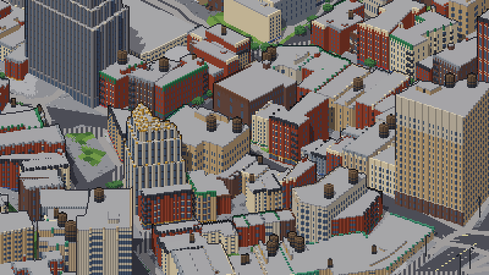

# @pixelworlds/city-nyc

New York's city pack for [pixelworld](https://www.npmjs.com/package/pixelworld): the generators its `new-york` style pack names. They draw brownstones with stoops (`brownstone`), walk-up tenements with fire escapes over shopfronts (`tenement`), cast-iron lofts (`castIronLoft`), and prewar blocks with water tanks on the roof (`prewarBlock`). The `new-york` pack names San Francisco's pack too, `@pixelworlds/city-sf`, for its blocks and towers, so load both.



```sh
npm install pixelworld @pixelworlds/city-sf @pixelworlds/city-nyc
```

`pixelworld` is a peer dependency: the pack uses your app's copy of its generator registry.

```ts
import { cityPlugin as sanFrancisco } from "@pixelworlds/city-sf";
import { cityPlugin as newYork } from "@pixelworlds/city-nyc";

const view = await createWorldView({ canvas, worldUrl: "/worlds/nyc/", style, plugins: [sanFrancisco, newYork] });
```

Without a view (tests, tools), `register()` registers the generators on the current thread. How plugins work: [docs/plugins.md](https://github.com/alexngai/pixelworld/blob/main/docs/plugins.md) §9. The look: [docs/style-guide.md](https://github.com/alexngai/pixelworld/blob/main/docs/style-guide.md) §19.

## Licence

MIT OR Apache-2.0.
