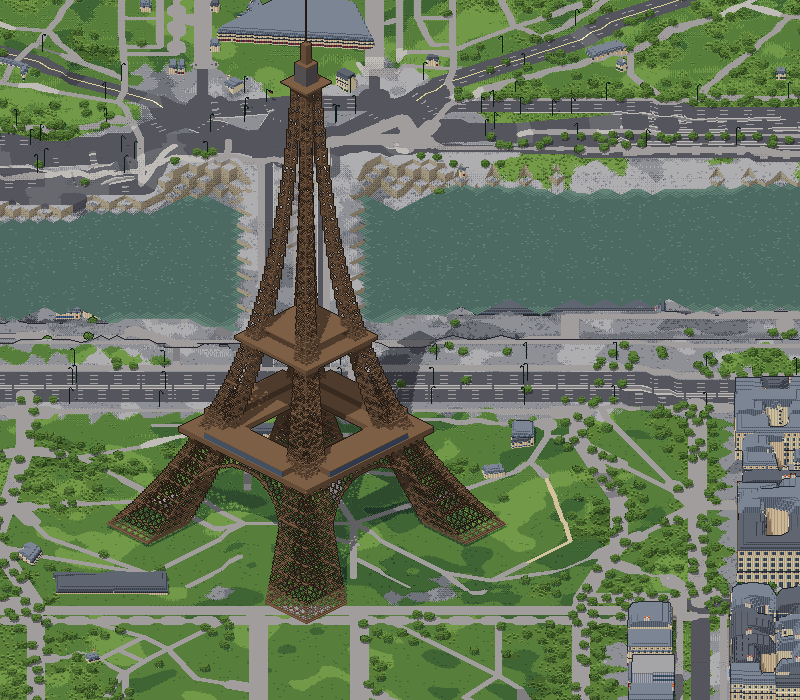

# @pixelworlds/city-paris

Paris's city pack for [pixelworld](https://www.npmjs.com/package/pixelworld): the generators its `paris` style pack names. They draw Haussmann blocks with continuous iron balconies on the second and fifth storeys under zinc mansards with dormers (`haussmann`), the faubourg's narrow plastered houses under steep roofs (`faubourg`), the brick social-housing blocks of the 1920s and 30s (`hbm`), French palaces round their courtyards under high slate roofs (`palace`), and eight landmark shapes on the proportions of Paris's landmarks: a Gothic cathedral (`cathedral`), a triumphal arch (`triumphalArch`), a lattice tower on four arched piers (`latticeArchTower`), an opera house (`operaHouse`), a steel arch bridge with gilt-crowned pylons (`steelArchBridge`), a Baroque domed church (`domedChurch`), a glass-vaulted exhibition palace (`glassPalace`) and a stone bridge of many arches (`stoneArchBridge`). The `paris` pack names San Francisco's pack too, `@pixelworlds/city-sf`, for its post-war blocks and towers, so load both.



```sh
npm install pixelworld @pixelworlds/city-sf @pixelworlds/city-paris
```

`pixelworld` is a peer dependency: the pack uses your app's copy of its generator registry.

```ts
import { cityPlugin as sanFrancisco } from "@pixelworlds/city-sf";
import { cityPlugin as paris } from "@pixelworlds/city-paris";

const view = await createWorldView({ canvas, worldUrl: "/worlds/paris-walk/", style, plugins: [sanFrancisco, paris] });
```

Without a view (tests, tools), `register()` registers the generators on the current thread. How plugins work: [docs/plugins.md](https://github.com/alexngai/pixelworld/blob/main/docs/plugins.md) §9. The look: [docs/style-guide.md](https://github.com/alexngai/pixelworld/blob/main/docs/style-guide.md) §20.

## Licence

MIT OR Apache-2.0.
