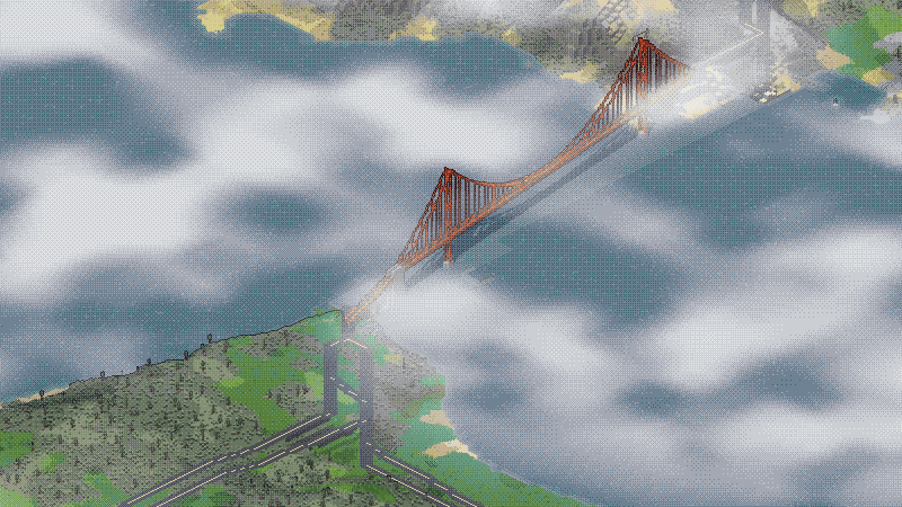

# pixelworld

Pixel-art isometric worlds from open data, in the browser. pixelworld streams a world package (terrain, roads, water, buildings and landmarks built from elevation, land-cover and OpenStreetMap data), bakes it into pixel-art tiles in a WebGL2 worker, and draws it in four rotations. You bring the controls, entities and rules: a map viewer, a driving game, a flight over the Grand Canyon.



San Francisco, New York, Paris, Kyoto, Tokyo and Hong Kong are drawn by city packs, also on npm (`@pixelworlds/city-*`): [more screenshots](https://github.com/alexngai/pixelworld#gallery).

## Install

```sh
npm install pixelworld
```

ESM only, with TypeScript declarations. Browsers need WebGL2 (and module workers, as every current browser has).

## A world in a page

```ts
import { createWorldView, roverController } from "pixelworld/engine";

const canvas = document.querySelector<HTMLCanvasElement>("#world")!;
const view = await createWorldView({
  canvas,
  worldUrl: "/worlds/grand-canyon-m0/",          // a world package: manifest.json and chunks/
  style: (id) => fetch(`/styles/${id}/style.json`).then((r) => r.json()), // the pack the manifest names
  controller: roverController({ listen: { keys: window, pointer: canvas } }),
});
await view.ready();                               // the first complete frame is drawn
```

Arrows drive the rover, WASD or a drag pans, Q/E rotate, 1–6 zoom. The view also has a camera (`view.camera.lookAt({ lon, lat })`), entities, layers, controllers and queries (`view.query.heightAt(x, y)`, `roadAt`, `pick`).

## Entry points

| Import | What |
|---|---|
| `pixelworld/engine` | `createWorldView` and the engine: camera, layers, entities, controllers, queries, `roverController`, `fogLayer` |
| `pixelworld/traffic` | ambient traffic: `trafficLayer()` for a view, and the deterministic simulation |
| `pixelworld/format` | the world package format: manifest, chunk and objects codecs, the geo grid |
| `pixelworld/grid` | the isometric projections (2:1, and a higher camera's 4:3), rotations, cells and heights |
| `pixelworld/style` | style packs: validation, palettes, night and atmosphere |
| `pixelworld/generators` | voxel models, meshing, and the generators that draw trees, buildings, landmarks and vehicles |

Each entry point brings only what it uses: `pixelworld/grid` alone is under 1 KB, and `pixelworld/engine` doesn't include traffic.

## Worlds and style packs

They are data, not part of this package:
- **World packages** are directories of static files (`manifest.json`, `chunks/*.pxwc`, optional objects, routes and heroes). Serve them from any static host and pass the directory's URL as `worldUrl`. Build your own with the Python pipeline, or start from the ones in the repository's `fixtures/` (ODbL 1.0: credit the sources each manifest lists).
- **Style packs** are JSON (palettes, surfaces, materials, assets). A manifest names its pack (`"style": "desert-southwest"`); pass the pack itself, or a resolver from that name. The packs in the repository's `worlds/_styles/` are CC BY 4.0.

## The bake worker

The engine bakes tiles in a module worker, `bake.worker.js`, shipped beside it. It creates it with `new Worker(new URL("./bake.worker.js", import.meta.url), { type: "module" })`, which Vite, webpack 5 and plain ESM served from your own origin (with an import map) all resolve without configuration. Browsers only start workers from the page's origin, so when the package comes from a CDN, or for other setups, copy `pixelworld/bake.worker.js` to your site, or wrap it in a `blob:` URL, and pass that as `workerUrl` ([how](https://github.com/alexngai/pixelworld/blob/main/docs/npm.md#the-bake-worker)). If no worker can run WebGL2, the engine bakes on the main thread.

## More

- [Using pixelworld from npm](https://github.com/alexngai/pixelworld/blob/main/docs/npm.md): the guide, with traffic, plugins and releases
- [The engine API](https://github.com/alexngai/pixelworld/blob/main/docs/library.md#7-as-built-the-engine-m4-step-1)
- [Example consumers](https://github.com/alexngai/pixelworld/tree/main/examples/consumers): Vite, webpack 5 and plain ESM

## Licence

The code is licensed under either of the [MIT License](LICENSE-MIT) or the [Apache License 2.0](LICENSE-APACHE), at your option. World packages (ODbL 1.0) and style packs (CC BY 4.0) are licensed separately; images rendered from worlds must credit their sources.
